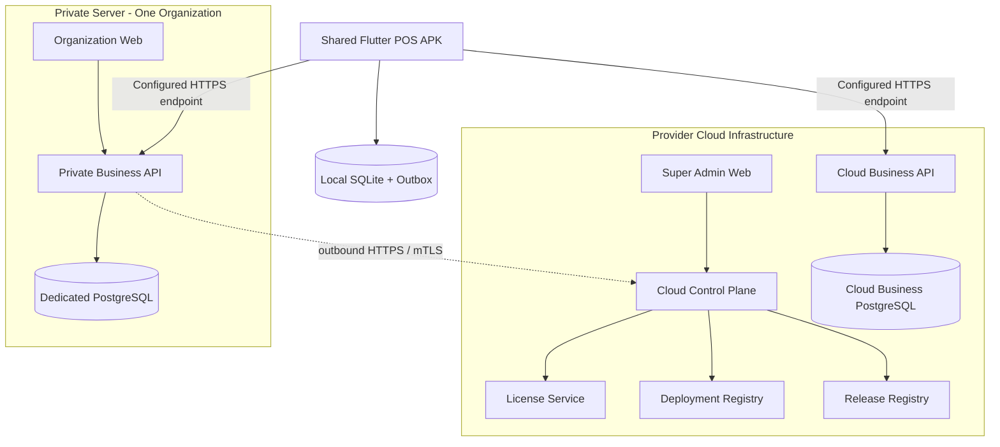

# POS Platform

**Hybrid Cloud SaaS + Private Server Point of Sale Platform**

> One product. One shared codebase. One Android POS APK. Two deployment models.

**Documentation version:** 1.0  
**Architecture baseline:** 2026-11-03  
**Project status:** Architecture and technical specification phase

---

## 1. Overview

POS Platform is a commercial point-of-sale (POS) system designed for organizations that operate one or more stores and touchscreen POS devices.

The platform supports two deployment models using the same product codebase:

- **Cloud SaaS:** provider-operated shared infrastructure serving multiple Organizations with logical tenant isolation.
- **Private Server:** a dedicated deployment serving exactly one Organization. The server may be customer-owned or provider-managed.

Both deployment models use the same Business Data Plane application, database schema, API contracts, and Flutter Android POS application. Deployment-specific behavior is controlled through explicit configuration and capabilities rather than separate product forks.

## 2. Core product principles

1. **Shared product codebase:** Cloud and Private Server use the same application release.
2. **Cloud multi-tenancy:** one Cloud deployment can serve multiple Organizations.
3. **Private single-tenancy:** one Private Server deployment is bound to exactly one Organization.
4. **One shared POS APK:** the Flutter application can be activated against either a Cloud or Private Server endpoint.
5. **Web-first administration:** Organization and Store administration is performed through Organization Web, not through the POS APK.
6. **Offline-first selling:** the POS stores eligible transactions locally and synchronizes them when connectivity is available.
7. **Separate control and business planes:** Cloud Control Plane manages commercial and deployment lifecycle; Business Data Plane processes actual business operations.
8. **Private Server Cloud registration:** every Private Server must register with and periodically communicate with the provider Cloud Control Plane.
9. **Local business continuity:** a temporary Control Plane outage must not interrupt normal local sales operations on a healthy Private Server.
10. **Recoverability and auditability:** deployments require documented backup, restore, migration, security, and operational procedures.

## 3. Deployment models

| Capability | Cloud SaaS | Private Server |
|---|---|---|
| Infrastructure | Provider-operated shared infrastructure | Customer-owned or provider-managed dedicated infrastructure |
| Organizations per deployment | Multiple | Exactly one |
| Business database | Shared Cloud database/cluster with tenant isolation | Dedicated database per deployment |
| Organization administration | Organization Web | Organization Web |
| Platform administration | Super Admin Web | Managed through provider Cloud Control Plane |
| License authority | Cloud platform subscription/entitlements | Cloud-issued signed license with local validation cache |
| POS application | Shared Flutter APK | Same Flutter APK |
| Cloud Control Plane connection | Native provider operation | Mandatory registration and periodic outbound connection |
| Business operations during temporary Cloud outage | Depends on Cloud service availability | Local operations continue within cached license and device policy |

### 3.1 Cloud SaaS

The provider operates the Cloud infrastructure. Multiple Organizations use the shared Cloud Business Data Plane. Business records are scoped by `organization_id` and, where applicable, `store_id`.

### 3.2 Private Server

Each Private Server deployment serves one fixed Organization and can contain multiple Stores and POS Devices. It has its own Business Data Plane and PostgreSQL database. Private Server communicates with the provider Cloud Control Plane for deployment registration, license lifecycle, heartbeat, and release metadata. Business transactions remain on the Private Server by default.

Private Server delivery supports both:

- **Customer-owned infrastructure:** the customer supplies the physical server, VPS, or cloud account.
- **Provider-managed dedicated infrastructure:** the provider supplies and operates a dedicated server or VPS for the customer.

## 4. Logical architecture

The platform separates management of the platform from execution of customer business operations.



### 4.1 Cloud Control Plane

Provider-operated services responsible for:

- Super Admin and provider administration.
- Commercial customer accounts, plans, and subscriptions.
- Private deployment enrollment and registry.
- Deployment identity and credentials.
- License issuance, renewal, and revocation status.
- Heartbeat and minimized operational telemetry.
- Release metadata and update channels.

The Control Plane is not the system of record for Private Server orders, payments, inventory, or customer business records.

### 4.2 Business Data Plane

The Business Data Plane is responsible for:

- Organizations and Stores.
- Users, employees, roles, and permissions.
- Products, categories, variants, barcodes, and pricing.
- Inventory and stock movements.
- POS devices and activation.
- Orders, payments, refunds, and reports.
- Device synchronization and business audit history.

It runs in Cloud multi-tenant mode or Private single-tenant mode.

## 5. Applications and responsibilities

| Application | Technology | Primary responsibility |
|---|---|---|
| Super Admin Web | Next.js + TypeScript | Provider administration, Cloud Organizations, subscriptions, deployments, licenses, releases |
| Organization Web | Next.js + TypeScript | Organization, Stores, employees, products, inventory, devices, orders, reports |
| POS Android APK | Flutter | Product lookup, cart, checkout, permitted payment recording, receipts, offline transactions, synchronization |
| Business Backend | Python + FastAPI | Business APIs, authorization, business rules, synchronization |
| Cloud Control Plane | Python + FastAPI (recommended shared backend foundation) | Deployment lifecycle, license, subscription, heartbeat, release metadata |

The POS APK must not create or administer Organizations or Stores. It receives its Organization and Store context during an authorized activation flow.

## 6. Technology stack

The following is the selected baseline. Dependency versions must be pinned and verified during implementation.

| Layer | Technology | Notes |
|---|---|---|
| Backend API | Python, FastAPI | Start as a modular monolith |
| ORM | SQLAlchemy 2.x | Explicit transaction boundaries |
| Migrations | Alembic | Versioned database changes |
| Primary database | PostgreSQL | Cloud and Private Business Data Plane |
| Cache / queue support | Redis | Optional where required; not a source of truth |
| Web applications | Next.js, TypeScript | Super Admin and Organization Web |
| Web UI | Tailwind CSS, shadcn/ui | Shared design system where appropriate |
| Android POS | Flutter | One APK for Cloud and Private Server |
| POS local database | SQLite, Drift | Offline persistence and Outbox |
| API style | REST, JSON | Versioned routes under `/api/v1` |
| Realtime | WebSocket | Optional enhancement; core POS must not depend on it |
| Reverse proxy | Nginx | TLS termination and routing |
| Deployment | Docker Compose | Initial Cloud and Private deployment packaging |

## 7. Repository structure

The repository is intended to evolve as a monorepo. The following is the target structure; directories will be introduced as implementation begins.

```text
pos-platform/
├── apps/
│   ├── backend/                 # FastAPI Business Data Plane
│   ├── control-plane/            # Provider Cloud Control Plane
│   ├── super-admin-web/          # Provider administration
│   ├── organization-web/         # Organization management
│   └── pos-mobile/               # Flutter Android POS
│
├── packages/
│   ├── api-contracts/            # OpenAPI and shared API contracts
│   ├── shared-types/             # Shared generated types where appropriate
│   └── ui-components/            # Shared Web UI components
│
├── database/
│   ├── business-migrations/      # Business Data Plane migrations
│   ├── control-plane-migrations/ # Control Plane migrations
│   └── seeds/
│
├── infrastructure/
│   ├── docker/
│   ├── cloud/
│   ├── private-server/
│   ├── nginx/
│   └── monitoring/
│
├── licensing/
│   ├── issuer/
│   ├── validator/
│   └── schemas/
│
├── docs/
│   ├── adr/
│   ├── 01-system-architecture.md
│   ├── 02-database-schema.md
│   ├── 03-api-specification.md
│   ├── 04-cloud-control-plane.md
│   ├── 05-private-server-deployment.md
│   ├── 06-pos-offline-sync.md
│   └── 07-security-and-licensing.md
│
├── scripts/
├── .gitignore
└── README.md
```

**Repository status:** the current baseline contains the architecture documentation under `docs/`. Application, infrastructure, migration, and test directories above describe the intended implementation structure; they are not all implemented yet.

## 8. Documentation

The architecture and technical specifications are the primary references for implementation.

| Document | Description |
|---|---|
| [01 — System Architecture](docs/01-system-architecture.md) | Product boundaries, deployment models, logical architecture, trust boundaries |
| [02 — Database Schema](docs/02-database-schema.md) | Business, Control Plane, and POS local database design |
| [03 — API Specification](docs/03-api-specification.md) | Business APIs, device APIs, synchronization APIs, Control Plane APIs |
| [04 — Cloud Control Plane](docs/04-cloud-control-plane.md) | Customer, subscription, deployment, license, heartbeat, release lifecycle |
| [05 — Private Server Deployment](docs/05-private-server-deployment.md) | Installation, configuration, networking, backup, restore, upgrade |
| [06 — POS Offline Sync](docs/06-pos-offline-sync.md) | SQLite, Outbox, idempotency, synchronization, conflict handling |
| [07 — Security and Licensing](docs/07-security-and-licensing.md) | Threat model, identity, tenant isolation, cryptography, license security |

### 8.1 Decision precedence

When implementation documents appear to conflict:

1. Accepted Architecture Decision Records (ADRs) take precedence for architectural decisions.
2. The relevant detailed technical specification defines implementation behavior.
3. API contracts and database migrations define the implemented interface and schema.
4. Any intentional deviation must be documented in a new or amended ADR before it becomes the new baseline.

## 9. Development status

The project is currently in the architecture and technical specification phase.

| Area | Status |
|---|---|
| Product and deployment architecture | Documented baseline |
| Database design | Documented baseline; migrations not yet implemented |
| API contract | Documented baseline; endpoints not yet implemented |
| Cloud Control Plane | Documented baseline; implementation pending |
| Private Server packaging | Documented baseline; Compose package pending |
| Offline POS synchronization | Documented baseline; Flutter implementation pending |
| Security and licensing | Documented baseline; implementation and security review pending |

Do not treat the project as production-ready until implementation, integration tests, security review, backup/restore tests, and deployment acceptance tests have passed.

## 10. Planned implementation sequence

1. **Foundation:** repository setup, coding standards, configuration management, CI, API contract tooling.
2. **Database and backend core:** PostgreSQL, Alembic, modular FastAPI structure, authentication, Organization, Store, RBAC.
3. **Organization Web:** product catalog, inventory, employee management, POS device management.
4. **Flutter POS:** activation, product bootstrap, cart, checkout, local SQLite, Outbox, receipt printing.
5. **Business transactions:** orders, payments, refunds, stock movements, reports.
6. **Cloud SaaS:** multi-tenant enforcement, Super Admin, subscriptions, Cloud operations.
7. **Control Plane:** Private enrollment, deployment identity, mTLS, license issuance, heartbeat, release registry.
8. **Private Server:** repeatable installation, dedicated database, backup/restore, updates, recovery.
9. **Production hardening:** load tests, tenant-isolation tests, security testing, operational runbooks, hardware compatibility.

## 11. Development prerequisites

The exact versions will be pinned in implementation manifests. Development machines should have the following tool families available:

- Git.
- Python runtime and a Python dependency manager.
- Node.js LTS and a package manager.
- Flutter SDK and Android SDK for the POS app.
- Docker Engine and Docker Compose plugin.
- PostgreSQL client tools.
- An IDE/editor with Python, TypeScript, Dart, and SQL support.

The repository does not yet provide a working application bootstrap or a verified `docker compose up` command. Those instructions will be added after the implementation scaffolding and Compose files are committed.

## 12. Engineering conventions

- Keep business logic in backend domain/service modules, not in API route handlers.
- Derive tenant context from authenticated server-side identity; never trust a client-supplied `organization_id` as authorization.
- Use explicit Store authorization for Store-scoped operations.
- Use UUID identifiers and UTC timestamps for persisted records.
- Never use floating-point types for money.
- Treat order, payment, refund, and stock movement history as auditable business records.
- Use idempotency keys for retryable transaction APIs.
- Keep user, device, deployment, and license-signing credentials separate.
- Never commit secrets, production `.env` files, private signing keys, or customer data.
- Add tests for authorization, tenant isolation, idempotency, and failure recovery when implementing a feature.
- Document architecture changes with ADRs.

## 13. Security baseline

- HTTPS is required for production endpoints.
- Private Server to Control Plane communication uses authenticated outbound connections; mTLS is the preferred deployment authentication mechanism.
- Private Server exposes only required application ports. PostgreSQL, Redis, and Docker management interfaces must not be publicly exposed.
- License files are digitally signed. Private Server verifies them using trusted public keys; license signing private keys remain in the provider-controlled signing environment.
- POS device credentials are unique per device, securely stored, and revocable.
- Cloud tenant isolation is enforced at the service and database layers.
- Logs must redact passwords, access tokens, refresh tokens, license secrets, payment credentials, and other sensitive data.

See [07 — Security and Licensing](docs/07-security-and-licensing.md) before implementing authentication, device activation, licensing, or deployment enrollment.

## 14. Operational principles

### Cloud SaaS

The provider owns Cloud infrastructure operations, service monitoring, database operations, backups, and releases according to the applicable service agreement.

### Private Server

Each deployment must have:

- A documented infrastructure owner and support responsibility.
- A registered deployment identity.
- A valid signed license entitlement.
- A configured HTTPS endpoint.
- Scheduled, protected backups and tested restore procedures.
- A supported application version and upgrade path.
- Cloud Control Plane connectivity for registration and periodic management.

A temporary Cloud Control Plane outage must not stop eligible local business operations. License cache and grace-period enforcement must follow the security and licensing specification.

## 15. Scope boundaries for the initial release

The initial release focuses on:

- Organization and Store administration.
- Product catalog and inventory.
- POS device activation and sales.
- Cash and supported payment recording.
- Receipts and refunds.
- Offline transaction persistence and synchronization.
- Cloud SaaS and one-Organization Private Server deployment.
- Subscription, license, deployment status, and release management.

Features such as Kubernetes orchestration, active-active multi-region writes, multiple Organizations per Private Server, and automatic ingestion of Private Server transaction data into provider Cloud are not part of the initial release.

## 16. Contributing and change management

Before submitting a change:

1. Identify the affected application and architecture boundary.
2. Check the relevant technical specification and API contract.
3. Add or update tests for business behavior and authorization.
4. Add a migration when a database schema change is required.
5. Update documentation when the change affects interfaces, operations, security, or architecture.
6. Add an ADR for a material architecture decision.

Pull requests should describe the behavior changed, migration impact, deployment impact, security implications, and test evidence.

## 17. License

The project's software distribution license and commercial terms have not yet been finalized. Do not assume that the use of open-source frameworks makes the complete POS Platform open source. Third-party dependency licenses must be reviewed and recorded before commercial distribution.

---

## Final statement

POS Platform is designed as one commercial product with two deployment models: multi-tenant Cloud SaaS and single-tenant Private Server. The provider Cloud Control Plane manages commercial and deployment lifecycle, while each Business Data Plane owns and processes its business transactions. A shared Flutter POS APK connects to the selected deployment and supports offline-first operations.

The current repository is an architecture baseline. Implementation should proceed from the documented contracts and be treated as production-ready only after functional, integration, security, recovery, and deployment acceptance tests have passed.
