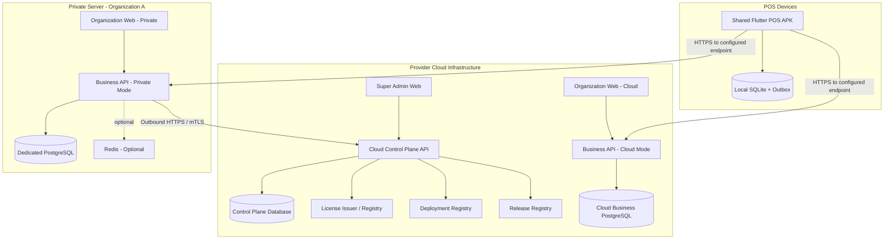

# POS Platform — System Architecture

> **Document ID:** ARC-001  
> **Version:** 1.0  
> **Date:** 2026-11-03  
> **Status:** Architecture baseline — proposed for implementation  
> **Product model:** Hybrid Cloud SaaS + Private Server

## 1. Purpose

This document defines the high-level system architecture for the POS Platform. It is the shared reference for backend, web, Android, infrastructure, security, and release engineering.

The platform supports two deployment models from one product codebase:

1. **Cloud SaaS:** multiple Organizations operate on provider-managed shared infrastructure with logical tenant isolation.
2. **Private Server:** each deployment serves exactly one Organization and runs on either customer-owned infrastructure or provider-managed dedicated infrastructure.

Both deployment models use the same business application, database schema, API contracts, and Flutter POS APK. Deployment-specific behavior is controlled through configuration and deployment capabilities, not through separate product forks.

## 2. Goals and non-goals

### 2.1 Goals

- Deliver one commercial POS product across Cloud and Private Server deployments.
- Support multiple Organizations in Cloud SaaS.
- Enforce exactly one Organization per Private Server deployment.
- Allow one Organization to manage multiple Stores and POS Devices.
- Provide a single Flutter Android APK that can be paired with either Cloud or Private Server.
- Support offline-first POS operations and reliable synchronization.
- Require every Private Server deployment to register with and periodically communicate with the provider's Cloud Control Plane.
- Keep business transactions on the selected Business Data Plane; do not send transaction-level customer business data to the Control Plane by default.
- Support repeatable deployment, updates, backup, restore, monitoring, and license management.
- Keep the initial architecture operationally manageable; start with a modular monolith for business APIs rather than premature microservices.

### 2.2 Non-goals for the initial release

- Kubernetes-based orchestration.
- Active-active multi-region business database replication.
- A cloud-hosted centralized database for Private Server business transactions.
- Automatic synchronization of Private Server orders, customers, products, or employee records to provider Cloud.
- Supporting multiple Organizations inside one Private Server deployment.
- Allowing the POS APK to create or administer Organizations or Stores.
- Treating offline storage of a payment record as proof that an external payment provider authorized the payment.

## 3. Architecture principles

1. **One product, shared codebase:** Cloud and Private Server use the same business application release.
2. **Separate control and business planes:** commercial/deployment control is separate from customer business operations.
3. **One Private Server, one Organization:** a Private deployment has a fixed Organization identity.
4. **Tenant context is server-derived:** clients cannot choose or override their authorized `organization_id` by submitting arbitrary request fields.
5. **Local business continuity:** temporary Cloud connectivity loss must not stop normal local sales operations on a healthy Private Server.
6. **Offline-first POS:** an order is durably stored on the device before synchronization is attempted.
7. **Idempotent synchronization:** retries must not create duplicate orders or payments.
8. **Least privilege:** user credentials, device credentials, deployment credentials, and license-signing keys have distinct purposes and scopes.
9. **Explicit deployment capabilities:** differences between `cloud` and `private` are configured and tested, not scattered across business logic.
10. **Recoverability:** all deployments require documented backup, restore, migration, and recovery procedures.

## 4. Deployment models

### 4.1 Cloud SaaS

The provider operates the Cloud infrastructure. Multiple Organizations use a shared Cloud Business Data Plane.

- One Cloud application environment can serve many Organizations.
- Business records are scoped by `organization_id` and, where applicable, `store_id`.
- Cloud Super Admin manages platform-level customers, Organizations, plans, subscriptions, and Cloud operations.
- Organization users manage only their own Organization and Stores.
- The provider is responsible for application availability, infrastructure operations, backups, and releases according to the commercial service agreement.

### 4.2 Private Server

Each customer has a dedicated deployment. The deployment may run on:

- **Customer-owned infrastructure:** hardware, VPS, or cloud account supplied by the customer; or
- **Provider-managed dedicated infrastructure:** a dedicated server or VPS supplied and operated by the provider for that customer.

Both options use the same Private Server package and operational model.

Rules:

- One Private Server deployment is bound to exactly one Organization.
- The Organization may have multiple Stores and POS Devices.
- The Organization ID is created and fixed during installation/provisioning.
- The Private Server UI and business APIs do not provide Organization creation or Organization switching.
- Business data is stored in the deployment's own PostgreSQL database.
- The deployment registers with the provider Cloud Control Plane and periodically reports its status.
- Private Server business transactions do not depend on a live Control Plane call.

### 4.3 Deployment comparison

| Capability | Cloud SaaS | Private Server |
|---|---|---|
| Infrastructure owner/operator | Provider | Customer or provider, depending on contract |
| Organizations per deployment | Multiple | Exactly one |
| Business database | Shared Cloud database/cluster with tenant isolation | Dedicated database/instance per deployment |
| Organization administration | Organization Web | Organization Web |
| Platform Super Admin | Provider Cloud only | Not hosted inside the customer's deployment |
| License/subscription authority | Cloud platform | Cloud Control Plane, with locally cached signed entitlement |
| POS APK | Shared APK | Shared APK |
| Store count | Plan/contract controlled | License/contract controlled |
| Cloud Control Plane connection | Native provider operation | Mandatory registration and periodic outbound connection |
| Temporary Internet outage | Depends on client/network state | Local business operations continue within cached entitlement policy |

## 5. Logical architecture

The platform has two major planes and three user-facing applications.

### 5.1 Cloud Control Plane

The Control Plane is operated by the provider and is responsible for platform and deployment lifecycle management.

Logical capabilities:

- Super Admin API and administration UI.
- Customer and commercial account records.
- Cloud Organization provisioning and subscription status.
- Private deployment registry.
- Private Server enrollment and deployment identity.
- License issuance, renewal, and revocation status.
- Release metadata and update channel information.
- Deployment heartbeat and health status.
- Optional, minimized operational telemetry.

The Control Plane is not the system of record for Private Server orders, payments, inventory, or customer records.

### 5.2 Business Data Plane

The Business Data Plane executes the POS product's day-to-day business operations.

Capabilities:

- Organization and Store settings.
- User, employee, role, and permission management.
- Product catalog and pricing.
- Inventory and stock movements.
- POS device registration and authorization.
- Orders, order items, discounts, and payments.
- Refunds and returns.
- Reports and operational queries.
- Device synchronization and offline order ingestion.
- Business audit history.

The same Business Data Plane application is deployed in two modes:

- **Cloud mode:** multi-tenant.
- **Private mode:** single-tenant, with a fixed Organization ID.

### 5.3 User-facing applications

| Application | Users | Responsibility |
|---|---|---|
| Super Admin Web | Provider administrators | Manage Cloud platform, Organizations, subscriptions, deployments, licenses, and releases |
| Organization Web | Organization owners and employees | Manage Stores, users, products, inventory, devices, orders, and reports |
| POS Android APK | Cashiers and authorized POS operators | Search products, create sales, record permitted payments, print receipts, and synchronize transactions |

The Organization Web is available in Cloud and Private Server deployments. Super Admin Web is a provider-side Cloud application. The POS APK is one shared application distributed through the provider's selected release channels.

## 6. High-level system diagram

The diagram represents logical boundaries. A production Cloud deployment may run multiple backend instances and managed database services. A Private Server may run all required services on one host or on separated hosts, depending on the customer's scale and reliability requirements.

## 7. Component responsibilities

### 7.1 Super Admin Web

- Create, suspend, activate, and manage Cloud Organizations.
- Manage plans, subscriptions, commercial entitlements, and limits.
- Register and inspect Private Server deployments.
- Issue, renew, and revoke Private Server licenses.
- View deployment heartbeat, reported version, and health status.
- Publish release metadata and supported update channels.
- Access only the operational information permitted by customer agreements and provider roles.

Super Admin Web must not assume that it can inspect Private Server business records. Any remote support access to customer business data requires a separately authorized, audited support procedure.

### 7.2 Organization Web

Available in both Cloud and Private deployments.

- Manage Organization settings.
- Manage Stores and store settings.
- Manage users, employees, roles, and permissions.
- Manage products, categories, variants, barcodes, and prices.
- Manage inventory, stock movements, and adjustments.
- Create and configure POS Devices and activation QR codes.
- View orders, payments, refunds, and reports according to permissions.

Private mode exposes one fixed Organization and does not expose platform-level Organization administration.

### 7.3 Business Backend

The Business Backend is initially a **modular monolith** built with FastAPI.

Responsibilities:

- Authenticate users and POS devices.
- Derive tenant and Store context from verified credentials.
- Enforce authorization and business rules.
- Execute database transactions.
- Expose versioned REST APIs.
- Process synchronization events idempotently.
- Publish optional realtime events.
- Record audit events.

The same versioned backend image should be deployable in Cloud and Private modes. Deployment profile and trusted configuration determine tenant mode and enabled integrations.

### 7.4 Cloud Control Plane service

The Control Plane should be a separately protected logical service, with its own API surface, service credentials, and database boundary. It may live in the same source repository as the Business Backend, but it must not share unrestricted database access or business-user authorization paths.

Responsibilities:

- Deployment enrollment and identity.
- License and entitlement lifecycle.
- Heartbeat ingestion.
- Release metadata distribution.
- Provider-level subscription and commercial records.

### 7.5 Flutter POS APK

- Scan or enter a one-time activation code.
- Bind to one server endpoint, Organization, Store, and Device identity.
- Download authorized product and configuration data.
- Search products and build a cart.
- Calculate display totals using the downloaded rules; the server remains authoritative for final online validation.
- Record permitted sales and payment information.
- Print receipts using supported device/printer integrations.
- Persist offline transactions and synchronize them when connectivity returns.
- Display sync state and unresolved conflicts to authorized users.

The APK must not create Organizations or Stores, administer employees, or alter the bound server endpoint without a reactivation/authorization flow.

## 8. Trust boundaries and communication

### 8.1 Client to Business Backend

- All production traffic uses HTTPS.
- User sessions and POS device credentials are distinct.
- Business requests are authorized by the backend.
- Organization and Store scope is derived from authenticated identity and server-side device assignment.
- Client-supplied tenant identifiers are treated as selectors only where allowed and must be validated against authorization context.

### 8.2 Private Server to Cloud Control Plane

- Private Server initiates outbound connections; the provider should not require inbound access to the customer's network.
- Use deployment-specific credentials, preferably mTLS, with rotation and revocation procedures.
- Limit connectivity to documented Control Plane endpoints.
- Send only the minimum operational metadata required for license and deployment management.
- Do not transmit transaction-level business data by default.

### 8.3 Control Plane to Private Server

The initial design should avoid arbitrary remote command execution and unsolicited inbound connections.

- Private Server polls or securely fetches license and release metadata.
- Updates are initiated by the customer or an authorized provider operator through an approved workflow.
- Any future remote management capability requires explicit customer authorization, strong authentication, audit logging, and a documented threat model.

### 8.4 POS endpoint trust

- Activation QR codes contain a server URL and short-lived, single-use activation material; never embed long-lived device secrets.
- Validate TLS certificates normally. Do not disable certificate validation for convenience.
- Store device credentials in Android Keystore-backed secure storage.
- Endpoint changes require explicit reactivation and must not silently move a device to another deployment.

## 9. Private Server enrollment and lifecycle

### 9.1 Initial installation

1. Installer checks supported operating system, Docker/runtime prerequisites, storage, and network configuration.
2. Installer creates secure application secrets and a unique deployment identity.
3. Installer initializes PostgreSQL and runs database migrations.
4. Installer creates or imports the single Organization identity.
5. Installer creates the first Organization Administrator through a secure bootstrap procedure.
6. Installer configures the public hostname and HTTPS.
7. Private Server sends an enrollment request to the Cloud Control Plane.
8. Control Plane validates the customer's purchase/enrollment authorization and registers the deployment.
9. Control Plane issues deployment credentials and a signed license entitlement.
10. Private Server validates the entitlement, completes health checks, and marks the installation ready.

### 9.2 Lifecycle states

Suggested deployment states:

- `pending_enrollment`
- `active`
- `warning`
- `license_expiring`
- `suspended`
- `revoked`
- `decommissioned`

The state machine must distinguish commercial status from local service health. For example, a temporary network outage should not automatically change a healthy local application into a suspended business service.

### 9.3 Heartbeat and license refresh defaults

Initial engineering defaults, subject to operational validation and commercial policy:

| Item | Initial default |
|---|---:|
| Deployment heartbeat | Every 5 minutes |
| License refresh attempt | Every 6 hours |
| Connectivity warning | After 24 hours without successful Control Plane contact |
| Escalated warning | After 72 hours |
| Cached entitlement grace | 7 days after last successful validation |

These values are policy defaults, not final contractual SLA terms. They must be configurable and documented. A successful validation refreshes the cached signed entitlement and its validation timestamp.

### 9.4 Temporary Control Plane outage

During a temporary Cloud connection outage, a Private Server must:

- Continue local user authentication using locally available identity data.
- Continue permitted POS and inventory operations.
- Continue local database reads and writes.
- Continue receipt printing and local device functions.
- Keep accepting local transactions while the local application and database are healthy.
- Retry heartbeat and license refresh with backoff.
- Display operational warnings to administrators.
- Queue non-critical status events for later delivery where appropriate.

During the outage, it cannot reliably:

- Enroll a new deployment.
- Obtain a first license if no valid entitlement has been installed.
- Renew or retrieve a revoked entitlement.
- Retrieve newly published release metadata.
- Provide current provider-side monitoring visibility.

When the configured grace period expires, apply the license policy. Recommended behavior is to block new administrative provisioning, new device activations, or use beyond licensed limits while preserving business data and providing an explicit renewal/recovery workflow. Do not delete data or interrupt a transaction already in progress solely because the Control Plane is unreachable.

## 10. License architecture

- The License Issuer runs in the provider Control Plane.
- The private signing key is held only by the provider's protected signing environment.
- Private Server contains trusted public verification keys only.
- Signed license payload includes license ID, customer ID, deployment ID, Organization ID, edition, features, limits, issue time, expiry, and signing key ID.
- Use a reviewed asymmetric signature scheme such as Ed25519.
- Support signing-key rotation with key IDs and a trusted public-key set.
- Private Server validates signature, deployment binding, Organization binding, expiry, limits, and locally known revocation state.
- Cloud refresh updates the signed entitlement and revocation/renewal information.

The license is an entitlement, not an authorization bypass. Every local API operation must still enforce user permissions, device permissions, and business rules.

## 11. Data architecture

### 11.1 Cloud tenancy

- Multiple Organizations share the Cloud Business Data Plane.
- Business tables include `organization_id` where tenant-scoped.
- Store-scoped records also include `store_id` where appropriate.
- Backend derives the active tenant from validated user membership or device assignment.
- Tenant-scoped repositories and queries are mandatory.
- PostgreSQL Row Level Security (RLS) is recommended as defense in depth.
- Cross-tenant isolation is tested at API and database levels.

### 11.2 Private tenancy

- One deployment has one fixed `organization_id`.
- Business tables retain the same schema and `organization_id` columns as Cloud.
- The deployment configuration binds the installation to its Organization.
- Public APIs reject references to other Organizations.
- Organization creation is available only during installation/provisioning, not as normal Private Server functionality.

### 11.3 Data ownership and transfer

- Cloud business data is stored in the provider's Cloud environment according to the Cloud agreement.
- Private Server business data resides in the customer's dedicated deployment.
- No automatic Private-to-Cloud transaction replication is included in the initial architecture.
- Any future cross-deployment migration or data import/export is an explicit, audited workflow.

### 11.4 Business data categories

| Category | Cloud Data Plane | Private Data Plane | Sent to Control Plane by default |
|---|---|---|---|
| Organization and Store settings | Yes | Yes | No |
| Users and employees | Yes | Yes | No |
| Products and prices | Yes | Yes | No |
| Inventory and stock movements | Yes | Yes | No |
| Orders and order items | Yes | Yes | No |
| Payments and refunds | Yes | Yes | No |
| Device identity and status | Yes | Yes | Limited deployment/device counts or status only, per policy |
| License entitlement | Provider-managed | Cached locally | Yes, license lifecycle metadata |
| Deployment version and health | Provider-managed | Reported | Yes |

## 12. POS activation and endpoint binding

### 12.1 Activation flow

1. Organization Administrator creates a POS Device in Organization Web.
2. Administrator assigns the device to a Store.
3. Backend creates a short-lived, single-use activation code.
4. Organization Web displays a QR code containing the selected endpoint, deployment identifier where applicable, and activation material.
5. APK scans the QR and connects to the endpoint over HTTPS.
6. Backend validates the code, deployment, Organization, Store, device limit, and license.
7. Backend issues a device identity and scoped credentials.
8. APK stores the endpoint and credentials securely.
9. APK downloads its initial configuration and permitted product data.
10. Device enters sales mode.

### 12.2 Device binding

A device binding consists of:

- `deployment_id` or equivalent server identity.
- `organization_id`.
- `store_id`.
- `device_id`.
- Device credential/token metadata.
- Configuration version and synchronization cursor.

The APK must display enough deployment/store identity for an operator to verify the device is paired with the intended environment.

### 12.3 Reassignment and reactivation

- Store reassignment is initiated from Organization Web by an authorized administrator.
- The system checks whether the device has unsynchronized transactions.
- Pending transactions must be synchronized or explicitly handled before reassignment.
- Endpoint changes require fresh activation against the target server.
- Previous device credentials are revoked as part of the transition.

## 13. Offline-first POS architecture

### 13.1 Local persistence

Flutter uses SQLite, accessed through Drift or an equivalent typed persistence layer.

Local data includes:

- Product and category cache.
- Store and device configuration.
- Cart drafts.
- Local orders and order lines.
- Local payment records and payment states.
- Outbox events.
- Synchronization cursors.
- Conflict and retry metadata.

Device credentials are stored separately using Android Keystore-backed storage.

### 13.2 Transactional Outbox

When a cashier confirms a sale:

1. Validate the cart against the locally cached configuration and payment policy.
2. Generate a globally unique order ID and idempotency key.
3. Write the order, lines, payment record, and Outbox event in one SQLite transaction.
4. Confirm that the order has been durably accepted locally.
5. Attempt synchronization when connectivity is available.
6. Backend validates authorization, prices/discount policy, payment state, and inventory policy.
7. Backend commits the order idempotently and returns an acknowledgement.
8. Client marks the Outbox event as acknowledged only after persisting the server response.

Retry with exponential backoff and jitter. An event must not be discarded before a durable acknowledgement is recorded.

### 13.3 Payment semantics

Offline order capture is not the same as external payment authorization.

- Cash can be recorded locally under the Organization's offline policy.
- Bank transfer requires an explicit verification policy.
- Card payments depend on the terminal's own authorization capabilities and provider rules.
- Online gateways require a confirmed provider response before the APK marks the payment as authorized.

The UI must distinguish `recorded_locally`, `pending_sync`, `authorized`, `failed`, and other relevant payment states. Never display a payment as externally authorized solely because the order was saved locally.

### 13.4 Inventory conflicts

- Online sales validate stock on the server.
- Offline sales use the last synchronized stock snapshot.
- The Organization selects an inventory policy, such as reject, allow negative stock, or accept and reconcile.
- Backend applies the configured policy on synchronization.
- Conflicts are visible and auditable; do not silently overwrite stock balances.
- Stock movements are the authoritative history; balance changes must be traceable.

## 14. API and communication architecture

### 14.1 Business API

- REST API under `/api/v1`.
- JSON request/response format by default.
- Versioned schemas and documented error codes.
- Idempotency support for operations retried by POS.
- WebSocket may be used for realtime updates, but core sales must not depend on it.

### 14.2 Control Plane API

Separate API surface, for example `/control/v1`:

- Deployment enrollment.
- Deployment heartbeat.
- License retrieval and renewal.
- Release metadata retrieval.
- Deployment lifecycle events.

Control Plane credentials must not be usable as business-user or POS-device credentials.

### 14.3 Network direction

- POS APK → selected Business Backend: outbound client HTTPS.
- Organization Web → selected Business Backend: HTTPS.
- Private Server → Cloud Control Plane: outbound HTTPS/mTLS.
- Cloud Control Plane → Private Server: no unrestricted inbound connection in the initial design.

## 15. Deployment architecture

### 15.1 Cloud environment

Logical services:

- Super Admin Web.
- Control Plane API and database.
- Cloud Organization Web.
- Cloud Business Backend instances.
- Cloud PostgreSQL service/cluster.
- Optional Redis/cache/queue.
- Object storage for uploaded assets where needed.
- Monitoring, logging, alerting, and backup services.

The Cloud should be designed for horizontal application scaling, managed database operations where practical, and tested restore procedures.

### 15.2 Private Server environment

Initial Docker Compose package:

- Nginx reverse proxy.
- Organization Web.
- Business Backend.
- PostgreSQL.
- Optional Redis.
- Optional background worker.
- Backup/restore scripts.
- Health check and deployment registration agent or backend module.

Redis is not mandatory unless a selected feature requires it. The system should be able to run a minimal deployment without unnecessary infrastructure services.

### 15.3 Customer-owned vs provider-managed Private Server

Both delivery options use the same application images and deployment package.

Differences are operational:

- Who owns the server/account.
- Who administers the operating system and network.
- Who performs backups and infrastructure monitoring.
- Who is responsible for maintenance windows and incident response.
- Where backup copies are stored.

These responsibilities must be defined in the service agreement and deployment handover checklist.

## 16. Security architecture

### 16.1 Identity and credentials

Use separate credential classes:

- Human user credentials.
- POS device credentials.
- Private deployment credentials.
- License signing keys.
- Database/service credentials.

Apply least privilege and independent revocation/rotation procedures.

### 16.2 Application security

- HTTPS for production endpoints.
- Secure password hashing using a modern password-hashing algorithm.
- Short-lived access tokens and controlled refresh-token rotation.
- RBAC plus Organization/Store scope enforcement.
- Request validation and rate limiting on public endpoints.
- Audit logging for privileged actions.
- Secret management outside source control.
- Sensitive information redaction in application logs.

### 16.3 Infrastructure security

- Do not expose PostgreSQL or Redis directly to the public Internet.
- Restrict inbound ports to required application/proxy traffic.
- Restrict outbound Control Plane access to documented endpoints where practical.
- Do not expose the Docker socket to application containers.
- Encrypt backups and control access to backup destinations.
- Keep operating system and container images patched.

### 16.4 Support access

Provider support must not imply unrestricted access to customer data. Any remote support session or data access requires explicit authorization, least privilege, expiration, and audit records.

## 17. Observability and operations

### 17.1 Private deployment heartbeat

Initial heartbeat fields may include:

- Deployment ID.
- Product version.
- Deployment mode.
- License ID/status.
- Application health summary.
- Database health summary.
- Last successful backup timestamp, if configured.
- Timestamp and request ID.

Avoid transmitting transaction-level details, customer records, employee data, or product-level sales information by default.

### 17.2 Local logs and metrics

Private Server must retain useful local logs even when Cloud is unavailable. Logs should support local diagnosis and optional, customer-authorized support export.

### 17.3 Operational alerts

Examples:

- Deployment heartbeat missing.
- License approaching expiry.
- Disk capacity low.
- Database unavailable.
- Backup failed or stale.
- Application version unsupported.
- Repeated synchronization failures.

## 18. Backup, restore, and disaster recovery

Backups should include:

- PostgreSQL data.
- Uploaded files and product images.
- Required deployment configuration.
- License/deployment recovery metadata, stored securely.

Requirements:

- Configurable schedule and retention.
- Encryption at rest and in transit.
- Separate backup destination where feasible.
- Restore drills and documented recovery steps.
- Defined Recovery Point Objective (RPO) and Recovery Time Objective (RTO) per service tier.
- Recovery process for deployment identity after server replacement.

A backup is not considered validated until a restore test has succeeded.

## 19. Release and update architecture

- Use semantic versioning for product releases.
- Publish immutable, versioned container images.
- Maintain release notes and compatibility metadata.
- Run migration tests for Cloud and Private deployment profiles.
- Back up before production migrations.
- Use staged migrations for destructive schema changes.
- Allow Private Server administrators or authorized provider operators to schedule updates.
- Do not silently apply unapproved updates to customer-owned infrastructure.
- Define supported upgrade paths and end-of-support policy.

The APK release lifecycle is separate from server deployment updates. Backend APIs must maintain documented compatibility with supported APK versions.

## 20. Performance, availability, and quality attributes

Initial engineering targets, to be validated through load and hardware testing:

| Attribute | Initial target or requirement |
|---|---|
| Cloud API availability | 99.9% monthly engineering target; contractual SLA TBD |
| Common online API latency | P95 < 500 ms under the agreed test profile |
| POS local interaction | Must remain responsive without network access |
| Offline order durability | Persist order and Outbox atomically before local acceptance |
| Duplicate prevention | Idempotent server processing |
| Tenant isolation | Automated API and database regression tests |
| Private Server outage tolerance | Continue local business operations during temporary Control Plane outage within entitlement policy |
| Recovery | RPO/RTO defined per contract and tested |
| Deployment reproducibility | Automated installation and health checks |

These are initial targets, not guaranteed service-level commitments until the deployment profile, workload, and infrastructure are measured.

## 21. Key architecture risks and mitigations

| Risk | Mitigation |
|---|---|
| Control Plane outage impacts Private Server | Cache signed entitlements; no synchronous Control Plane dependency for business transactions; configurable grace policy |
| Cloud tenant data leakage | Server-derived tenant context, tenant-scoped queries, RLS defense in depth, isolation tests |
| Duplicate offline orders | Unique IDs, idempotency keys, transactional Outbox, durable acknowledgements |
| Inventory conflicts | Explicit per-Organization policy, stock movement ledger, conflict review |
| License key compromise | Protected signing environment, key rotation, key IDs, revocation/renewal workflow |
| Failed Private Server update | Pre-upgrade backup, staged migrations, health checks, recovery procedure |
| Customer cannot restore backups | Automated backup monitoring and regular restore drills |
| Untrusted endpoint/QR activation | HTTPS validation, short-lived single-use codes, secure device credential storage |
| Support access exposes customer data | Explicit support authorization, least privilege, audit, and time-limited access |

## 22. Architecture acceptance criteria

The architecture baseline is considered implemented when the following are demonstrated in a test environment.

### Cloud

- Multiple Organizations can be provisioned.
- Users and devices are restricted to their authorized Organization and Store.
- Cross-tenant access attempts are rejected.
- Super Admin functions are inaccessible to Organization users.

### Private Server

- A deployment can be installed using the documented package.
- Exactly one Organization is initialized for the deployment.
- The deployment has its own PostgreSQL database.
- Deployment enrollment and license validation succeed against the Control Plane.
- Heartbeat and license refresh work over outbound connections.
- A temporary Control Plane outage does not interrupt normal local sales operations while the cached entitlement is valid.
- No transaction-level business data is sent to the Control Plane by default.

### Shared POS APK

- The same APK can activate against Cloud and Private endpoints.
- Endpoint and Store binding are visible and enforced.
- An endpoint change requires authorized reactivation.
- Offline orders are stored durably and synchronized after reconnection.
- Retried synchronization does not create duplicates.
- Payment authorization state is not misrepresented.

### Operations

- Backup and restore are tested.
- A release can be installed and upgraded in both deployment profiles.
- Migration failure and recovery behavior are documented.
- Logs and health checks are usable during a Cloud connectivity outage.

## 23. Open decisions

The following must be resolved in subsequent technical specifications and hardware discovery:

1. Minimum Android version and supported screen resolutions.
2. Exact touchscreen display models and Android device profiles.
3. Printer connectivity: USB, Bluetooth, LAN, or integrated printer SDK.
4. Barcode scanner support: camera, USB HID, or Bluetooth HID.
5. Payment gateway and card terminal integrations.
6. Per-Organization offline inventory policy.
7. Tax, receipt, and e-invoice requirements for each target market.
8. Final license grace period, suspension behavior, and commercial policy.
9. Cloud infrastructure provider and regions.
10. Minimum Private Server CPU, RAM, storage, and backup requirements.
11. RPO/RTO service tiers.
12. APK update and distribution strategy.
13. Supported server and APK compatibility window.

Each finalized decision should be recorded in a dedicated Architecture Decision Record (ADR) or the relevant technical specification.

## 24. Related documents

- `02-database-schema.md` — database entities, relationships, indexes, constraints, and tenant rules.
- `03-api-specification.md` — Business API and Control Plane API contracts.
- `04-cloud-control-plane.md` — deployment registry, license, subscription, heartbeat, and release services.
- `05-private-server-deployment.md` — installation, configuration, update, backup, and restore procedures.
- `06-pos-offline-sync.md` — local data model, Outbox, idempotency, conflict handling, and payment states.
- `07-security-and-licensing.md` — threat model, credential lifecycle, signing, key rotation, and entitlement policy.
- `adr/` — individual Architecture Decision Records.

---

## Final architecture statement

The POS Platform is a hybrid commercial product built from one shared codebase and distributed through two deployment models.

- **Cloud SaaS** is a provider-managed, multi-tenant Business Data Plane.
- **Private Server** is a dedicated, single-tenant Business Data Plane with exactly one Organization per deployment.
- **Cloud Control Plane** manages provider-side commercial and deployment lifecycle functions. Every Private Server must enroll and periodically connect to it.
- **Business operations remain local to the selected deployment.** A temporary Control Plane outage must not become a synchronous dependency for POS sales.
- **One Flutter APK** can connect to either deployment through secure, explicit device activation.

This separation allows the product to scale commercially while preserving a consistent business application, API contract, database schema, and POS experience.
