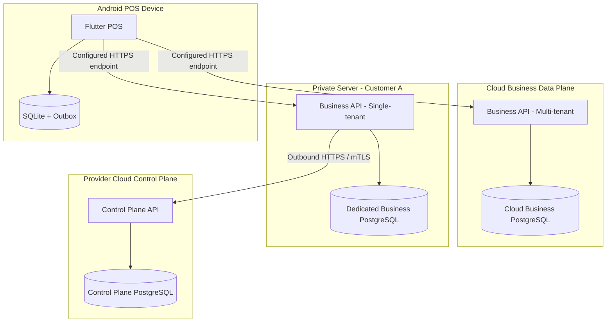
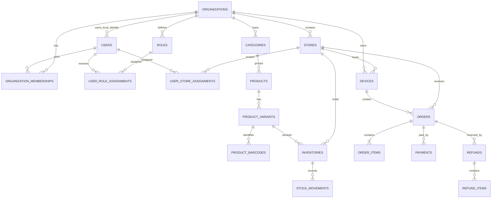
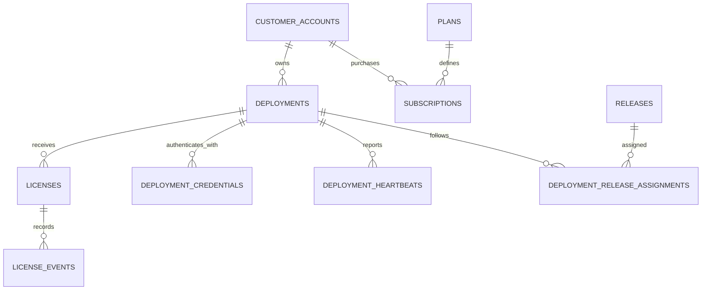

# POS Platform — Database Schema

> **Document ID:** DB-001  
> **Version:** 1.0  
> **Date:** 2026-11-03  
> **Status:** Proposed — implementation baseline  
> **Related document:** `01-system-architecture.md`  
> **Primary database:** PostgreSQL  
> **Local POS database:** SQLite via Drift  
> **Deployment models:** Cloud multi-tenant + Private single-tenant

---

## 1. Purpose and scope

This document defines the logical database design for the POS Platform. It is the source of truth for database implementation, ORM models, migrations, tenant isolation, synchronization, and data ownership.

The platform has two independent database boundaries:

1. **Business Data Plane Database** — stores Organization, Store, user, product, inventory, device, order, payment, and operational data. The same schema is deployed in Cloud and Private Server.
2. **Cloud Control Plane Database** — stores provider-side customer accounts, Cloud subscriptions, Private Server deployment registrations, licenses, release metadata, and operational heartbeat records.

The Flutter POS APK has a third, local persistence boundary:

3. **POS Local Database** — stores the device's permitted cached data, drafts, locally accepted orders, payment states, Outbox events, and synchronization cursors.

These are separate logical data stores. Do not create cross-database foreign keys. Communicate between the Business Data Plane and Control Plane through authenticated APIs.

This version defines the initial commercial POS foundation. Advanced accounting, procurement, loyalty, e-commerce, multi-warehouse routing, and complex tax engines are outside the initial schema unless added through later ADRs.

## 2. Database topology

### 2.1 Cloud Business Data Plane

Cloud Business Data Plane supports multiple Organizations in the same database or managed PostgreSQL cluster.

- Every tenant-owned business row is scoped by `organization_id`.
- Store-scoped rows additionally carry `store_id` where that scope is meaningful.
- The backend derives the tenant from the verified user membership or device credential.
- PostgreSQL Row Level Security (RLS) provides defense in depth.
- Cross-tenant foreign-key references are prohibited by application rules and composite constraints where applicable.

### 2.2 Private Business Data Plane

Each Private Server deployment has its own database and serves exactly one Organization.

- The schema remains the same as Cloud.
- `organization_id` remains present in tenant-owned tables.
- The active Organization ID is fixed in trusted deployment configuration and the installation record.
- The application rejects requests, rows, and references belonging to any other Organization.
- The Private Server cannot use normal business APIs to create or switch Organizations.

### 2.3 Cloud Control Plane Database

The Control Plane database is provider-owned and separate from the Business Data Plane database.

It contains:

- Commercial customer accounts.
- Plans and plan entitlements.
- Cloud subscription records.
- Private Server deployment registrations.
- Deployment credentials and certificate metadata.
- License issuance and lifecycle metadata.
- Heartbeat and health summaries.
- Software release and update-channel metadata.

It does **not** contain Private Server orders, payment transactions, inventory balances, employee records, or customer records by default.

### 2.4 POS Local Database

Each activated Android device has a local SQLite database. It is not a system of record for shared business data; it is a device-local cache and durable transaction queue.

Local data must be scoped to the currently activated deployment, Organization, Store, and Device. When re-pairing to another endpoint, the app must not silently reuse the prior deployment's cached business data.

### 2.5 Topology diagram



## 3. Core database design decisions

| ID | Decision | Rule |
|---|---|---|
| DB-ADR-001 | Shared Business schema | Cloud and Private use the same Business Data Plane schema and migrations. |
| DB-ADR-002 | Separate Control Plane DB | Provider commercial and deployment records are not stored in the customer Business DB. |
| DB-ADR-003 | UUID identifiers | Use UUID primary keys for distributed/client-generated entities. |
| DB-ADR-004 | Tenant scope | Tenant-owned business tables include `organization_id`. |
| DB-ADR-005 | Store scope | Store-owned operational rows include `store_id` when applicable. |
| DB-ADR-006 | Fixed Private tenant | Private deployment is bound to one Organization ID. |
| DB-ADR-007 | Monetary precision | Never use binary floating-point for money. |
| DB-ADR-008 | Immutable transaction history | Orders, payments, refunds, and stock movements are not hard-deleted. |
| DB-ADR-009 | Idempotency | Device and API retries are protected by stable idempotency keys. |
| DB-ADR-010 | Outbox | Local order and Outbox writes are atomic on the Android device. |
| DB-ADR-011 | No cross-database FKs | Control Plane and Business Data Plane communicate through APIs only. |
| DB-ADR-012 | UTC timestamps | Store server timestamps as `timestamptz`; render using Organization/Store timezone. |

## 4. PostgreSQL conventions

### 4.1 Identifiers

- Primary keys: `uuid`.
- Generate UUIDs in the application or database using a standard UUID generator.
- External business identifiers (order number, SKU, receipt number) are separate human-readable columns and are not primary keys.
- Foreign keys must use the same data type as the referenced primary key.

### 4.2 Timestamps and dates

- `created_at`, `updated_at`, `occurred_at`, `paid_at`, and similar instants use `timestamptz` and are stored in UTC.
- Business dates such as a trading day use `date` where they represent a calendar date in the Store's timezone.
- Store the timezone as an IANA timezone identifier, for example `Asia/Ho_Chi_Minh`.
- Do not store local wall-clock timestamps without timezone context.

### 4.3 Monetary values

Use `numeric(19,4)` for unit prices, discounts, tax amounts, totals, and payment amounts, with an ISO 4217 `currency_code` such as `VND`.

Rules:

- Never use `real`, `double precision`, or application floating-point arithmetic for money.
- Define currency scale and rounding behavior centrally.
- Round only at explicitly defined calculation boundaries.
- Store the currency code on documents and payment records; do not infer it later from the current Organization setting.
- Keep order/payment snapshots immutable after posting except through explicit refund, reversal, or correction records.

The schema may later introduce a currency metadata table if the product supports multiple currencies beyond the initial target market.

### 4.4 Status fields

Use constrained `varchar` values or PostgreSQL enums where the lifecycle is stable. For workflows expected to evolve, prefer `varchar` with `CHECK` constraints and application-level typed enums, avoiding frequent database enum migrations.

All status transitions must be validated by the service layer. A status column alone does not authorize a transition.

### 4.5 Soft deletion

- Master data may use `deleted_at` for recoverable deletion, subject to uniqueness rules.
- Transaction records must not be hard-deleted through normal application flows.
- Deactivation is preferred for users, devices, products, stores, and payment methods.
- A correction to a posted financial transaction must be represented by an auditable reversal, refund, or adjustment.

### 4.6 Audit columns

Most mutable business tables should include:

```text
created_at       timestamptz NOT NULL
created_by       uuid NULL
updated_at       timestamptz NOT NULL
updated_by       uuid NULL
```

Use `deleted_at` only where soft deletion is appropriate. System-generated records may have a null actor but must carry a source/system context in audit events.

### 4.7 Naming

- Use `snake_case` for tables and columns.
- Use plural table names consistently.
- Explicit foreign key names are recommended: `fk_orders_organization`.
- Unique constraints: `uq_<table>_<columns>`.
- Indexes: `ix_<table>_<columns>`.
- Check constraints: `ck_<table>_<rule>`.

## 5. Logical schemas and ownership

The implementation may use PostgreSQL schemas (namespaces) to clarify ownership. At minimum, logical access boundaries must exist even if the first release keeps application tables in `public`.

Suggested namespaces:

| PostgreSQL schema | Database boundary | Purpose |
|---|---|---|
| `business` | Business DB | Organization, Store, users, catalog, inventory, sales, payments, devices |
| `ops` | Business DB | Audit, local deployment metadata, transactional outbox, synchronization support |
| `control` | Control Plane DB | Customers, plans, subscriptions, deployments, licenses, releases, heartbeats |

The Control Plane schema is deployed to a separate database, not merely a different PostgreSQL schema in the same customer database.

## 6. Entity relationship overview

### 6.1 Business Data Plane ERD



### 6.2 Control Plane ERD



## 7. Business Data Plane — table catalogue

The following catalogue is the initial authoritative scope. Fields marked as optional may be nullable. Exact ORM names should follow this document unless an approved ADR changes them.

### 7.1 Organization and Store

#### `organizations`

Represents a business tenant. Cloud can contain many rows; a Private deployment contains exactly one active row.

| Column | Type | Rules / purpose |
|---|---|---|
| `id` | uuid | PK |
| `code` | varchar(50) | Required; unique within deployment/database |
| `name` | varchar(200) | Required |
| `legal_name` | varchar(250) | Optional registered name |
| `tax_identifier` | varchar(80) | Optional; sensitive business data |
| `default_currency` | char(3) | Required ISO currency code |
| `timezone` | varchar(64) | Required IANA timezone |
| `status` | varchar(20) | `active`, `suspended`, `archived` |
| `created_at` | timestamptz | Required |
| `updated_at` | timestamptz | Required |
| `deleted_at` | timestamptz | Optional; use only for controlled archival |

Constraints:
- `uq_organizations_code` on `code`.
- `ck_organizations_status` for allowed statuses.
- Private installation bootstrap must enforce only one Organization in the deployment.

#### `organization_settings`

| Column | Type | Rules / purpose |
|---|---|---|
| `id` | uuid | PK |
| `organization_id` | uuid | FK to organizations; unique |
| `settings` | jsonb | Non-secret Organization preferences |
| `created_at` | timestamptz | Required |
| `updated_at` | timestamptz | Required |

Do not store signing keys, passwords, API secrets, or device tokens in this JSON document.

#### `stores`

| Column | Type | Rules / purpose |
|---|---|---|
| `id` | uuid | PK |
| `organization_id` | uuid | Required FK |
| `code` | varchar(50) | Required; unique within Organization |
| `name` | varchar(200) | Required |
| `address_line` | varchar(300) | Optional |
| `phone` | varchar(40) | Optional |
| `timezone` | varchar(64) | Required; defaults from Organization |
| `currency_code` | char(3) | Required; defaults from Organization |
| `status` | varchar(20) | `active`, `inactive`, `archived` |
| `created_at` | timestamptz | Required |
| `created_by` | uuid | Optional user FK |
| `updated_at` | timestamptz | Required |
| `updated_by` | uuid | Optional user FK |
| `deleted_at` | timestamptz | Optional |

Constraints:
- `uq_stores_org_code` on (`organization_id`, `code`).
- Composite unique key `uq_stores_org_id` on (`organization_id`, `id`) to support tenant-safe composite foreign keys.

#### `store_settings`

| Column | Type | Rules / purpose |
|---|---|---|
| `id` | uuid | PK |
| `organization_id` | uuid | Required tenant scope |
| `store_id` | uuid | Required FK to Store within same Organization |
| `settings` | jsonb | Non-secret Store configuration |
| `created_at` | timestamptz | Required |
| `updated_at` | timestamptz | Required |

Unique: (`organization_id`, `store_id`).

### 7.2 Identity, users, roles, and permissions

#### `users`

Represents a login identity within a Business Data Plane deployment. In the initial implementation, Cloud identities are scoped to that Cloud deployment. Cross-Organization identity federation is not assumed.

| Column | Type | Rules / purpose |
|---|---|---|
| `id` | uuid | PK |
| `organization_id` | uuid | Required tenant scope |
| `email` | varchar(254) | Optional depending on login policy |
| `phone` | varchar(40) | Optional depending on login policy |
| `display_name` | varchar(160) | Required |
| `password_hash` | varchar(255) | Required for password login; use approved password hashing |
| `status` | varchar(20) | `invited`, `active`, `locked`, `disabled` |
| `last_login_at` | timestamptz | Optional |
| `created_at` | timestamptz | Required |
| `created_by` | uuid | Optional |
| `updated_at` | timestamptz | Required |
| `updated_by` | uuid | Optional |
| `deleted_at` | timestamptz | Optional |

Constraints:
- Enforce at least one configured login identifier (email or phone) according to authentication policy.
- Normalize email/phone before uniqueness checks.
- Unique login identifier per Organization, not globally across all Organizations.
- Store a password hash only; never store plaintext passwords.

#### `organization_memberships`

Separates the user's Organization membership from the user record and leaves room for future identity federation.

| Column | Type | Rules / purpose |
|---|---|---|
| `id` | uuid | PK |
| `organization_id` | uuid | Required FK |
| `user_id` | uuid | Required FK to users |
| `membership_status` | varchar(20) | `invited`, `active`, `suspended`, `revoked` |
| `joined_at` | timestamptz | Optional |
| `created_at` | timestamptz | Required |

Unique: (`organization_id`, `user_id`). In the initial deployment model, a user row belongs to one Organization; the membership table is retained to keep authorization explicit and make future identity changes easier.

#### `roles`

| Column | Type | Rules / purpose |
|---|---|---|
| `id` | uuid | PK |
| `organization_id` | uuid | Required tenant scope |
| `code` | varchar(60) | Required, Organization-unique |
| `name` | varchar(120) | Required |
| `description` | text | Optional |
| `is_system` | boolean | Required default false; system roles are protected |
| `created_at` | timestamptz | Required |
| `updated_at` | timestamptz | Required |

Unique: (`organization_id`, `code`).

#### `permissions`

Global permission catalogue shipped with the product.

| Column | Type | Rules / purpose |
|---|---|---|
| `id` | uuid | PK |
| `code` | varchar(120) | Required unique, e.g. `sales.order.create` |
| `module` | varchar(60) | Required |
| `description` | text | Optional |

Permissions are seeded by application migrations. Organization administrators assign roles; they do not create arbitrary permission codes.

#### `role_permissions`

| Column | Type | Rules / purpose |
|---|---|---|
| `role_id` | uuid | FK |
| `permission_id` | uuid | FK |
| `created_at` | timestamptz | Required |

Primary key: (`role_id`, `permission_id`). Ensure the role belongs to the active Organization.

#### `user_role_assignments`

| Column | Type | Rules / purpose |
|---|---|---|
| `id` | uuid | PK |
| `organization_id` | uuid | Required tenant scope |
| `user_id` | uuid | Required |
| `role_id` | uuid | Required |
| `assigned_at` | timestamptz | Required |
| `assigned_by` | uuid | Optional |

Unique: (`organization_id`, `user_id`, `role_id`).

#### `user_store_assignments`

Optional restriction of a user to one or more Stores. Absence of rows must not implicitly mean all-Store access unless the role/policy explicitly defines it.

| Column | Type | Rules / purpose |
|---|---|---|
| `id` | uuid | PK |
| `organization_id` | uuid | Required |
| `user_id` | uuid | Required |
| `store_id` | uuid | Required |
| `created_at` | timestamptz | Required |

Unique: (`organization_id`, `user_id`, `store_id`).

### 7.3 POS devices and activation

#### `devices`

| Column | Type | Rules / purpose |
|---|---|---|
| `id` | uuid | PK |
| `organization_id` | uuid | Required tenant scope |
| `store_id` | uuid | Required Store binding |
| `device_code` | varchar(80) | Human-readable code, Organization-unique |
| `name` | varchar(160) | Required display name |
| `device_type` | varchar(30) | Initially `android_pos` |
| `status` | varchar(20) | `pending`, `active`, `disabled`, `revoked` |
| `platform` | varchar(30) | e.g. `android` |
| `app_version` | varchar(40) | Last reported version |
| `last_seen_at` | timestamptz | Optional heartbeat from device to Business Backend |
| `last_sync_at` | timestamptz | Optional successful sync timestamp |
| `created_at` | timestamptz | Required |
| `created_by` | uuid | Optional |
| `updated_at` | timestamptz | Required |
| `deleted_at` | timestamptz | Optional; prefer disable/revoke |

Unique: (`organization_id`, `device_code`). Composite unique (`organization_id`, `store_id`, `id`) or appropriate composite key is required for tenant-safe Store references.

#### `device_activations`

Stores short-lived activation attempts; it must not store permanent device tokens.

| Column | Type | Rules / purpose |
|---|---|---|
| `id` | uuid | PK |
| `organization_id` | uuid | Required |
| `store_id` | uuid | Required |
| `device_id` | uuid | Required |
| `activation_code_hash` | varchar(255) | Hash of the one-time code; never store raw code |
| `expires_at` | timestamptz | Required |
| `consumed_at` | timestamptz | Nullable; set once |
| `created_at` | timestamptz | Required |
| `created_by` | uuid | Required user/admin |

Index unconsumed activation records by code hash and expiration. Rate-limit activation attempts at the API layer.

#### `device_tokens`

| Column | Type | Rules / purpose |
|---|---|---|
| `id` | uuid | PK |
| `organization_id` | uuid | Required |
| `device_id` | uuid | Required |
| `token_hash` | varchar(255) | Store only a cryptographic hash of a high-entropy token |
| `token_family_id` | uuid | Supports rotation/revocation of a token family |
| `issued_at` | timestamptz | Required |
| `expires_at` | timestamptz | Required |
| `last_used_at` | timestamptz | Optional |
| `revoked_at` | timestamptz | Optional |
| `revoke_reason` | varchar(200) | Optional |

The raw device token is returned once to the APK and stored in Android Keystore-backed secure storage. It must not be logged or stored in plaintext in PostgreSQL.

#### `device_events`

| Column | Type | Rules / purpose |
|---|---|---|
| `id` | uuid | PK |
| `organization_id` | uuid | Required |
| `device_id` | uuid | Required |
| `event_type` | varchar(60) | e.g. `activated`, `heartbeat`, `store_reassigned`, `revoked` |
| `occurred_at` | timestamptz | Device-reported time, if available |
| `received_at` | timestamptz | Server receive time |
| `metadata` | jsonb | Allowlisted non-secret metadata only |

### 7.4 Product catalog

#### `categories`

| Column | Type | Rules / purpose |
|---|---|---|
| `id` | uuid | PK |
| `organization_id` | uuid | Required |
| `parent_category_id` | uuid | Optional self-reference within Organization |
| `code` | varchar(60) | Optional; unique within Organization when provided |
| `name` | varchar(160) | Required |
| `sort_order` | integer | Default 0 |
| `status` | varchar(20) | `active`, `inactive` |
| `created_at` | timestamptz | Required |
| `updated_at` | timestamptz | Required |
| `deleted_at` | timestamptz | Optional |

Prevent a category from being its own parent and prevent cross-Organization parent references.

#### `products`

Represents the catalog-level product. Saleable stock and barcode handling should normally occur at the variant level.

| Column | Type | Rules / purpose |
|---|---|---|
| `id` | uuid | PK |
| `organization_id` | uuid | Required |
| `category_id` | uuid | Optional FK within Organization |
| `product_code` | varchar(80) | Required; Organization-unique |
| `name` | varchar(240) | Required |
| `description` | text | Optional |
| `image_key` | varchar(500) | Optional object-storage key, not an arbitrary trusted URL |
| `product_type` | varchar(30) | Initially `stocked`, `non_stocked`, `service` |
| `track_inventory` | boolean | Required default true |
| `status` | varchar(20) | `active`, `inactive`, `archived` |
| `created_at` | timestamptz | Required |
| `created_by` | uuid | Optional |
| `updated_at` | timestamptz | Required |
| `updated_by` | uuid | Optional |
| `deleted_at` | timestamptz | Optional |

#### `product_variants`

A product has one or more variants. A product with no user-visible options still has a default variant.

| Column | Type | Rules / purpose |
|---|---|---|
| `id` | uuid | PK |
| `organization_id` | uuid | Required |
| `product_id` | uuid | Required FK within Organization |
| `variant_code` | varchar(80) | Required; Organization-unique |
| `variant_name` | varchar(160) | Required |
| `sku` | varchar(100) | Optional; Organization-unique when present |
| `unit_name` | varchar(40) | Required, e.g. `piece`, `box` |
| `default_cost` | numeric(19,4) | Optional |
| `default_price` | numeric(19,4) | Required, non-negative |
| `currency_code` | char(3) | Required |
| `is_default` | boolean | Required default false |
| `status` | varchar(20) | `active`, `inactive` |
| `created_at` | timestamptz | Required |
| `updated_at` | timestamptz | Required |
| `deleted_at` | timestamptz | Optional |

Unique: (`organization_id`, `variant_code`); partial unique on (`organization_id`, `sku`) where SKU is not null; at most one default variant per product.

#### `product_barcodes`

| Column | Type | Rules / purpose |
|---|---|---|
| `id` | uuid | PK |
| `organization_id` | uuid | Required |
| `product_variant_id` | uuid | Required |
| `barcode` | varchar(100) | Required normalized barcode |
| `barcode_type` | varchar(30) | Optional, e.g. `EAN13`, `UPC_A`, `CODE128` |
| `is_primary` | boolean | Default false |
| `created_at` | timestamptz | Required |

Unique: (`organization_id`, `barcode`). Barcode normalization must be deterministic and shared between Web, API, and APK.

#### `price_lists`

Optional structured pricing for different Stores, sales channels, or customer groups. Initial release may operate with a default price list per Organization.

| Column | Type | Rules / purpose |
|---|---|---|
| `id` | uuid | PK |
| `organization_id` | uuid | Required |
| `code` | varchar(60) | Required Organization-unique |
| `name` | varchar(160) | Required |
| `currency_code` | char(3) | Required |
| `is_default` | boolean | Default false |
| `status` | varchar(20) | `active`, `inactive` |
| `created_at` | timestamptz | Required |
| `updated_at` | timestamptz | Required |

#### `price_list_items`

| Column | Type | Rules / purpose |
|---|---|---|
| `id` | uuid | PK |
| `organization_id` | uuid | Required |
| `price_list_id` | uuid | Required |
| `product_variant_id` | uuid | Required |
| `unit_price` | numeric(19,4) | Required, non-negative |
| `valid_from` | timestamptz | Optional |
| `valid_until` | timestamptz | Optional; later than valid_from |

Unique: (`organization_id`, `price_list_id`, `product_variant_id`, `valid_from`) with suitable handling for null validity start.

#### `store_price_list_assignments`

| Column | Type | Rules / purpose |
|---|---|---|
| `organization_id` | uuid | Required |
| `store_id` | uuid | Required |
| `price_list_id` | uuid | Required |
| `created_at` | timestamptz | Required |

Primary key: (`organization_id`, `store_id`). One active default price-list assignment per Store in the initial release.

### 7.5 Inventory

#### `inventories`

Materialized current balance per Store and product variant. This table is a performance projection; `stock_movements` remains the auditable stock history.

| Column | Type | Rules / purpose |
|---|---|---|
| `id` | uuid | PK |
| `organization_id` | uuid | Required |
| `store_id` | uuid | Required |
| `product_variant_id` | uuid | Required |
| `on_hand_quantity` | numeric(19,4) | Required default 0 |
| `reserved_quantity` | numeric(19,4) | Required default 0 |
| `updated_at` | timestamptz | Required |

Unique: (`organization_id`, `store_id`, `product_variant_id`). Enforce non-negative reserved quantity. Negative on-hand stock is governed by Organization policy.

#### `stock_movements`

Append-only inventory ledger. Do not edit or delete posted movements. Corrections are represented by compensating movements.

| Column | Type | Rules / purpose |
|---|---|---|
| `id` | uuid | PK |
| `organization_id` | uuid | Required |
| `store_id` | uuid | Required |
| `product_variant_id` | uuid | Required |
| `movement_type` | varchar(40) | `opening`, `sale`, `refund`, `adjustment`, `transfer_in`, `transfer_out`, `purchase_receipt` |
| `quantity_delta` | numeric(19,4) | Required; positive or negative |
| `quantity_after` | numeric(19,4) | Optional snapshot after movement |
| `source_type` | varchar(40) | Optional source document type |
| `source_id` | uuid | Optional source document ID |
| `idempotency_key` | varchar(120) | Optional unique source operation key |
| `occurred_at` | timestamptz | Required |
| `created_at` | timestamptz | Required |
| `created_by` | uuid | Optional |

Indexes: (`organization_id`, `store_id`, `product_variant_id`, `occurred_at` DESC); unique idempotency key where present.

#### `stock_adjustments`

| Column | Type | Rules / purpose |
|---|---|---|
| `id` | uuid | PK |
| `organization_id` | uuid | Required |
| `store_id` | uuid | Required |
| `adjustment_number` | varchar(60) | Required Store-unique number |
| `status` | varchar(20) | `draft`, `posted`, `voided` |
| `reason` | varchar(240) | Required when posted |
| `occurred_at` | timestamptz | Required |
| `created_at` | timestamptz | Required |
| `created_by` | uuid | Required |
| `posted_at` | timestamptz | Optional |
| `posted_by` | uuid | Optional |

#### `stock_adjustment_items`

| Column | Type | Rules / purpose |
|---|---|---|
| `id` | uuid | PK |
| `organization_id` | uuid | Required |
| `adjustment_id` | uuid | Required |
| `product_variant_id` | uuid | Required |
| `quantity_delta` | numeric(19,4) | Required, non-zero |
| `note` | varchar(240) | Optional |

Posting an adjustment creates the corresponding `stock_movements` and updates `inventories` in one database transaction.

### 7.6 Sales and orders

#### `orders`

The order is the immutable commercial snapshot after it is posted. Mutable draft carts may exist separately, but a posted order must not be recalculated from the current product catalog.

| Column | Type | Rules / purpose |
|---|---|---|
| `id` | uuid | PK; may be generated by POS before synchronization |
| `organization_id` | uuid | Required |
| `store_id` | uuid | Required |
| `device_id` | uuid | Optional for Web-created orders |
| `cashier_user_id` | uuid | Optional for system/imported orders |
| `order_number` | varchar(80) | Required human-readable number, Store-scoped |
| `client_order_id` | uuid | Optional stable client-generated identifier; unique per Organization |
| `idempotency_key` | varchar(120) | Required for device/API creation; unique per Organization |
| `order_status` | varchar(24) | `draft`, `completed`, `cancelled`, `partially_refunded`, `refunded` |
| `payment_status` | varchar(24) | `unpaid`, `partially_paid`, `paid`, `partially_refunded`, `refunded` |
| `source` | varchar(24) | `pos`, `web`, `import` |
| `currency_code` | char(3) | Required snapshot |
| `subtotal_amount` | numeric(19,4) | Required default 0 |
| `discount_amount` | numeric(19,4) | Required default 0 |
| `tax_amount` | numeric(19,4) | Required default 0 |
| `total_amount` | numeric(19,4) | Required |
| `paid_amount` | numeric(19,4) | Required default 0 |
| `change_amount` | numeric(19,4) | Required default 0 |
| `customer_name_snapshot` | varchar(200) | Optional snapshot |
| `customer_phone_snapshot` | varchar(40) | Optional snapshot |
| `note` | varchar(1000) | Optional |
| `occurred_at` | timestamptz | Required; business event time supplied by trusted server policy |
| `completed_at` | timestamptz | Optional |
| `created_at` | timestamptz | Required server receive/create time |
| `created_by` | uuid | Optional |
| `updated_at` | timestamptz | Required |

Constraints:
- Unique (`organization_id`, `store_id`, `order_number`).
- Unique (`organization_id`, `idempotency_key`) where idempotency key is not null.
- All amount columns must be non-negative except explicit adjustment/refund structures.
- Validate `total_amount = subtotal_amount - discount_amount + tax_amount` according to the defined rounding policy.
- The server must not trust POS-calculated totals without recalculation/validation against authorized pricing and promotion rules.

#### `order_items`

Contains a historical snapshot of each sold line.

| Column | Type | Rules / purpose |
|---|---|---|
| `id` | uuid | PK |
| `organization_id` | uuid | Required |
| `order_id` | uuid | Required |
| `product_id` | uuid | Optional reference to current catalog record |
| `product_variant_id` | uuid | Optional reference to current variant |
| `product_code_snapshot` | varchar(80) | Required |
| `product_name_snapshot` | varchar(240) | Required |
| `variant_name_snapshot` | varchar(160) | Optional |
| `barcode_snapshot` | varchar(100) | Optional |
| `unit_name_snapshot` | varchar(40) | Required |
| `quantity` | numeric(19,4) | Required, greater than 0 |
| `unit_price` | numeric(19,4) | Required |
| `discount_amount` | numeric(19,4) | Required default 0 |
| `tax_amount` | numeric(19,4) | Required default 0 |
| `line_total` | numeric(19,4) | Required |
| `created_at` | timestamptz | Required |

The snapshot columns are authoritative for historical receipts and reports. Product references may become null if a catalog record is archived or removed under a controlled retention process.

#### `order_discounts`

| Column | Type | Rules / purpose |
|---|---|---|
| `id` | uuid | PK |
| `organization_id` | uuid | Required |
| `order_id` | uuid | Required |
| `order_item_id` | uuid | Optional for order-level discount |
| `discount_type` | varchar(24) | `fixed`, `percentage`, `promotion`, `manual` |
| `description` | varchar(240) | Required snapshot |
| `rate` | numeric(9,4) | Optional percentage/rate |
| `amount` | numeric(19,4) | Required non-negative |
| `approved_by` | uuid | Optional approver when policy requires |
| `created_at` | timestamptz | Required |

#### `order_tax_lines`

| Column | Type | Rules / purpose |
|---|---|---|
| `id` | uuid | PK |
| `organization_id` | uuid | Required |
| `order_id` | uuid | Required |
| `order_item_id` | uuid | Optional |
| `tax_code_snapshot` | varchar(60) | Optional |
| `tax_name_snapshot` | varchar(120) | Required |
| `tax_rate` | numeric(9,4) | Required |
| `taxable_amount` | numeric(19,4) | Required |
| `tax_amount` | numeric(19,4) | Required |

Tax calculation and invoice requirements are market-specific and must be confirmed before enabling regulated tax/invoice functionality.

### 7.7 Payments and refunds

#### `payment_methods`

| Column | Type | Rules / purpose |
|---|---|---|
| `id` | uuid | PK |
| `organization_id` | uuid | Required |
| `code` | varchar(50) | Required Organization-unique |
| `name` | varchar(120) | Required |
| `method_type` | varchar(30) | `cash`, `bank_transfer`, `card_terminal`, `online_gateway`, `other` |
| `supports_offline_recording` | boolean | Required default false |
| `requires_external_authorization` | boolean | Required default false |
| `status` | varchar(20) | `active`, `inactive` |
| `created_at` | timestamptz | Required |
| `updated_at` | timestamptz | Required |

#### `payments`

A payment record is separate from the order to support partial payment, multiple tenders, retries, and refunds.

| Column | Type | Rules / purpose |
|---|---|---|
| `id` | uuid | PK; may be generated by POS before sync |
| `organization_id` | uuid | Required |
| `store_id` | uuid | Required |
| `order_id` | uuid | Required |
| `payment_method_id` | uuid | Required |
| `payment_number` | varchar(80) | Optional Store-scoped reference |
| `idempotency_key` | varchar(120) | Required for externally retried payment creation |
| `amount` | numeric(19,4) | Required greater than 0 |
| `currency_code` | char(3) | Required |
| `payment_status` | varchar(24) | `recorded_locally`, `pending_authorization`, `authorized`, `captured`, `failed`, `cancelled`, `refunded`, `partially_refunded` |
| `authorization_reference` | varchar(160) | Optional provider/terminal reference |
| `provider_code` | varchar(60) | Optional gateway/terminal identifier |
| `provider_transaction_id` | varchar(160) | Optional provider transaction ID |
| `recorded_at` | timestamptz | Required |
| `authorized_at` | timestamptz | Optional |
| `captured_at` | timestamptz | Optional |
| `created_by` | uuid | Optional |
| `created_at` | timestamptz | Required |

Never store card PAN, CVV, magnetic-stripe data, or payment credentials in this table. Store only approved token/reference metadata from the payment provider.

#### `refunds`

| Column | Type | Rules / purpose |
|---|---|---|
| `id` | uuid | PK |
| `organization_id` | uuid | Required |
| `store_id` | uuid | Required |
| `order_id` | uuid | Required |
| `refund_number` | varchar(80) | Required Store-scoped number |
| `status` | varchar(20) | `draft`, `completed`, `cancelled` |
| `reason` | varchar(500) | Required for completed refund |
| `currency_code` | char(3) | Required |
| `refund_total` | numeric(19,4) | Required greater than 0 |
| `occurred_at` | timestamptz | Required |
| `created_at` | timestamptz | Required |
| `created_by` | uuid | Required |
| `completed_at` | timestamptz | Optional |
| `completed_by` | uuid | Optional |

#### `refund_items`

| Column | Type | Rules / purpose |
|---|---|---|
| `id` | uuid | PK |
| `organization_id` | uuid | Required |
| `refund_id` | uuid | Required |
| `order_item_id` | uuid | Required |
| `quantity` | numeric(19,4) | Required greater than 0 |
| `refund_amount` | numeric(19,4) | Required greater than 0 |
| `restock_quantity` | numeric(19,4) | Required default 0 |
| `restock_store_id` | uuid | Optional Store if returned stock is accepted |

A refund must not exceed the refundable quantity/value of its original order line. Refund completion must create corresponding payment/refund ledger effects and, where applicable, stock movements in one consistent transaction.

### 7.8 POS shift and cash drawer (recommended for initial commercial POS)

#### `cash_drawers`

| Column | Type | Rules / purpose |
|---|---|---|
| `id` | uuid | PK |
| `organization_id` | uuid | Required |
| `store_id` | uuid | Required |
| `code` | varchar(60) | Store-unique |
| `name` | varchar(120) | Required |
| `status` | varchar(20) | `active`, `inactive` |

#### `cash_sessions`

Represents one cashier shift or drawer session.

| Column | Type | Rules / purpose |
|---|---|---|
| `id` | uuid | PK |
| `organization_id` | uuid | Required |
| `store_id` | uuid | Required |
| `cash_drawer_id` | uuid | Required |
| `device_id` | uuid | Optional |
| `opened_by` | uuid | Required |
| `closed_by` | uuid | Optional |
| `status` | varchar(20) | `open`, `closed`, `reviewed` |
| `opening_amount` | numeric(19,4) | Required default 0 |
| `expected_closing_amount` | numeric(19,4) | Optional server-calculated |
| `actual_closing_amount` | numeric(19,4) | Optional cashier-counted |
| `difference_amount` | numeric(19,4) | Optional |
| `opened_at` | timestamptz | Required |
| `closed_at` | timestamptz | Optional |

A policy must define whether multiple simultaneous cash sessions per Store, drawer, cashier, or device are allowed. Enforce that policy with an appropriate partial unique index.

#### `cash_movements`

| Column | Type | Rules / purpose |
|---|---|---|
| `id` | uuid | PK |
| `organization_id` | uuid | Required |
| `store_id` | uuid | Required |
| `cash_session_id` | uuid | Required |
| `movement_type` | varchar(30) | `cash_in`, `cash_out`, `sale_cash`, `refund_cash`, `opening`, `closing_adjustment` |
| `amount` | numeric(19,4) | Required positive magnitude |
| `direction` | varchar(8) | `in`, `out` |
| `reference_type` | varchar(40) | Optional |
| `reference_id` | uuid | Optional |
| `note` | varchar(300) | Optional |
| `created_at` | timestamptz | Required |
| `created_by` | uuid | Optional |

Cash movements are append-only after posting.

### 7.9 Audit, idempotency, and server synchronization

#### `audit_logs`

| Column | Type | Rules / purpose |
|---|---|---|
| `id` | uuid | PK |
| `organization_id` | uuid | Nullable only for deployment/system events not owned by a tenant |
| `store_id` | uuid | Optional |
| `actor_type` | varchar(24) | `user`, `device`, `system`, `integration` |
| `actor_id` | uuid | Optional |
| `action` | varchar(120) | Required stable action code |
| `entity_type` | varchar(80) | Required |
| `entity_id` | uuid | Optional |
| `request_id` | varchar(80) | Optional correlation ID |
| `source_ip` | inet | Optional; apply privacy policy |
| `metadata` | jsonb | Allowlisted before/after metadata; no secrets |
| `occurred_at` | timestamptz | Required |

Audit records should be append-only for application roles. Retention is configurable by contract and legal requirements.

#### `idempotency_records`

Protects server-side API operations from duplicate processing.

| Column | Type | Rules / purpose |
|---|---|---|
| `id` | uuid | PK |
| `organization_id` | uuid | Required |
| `scope` | varchar(80) | Required, e.g. `orders.create` |
| `idempotency_key` | varchar(160) | Required |
| `request_hash` | varchar(128) | Hash of canonical request payload |
| `status` | varchar(20) | `processing`, `completed`, `failed` |
| `response_status` | integer | Optional HTTP status |
| `response_body` | jsonb | Optional safe, replayable response |
| `resource_type` | varchar(80) | Optional |
| `resource_id` | uuid | Optional |
| `created_at` | timestamptz | Required |
| `expires_at` | timestamptz | Required |

Unique: (`organization_id`, `scope`, `idempotency_key`). Do not store sensitive response material. Reuse of the same key with a different request hash must return a conflict.

#### `sync_checkpoints`

| Column | Type | Rules / purpose |
|---|---|---|
| `id` | uuid | PK |
| `organization_id` | uuid | Required |
| `device_id` | uuid | Required |
| `stream_name` | varchar(60) | Required, e.g. `catalog`, `settings`, `orders` |
| `cursor_value` | varchar(200) | Opaque server-generated cursor |
| `last_success_at` | timestamptz | Optional |
| `updated_at` | timestamptz | Required |

Unique: (`organization_id`, `device_id`, `stream_name`). A cursor is opaque; clients must not synthesize or increment it.

### 7.10 Local deployment metadata in Private Business DB

These records identify the local installation and cache the most recently validated entitlement. They do not replace the Control Plane's authoritative deployment/license records.

#### `local_deployment_identity`

A singleton record per Private Server database.

| Column | Type | Rules / purpose |
|---|---|---|
| `id` | smallint | PK; fixed value 1 |
| `deployment_id` | uuid | Required, provisioned by Cloud enrollment |
| `organization_id` | uuid | Required fixed Organization ID |
| `deployment_mode` | varchar(20) | Must equal `private` |
| `registered_at` | timestamptz | Required after enrollment |
| `created_at` | timestamptz | Required |

Enforce exactly one row. The installer creates the Organization and this record in a controlled bootstrap transaction. The application must reject a second Organization in Private mode.

#### `local_license_cache`

| Column | Type | Rules / purpose |
|---|---|---|
| `id` | smallint | PK; fixed value 1 |
| `license_id` | uuid | Required |
| `deployment_id` | uuid | Required |
| `organization_id` | uuid | Required |
| `signed_payload` | bytea or text | Required exact signed license envelope |
| `key_id` | varchar(80) | Required |
| `last_validated_at` | timestamptz | Required |
| `expires_at` | timestamptz | Required |
| `revocation_snapshot_at` | timestamptz | Optional |
| `updated_at` | timestamptz | Required |

The application verifies the signature on load and whenever license state is refreshed. Protect this record with restrictive database permissions and include it in backup/recovery procedures. The trusted public keys are shipped/updated through a secure release mechanism, not stored as private secrets in this table.

## 8. Cloud Control Plane — table catalogue

The Control Plane database is physically/logically separate from each Business Data Plane database. It stores provider commercial and deployment lifecycle metadata only.

### 8.1 `customer_accounts`

Represents the provider's commercial customer. This is not the same as a Business Data Plane Organization record.

| Column | Type | Rules / purpose |
|---|---|---|
| `id` | uuid | PK |
| `customer_code` | varchar(60) | Unique |
| `legal_name` | varchar(250) | Required |
| `display_name` | varchar(200) | Required |
| `billing_email` | varchar(254) | Optional |
| `status` | varchar(20) | `active`, `suspended`, `closed` |
| `created_at` | timestamptz | Required |
| `updated_at` | timestamptz | Required |

### 8.2 `plans`

| Column | Type | Rules / purpose |
|---|---|---|
| `id` | uuid | PK |
| `code` | varchar(60) | Unique |
| `name` | varchar(120) | Required |
| `deployment_type` | varchar(20) | `cloud`, `private`, `both` |
| `description` | text | Optional |
| `is_active` | boolean | Required |
| `created_at` | timestamptz | Required |
| `updated_at` | timestamptz | Required |

### 8.3 `plan_entitlements`

| Column | Type | Rules / purpose |
|---|---|---|
| `id` | uuid | PK |
| `plan_id` | uuid | Required FK |
| `entitlement_code` | varchar(100) | Required, e.g. `max_stores`, `max_devices`, `feature.inventory` |
| `value_type` | varchar(20) | `integer`, `boolean`, `string`, `json` |
| `value_json` | jsonb | Required typed value |

Unique: (`plan_id`, `entitlement_code`). Entitlement values must be validated by a schema at plan publication time.

### 8.4 `subscriptions`

Primarily for Cloud SaaS subscriptions and commercial contracts. Private license contracts may also be associated with a subscription record if the business model requires recurring billing.

| Column | Type | Rules / purpose |
|---|---|---|
| `id` | uuid | PK |
| `customer_account_id` | uuid | Required |
| `plan_id` | uuid | Required |
| `deployment_type` | varchar(20) | `cloud`, `private` |
| `status` | varchar(20) | `trialing`, `active`, `past_due`, `suspended`, `cancelled`, `expired` |
| `starts_at` | timestamptz | Required |
| `current_period_start` | timestamptz | Optional |
| `current_period_end` | timestamptz | Optional |
| `cancelled_at` | timestamptz | Optional |
| `external_billing_reference` | varchar(160) | Optional payment/billing provider reference |
| `created_at` | timestamptz | Required |
| `updated_at` | timestamptz | Required |

### 8.5 `deployments`

A registered runtime installation. A Cloud SaaS deployment can serve multiple Organizations; a Private deployment is bound to one Organization.

| Column | Type | Rules / purpose |
|---|---|---|
| `id` | uuid | PK; deployment ID used by Private installation |
| `customer_account_id` | uuid | Required |
| `subscription_id` | uuid | Optional |
| `deployment_code` | varchar(80) | Provider-unique |
| `deployment_type` | varchar(20) | `cloud`, `private` |
| `hosting_mode` | varchar(30) | `provider_shared`, `customer_managed`, `provider_dedicated` |
| `business_organization_id` | uuid | Required for Private; optional reference for Cloud binding where applicable |
| `region_code` | varchar(40) | Optional coarse region |
| `reported_version` | varchar(40) | Last reported version |
| `status` | varchar(24) | `pending_enrollment`, `active`, `warning`, `suspended`, `revoked`, `decommissioned` |
| `last_heartbeat_at` | timestamptz | Optional |
| `registered_at` | timestamptz | Optional |
| `created_at` | timestamptz | Required |
| `updated_at` | timestamptz | Required |

`business_organization_id` is a cross-database reference only. Do not create a foreign key to a Business Data Plane database. For a Private deployment it must match `local_deployment_identity.organization_id`.

### 8.6 `deployment_credentials`

Stores credential metadata, certificate fingerprint, public key material where applicable, and lifecycle state. Do not store exportable plaintext private keys.

| Column | Type | Rules / purpose |
|---|---|---|
| `id` | uuid | PK |
| `deployment_id` | uuid | Required FK |
| `credential_type` | varchar(30) | `mtls_certificate`, `client_key_id`, `api_credential` |
| `key_id` | varchar(100) | Required |
| `public_material` | text | Optional public certificate/key material |
| `fingerprint` | varchar(160) | Required for certificate credentials |
| `issued_at` | timestamptz | Required |
| `expires_at` | timestamptz | Optional |
| `revoked_at` | timestamptz | Optional |
| `created_at` | timestamptz | Required |

### 8.7 `licenses`

| Column | Type | Rules / purpose |
|---|---|---|
| `id` | uuid | PK |
| `deployment_id` | uuid | Required FK |
| `customer_account_id` | uuid | Required FK |
| `organization_id` | uuid | Required for Private entitlement binding |
| `license_number` | varchar(100) | Unique |
| `edition` | varchar(50) | Required |
| `status` | varchar(20) | `draft`, `issued`, `active`, `expired`, `revoked`, `superseded` |
| `key_id` | varchar(80) | Required signing key identifier |
| `signed_payload` | bytea or text | Exact signed envelope |
| `issued_at` | timestamptz | Required |
| `starts_at` | timestamptz | Required |
| `expires_at` | timestamptz | Required |
| `revoked_at` | timestamptz | Optional |
| `created_at` | timestamptz | Required |
| `created_by` | uuid | Optional provider admin |

Do not store the signing private key in this table or in the Control Plane database. The signing key belongs in a protected key-management/signing environment.

### 8.8 `license_events`

Append-only lifecycle events: `issued`, `renewed`, `revoked`, `replaced`, `reissued`.

| Column | Type | Rules / purpose |
|---|---|---|
| `id` | uuid | PK |
| `license_id` | uuid | Required FK |
| `event_type` | varchar(30) | Required |
| `event_at` | timestamptz | Required |
| `actor_id` | uuid | Optional provider admin/service |
| `reason` | varchar(500) | Optional |
| `metadata` | jsonb | Non-secret metadata |

### 8.9 `deployment_heartbeats`

| Column | Type | Rules / purpose |
|---|---|---|
| `id` | uuid | PK |
| `deployment_id` | uuid | Required FK |
| `received_at` | timestamptz | Required server receive time |
| `reported_at` | timestamptz | Optional deployment-reported time |
| `reported_version` | varchar(40) | Optional |
| `health_status` | varchar(24) | `healthy`, `degraded`, `unhealthy`, `unknown` |
| `active_device_count` | integer | Optional aggregate count |
| `store_count` | integer | Optional aggregate count |
| `metadata` | jsonb | Allowlisted operational metadata only |

Partition or periodically archive this table as volume grows. Do not place transaction-level metrics or customer PII into heartbeat metadata.

### 8.10 `releases`

| Column | Type | Rules / purpose |
|---|---|---|
| `id` | uuid | PK |
| `version` | varchar(40) | Required unique |
| `release_channel` | varchar(30) | `stable`, `preview`, `hotfix` |
| `deployment_type` | varchar(20) | `cloud`, `private`, `both` |
| `artifact_reference` | varchar(500) | Registry/object key, not an untrusted executable URL |
| `checksum_sha256` | char(64) | Required |
| `release_notes` | text | Optional |
| `minimum_upgrade_version` | varchar(40) | Optional |
| `published_at` | timestamptz | Optional |
| `status` | varchar(20) | `draft`, `published`, `withdrawn` |

### 8.11 `deployment_release_assignments`

| Column | Type | Rules / purpose |
|---|---|---|
| `id` | uuid | PK |
| `deployment_id` | uuid | Required FK |
| `release_id` | uuid | Required FK |
| `assigned_at` | timestamptz | Required |
| `assigned_by` | uuid | Optional |
| `maintenance_window` | jsonb | Optional approved window metadata |

### 8.12 `control_plane_audit_logs`

Separate from Business Data Plane audit logs. Records provider-side actions such as license issuance, deployment suspension, credential rotation, release publication, and Super Admin changes.

| Column | Type | Rules / purpose |
|---|---|---|
| `id` | uuid | PK |
| `actor_type` | varchar(24) | `provider_user`, `service` |
| `actor_id` | uuid | Optional |
| `action` | varchar(120) | Required stable action code |
| `entity_type` | varchar(80) | Required |
| `entity_id` | uuid | Optional |
| `request_id` | varchar(80) | Optional |
| `metadata` | jsonb | Non-secret metadata |
| `occurred_at` | timestamptz | Required |

## 9. POS Local SQLite schema

The Android database is device-local. It must not be confused with either server database.

Suggested local tables:

| Table | Purpose |
|---|---|
| `local_deployment` | Current endpoint, deployment ID, Organization and Store binding |
| `local_device_config` | Device settings and last configuration version |
| `cached_categories` | Product category cache |
| `cached_products` | Product cache |
| `cached_product_variants` | Variant, SKU and price cache |
| `cached_barcodes` | Barcode lookup cache |
| `cart_drafts` | Recoverable in-progress carts |
| `cart_draft_items` | Cart lines |
| `local_orders` | Locally accepted orders and sync state |
| `local_order_items` | Local order snapshots |
| `local_payments` | Local payment records and authorization state |
| `outbox_events` | Durable pending synchronization events |
| `sync_cursors` | Opaque server-issued sync cursors |
| `sync_conflicts` | Reconciliation/conflict records |
| `local_app_metadata` | Schema version and non-secret app metadata |

### 9.1 Local deployment binding

`local_deployment` must hold the active endpoint and deployment binding. Sensitive credentials must not be stored in ordinary SQLite columns; use Android Keystore-backed secure storage.

Recommended fields:
- `deployment_id`
- `server_url`
- `organization_id`
- `store_id`
- `device_id`
- `activated_at`
- `config_version`

On reactivation to a different server or Organization, the application must either synchronize/export pending data through an authorized recovery workflow or require an explicit disposition. It must not silently attach prior cached orders to the new deployment.

### 9.2 Outbox event

Recommended fields:
- `id` (UUID)
- `event_type`
- `aggregate_type`
- `aggregate_id`
- `idempotency_key`
- `payload_json`
- `payload_version`
- `created_at`
- `attempt_count`
- `next_attempt_at`
- `last_error_code`
- `acknowledged_at`

The order, order lines, local payment entries, and Outbox event are committed atomically in one SQLite transaction. A local event is deleted or archived only after a durable server acknowledgement has been saved.

## 10. Tenant isolation and composite relationships

### 10.1 Tenant-scoped columns

Every tenant-owned Business Data Plane table must include `organization_id`, except global immutable dictionaries such as `permissions` where tenant ownership is not applicable.

Store-scoped tables must also include `store_id` where the record is owned by or operationally associated with a Store.

### 10.2 Composite foreign keys

For important tenant-scoped relationships, use composite unique keys and foreign keys to prevent accidental cross-Organization references.

Example:

```sql
ALTER TABLE stores
  ADD CONSTRAINT uq_stores_org_id UNIQUE (organization_id, id);

ALTER TABLE devices
  ADD CONSTRAINT fk_devices_store_same_org
  FOREIGN KEY (organization_id, store_id)
  REFERENCES stores (organization_id, id);
```

Apply the same pattern to relationships such as:
- product to category;
- variant to product;
- inventory to Store and variant;
- order to Store and Device;
- order items to order;
- payment to order;
- refund to order;
- device to Store.

This is defense in depth; backend authorization and tenant-scoped query rules are still mandatory.

### 10.3 RLS policy

For Cloud multi-tenant access, set tenant context inside each database transaction after validating the authenticated principal:

```sql
BEGIN;
SET LOCAL app.organization_id = '00000000-0000-0000-0000-000000000001';
-- Tenant-scoped queries execute in this transaction.
COMMIT;
```

Representative policy:

```sql
ALTER TABLE products ENABLE ROW LEVEL SECURITY;
ALTER TABLE products FORCE ROW LEVEL SECURITY;

CREATE POLICY products_tenant_isolation ON products
USING (
  organization_id = current_setting('app.organization_id', true)::uuid
)
WITH CHECK (
  organization_id = current_setting('app.organization_id', true)::uuid
);
```

Implementation requirements:
- Set tenant context with `SET LOCAL` inside the transaction; do not use a session-level value that can leak through pooled connections.
- Use a non-owner application DB role that does not bypass RLS.
- Migration and maintenance roles must be separate from runtime roles.
- Test missing tenant context, wrong tenant, pooled connection reuse, and privileged paths.
- A tenant ID in a request body or query string must never be sufficient to set database context.

Private Server mode additionally verifies that the context Organization ID matches `local_deployment_identity.organization_id`.

## 11. Key constraints and uniqueness rules

The following rules are required even if exact constraint names differ in migration implementation:

| Entity | Uniqueness / integrity rule |
|---|---|
| Organization | `code` unique per Business database |
| Store | (`organization_id`, `code`) unique |
| User | Normalized login identifier unique within Organization |
| Membership | (`organization_id`, `user_id`) unique |
| Role | (`organization_id`, `code`) unique |
| Device | (`organization_id`, `device_code`) unique |
| Device token | `token_hash` unique |
| Product | (`organization_id`, `product_code`) unique |
| Variant | (`organization_id`, `variant_code`) unique |
| SKU | Unique within Organization where not null |
| Barcode | (`organization_id`, normalized `barcode`) unique |
| Inventory | (`organization_id`, `store_id`, `product_variant_id`) unique |
| Stock idempotency | Unique per Organization where idempotency key exists |
| Order number | (`organization_id`, `store_id`, `order_number`) unique |
| Order idempotency | (`organization_id`, `idempotency_key`) unique where present |
| Payment idempotency | Unique per Organization and payment operation scope |
| Refund number | (`organization_id`, `store_id`, `refund_number`) unique |
| Cash session | Enforce approved open-session policy with a partial unique index |
| Control Plane deployment code | Globally unique |
| License number | Globally unique |
| Release version | Unique per release channel or globally unique, per release policy |

Nullable unique columns require partial unique indexes or generated normalized columns where PostgreSQL's null semantics would otherwise allow undesired duplicates.

## 12. Index strategy

Indexes should be created around actual query patterns and validated using `EXPLAIN (ANALYZE, BUFFERS)` against representative data.

### 12.1 Baseline Business indexes

| Table | Index |
|---|---|
| `stores` | (`organization_id`, `status`) |
| `users` | (`organization_id`, normalized email) partial where email is not null |
| `users` | (`organization_id`, normalized phone) partial where phone is not null |
| `devices` | (`organization_id`, `store_id`, `status`) |
| `products` | (`organization_id`, `status`, `name`) or trigram/full-text index after search testing |
| `product_variants` | (`organization_id`, `sku`) partial where SKU is not null |
| `product_barcodes` | unique (`organization_id`, `barcode`) |
| `inventories` | unique (`organization_id`, `store_id`, `product_variant_id`) |
| `stock_movements` | (`organization_id`, `store_id`, `product_variant_id`, `occurred_at` DESC) |
| `orders` | (`organization_id`, `store_id`, `created_at` DESC) |
| `orders` | (`organization_id`, `store_id`, `order_status`, `created_at` DESC) |
| `orders` | unique (`organization_id`, `store_id`, `order_number`) |
| `payments` | (`organization_id`, `order_id`, `created_at`) |
| `refunds` | (`organization_id`, `order_id`, `created_at`) |
| `audit_logs` | (`organization_id`, `occurred_at` DESC) |
| `idempotency_records` | unique (`organization_id`, `scope`, `idempotency_key`) |

### 12.2 Control Plane indexes

- `deployments(customer_account_id, status)`.
- `deployments(status, last_heartbeat_at)`.
- `licenses(deployment_id, status, expires_at)`.
- `deployment_heartbeats(deployment_id, received_at DESC)`.
- `subscriptions(customer_account_id, status)`.
- `releases(release_channel, deployment_type, published_at DESC)`.

### 12.3 Index policy

- Avoid indexing every column by default.
- Use partial indexes for active/unrevoked rows where relevant.
- Use GIN indexes for JSONB only for demonstrated query needs.
- Consider partitioning high-volume append-only tables such as heartbeats and audit logs after real workload measurements.
- Revisit indexes when query plans show sequential scans on large operational tables.

## 13. Transaction and concurrency rules

### 13.1 Order creation

Order creation must be one server-side database transaction that:
1. Validates device/user and Organization/Store scope.
2. Checks idempotency record.
3. Validates current product, price, discounts, and payment policy.
4. Creates order and immutable order line snapshots.
5. Creates payment records with accurate authorization states.
6. Creates stock movements and updates inventory according to the configured policy.
7. Writes audit/outbox events as required.
8. Stores the idempotent response.

All writes must commit or roll back together.

### 13.2 Inventory concurrency

- Lock or atomically update the relevant `inventories` rows when applying stock movements.
- Validate available stock using `on_hand_quantity - reserved_quantity` where reservation is enabled.
- Use a consistent lock order for multi-item orders to reduce deadlocks.
- Never overwrite the stock balance based only on a stale client snapshot.
- A stock movement and materialized balance change must commit in one transaction.

### 13.3 Refunds

Refund completion must validate cumulative refunded quantity and value against the original order. Payment reversal/refund state and any restock stock movement must be consistent and auditable.

### 13.4 Idempotency

The server must atomically claim an idempotency key before performing a mutating operation. A duplicate request with the same key and same canonical request hash returns the original outcome. The same key with a different request hash returns a conflict.

### 13.5 Number generation

Human-readable order, payment, adjustment, and refund numbers require server-side concurrency-safe generation. Do not generate authoritative document numbers by reading `MAX(number) + 1`.

Recommended options:
- Per-Store counter rows updated with `SELECT ... FOR UPDATE`; or
- Database sequences combined with a Store/date prefix.

The selected numbering method must be deterministic across restarts and tested under concurrent order creation.

## 14. Data lifecycle and deletion

### 14.1 Master data

Products, categories, users, Stores, devices, and payment methods should normally be deactivated or soft-deleted. Deletion must not break historical order snapshots or audit records.

### 14.2 Transactional data

Orders, payments, refunds, stock movements, cash movements, and audit logs must not be hard-deleted by ordinary application flows.

Corrections must use explicit cancellation, reversal, refund, adjustment, or compensating records.

### 14.3 Retention

Retention periods are configurable by jurisdiction, customer contract, and product policy. Do not hardcode a universal legal-retention period into the schema. Partitioning/archival policies should be introduced based on volume and retention requirements.

### 14.4 Personal data

Customer names and phone numbers captured on receipts are optional snapshots and must be minimized. Define export, access, deletion/anonymization, and retention workflows before collecting additional personal data. Anonymization must not destroy records required for financial/audit integrity.

## 15. Migration strategy

### 15.1 Migration ownership

- Use Alembic for PostgreSQL schema migrations.
- One migration history is shared by Cloud and Private Business Data Plane.
- Control Plane migrations are independently managed, even if stored in the same repository.
- Flutter SQLite has its own versioned migration history through Drift.

### 15.2 Migration requirements

Every migration must:
- Have a deterministic revision ID and descriptive name.
- Be tested against an empty database and a previous supported schema version.
- Avoid long table locks where practical.
- Include data backfill strategy for new required columns.
- Be safe to retry where possible.
- Specify whether it is backward-compatible with the prior application release.
- Include rollback or forward-repair instructions.

### 15.3 Expand-and-contract

For changes that affect large tables or mixed application versions:
1. Add new nullable columns/tables/indexes.
2. Deploy code that can read old and new forms.
3. Backfill data in controlled batches.
4. Switch writes to the new representation.
5. Verify data and metrics.
6. Enforce constraints or remove obsolete columns in a later release.

Do not rely on automatic downgrade for destructive schema changes.

### 15.4 Deployment compatibility

Before a Private Server update, verify:
- Current version is within the supported upgrade path.
- Database backup is successful.
- License and deployment registration are valid.
- Required maintenance window is approved.
- Migration and application image are compatible.
- Post-upgrade health checks pass.

## 16. Seed data

Seed data is split into three categories:

### 16.1 Global immutable product dictionaries

Examples:
- permission catalogue;
- supported payment method type codes;
- supported barcode type codes;
- status values where represented as seed/reference records.

These values are versioned with application releases.

### 16.2 Organization bootstrap data

Created during Organization provisioning:
- default Organization settings;
- default Store if the onboarding flow requires one;
- initial Organization Administrator;
- default roles and role-permission assignments;
- default payment methods;
- default price list;
- default product/category import template settings.

### 16.3 Private deployment bootstrap

The installer must create:
- exactly one Organization;
- local deployment identity;
- first Organization Administrator;
- default roles and permissions;
- initial Store only if selected during setup;
- empty local license cache until a valid entitlement is received;
- an enrollment state that prevents production use until registration/license activation succeeds.

Never seed real credentials, production license private keys, or shared default passwords.

## 17. Database roles and access

Use separate PostgreSQL roles for distinct responsibilities.

| Role | Responsibility | Restrictions |
|---|---|---|
| `business_app` | Runtime Business API | No superuser, no `BYPASSRLS`, least-privilege table grants |
| `business_migrator` | Business DB migrations | Used only by deployment/migration process |
| `business_readonly` | Approved read-only reporting/integration | Read-only and tenant-scoped |
| `control_app` | Control Plane runtime | Access only to Control Plane DB objects |
| `control_migrator` | Control Plane migrations | Used only by migration process |
| `backup_operator` | Backup/restore operations | Restricted operational use |

The Control Plane runtime role must not have direct access to customer Private Business databases. The Business runtime role must not have direct access to the Control Plane database.

## 18. Backup and recovery data scope

### 18.1 Business database backup

Include:
- schema and business records;
- device registration/token hashes;
- synchronization/idempotency state needed to avoid duplicate processing;
- audit records according to retention policy;
- local Private deployment identity and cached signed entitlement metadata.

### 18.2 Object storage backup

Back up product images and uploaded files referenced by `image_key` or related object keys. A database-only backup is not a complete application backup when external files are used.

### 18.3 Control Plane backup

Include customer commercial records, deployment registrations, license metadata, credential lifecycle metadata, release metadata, and audit records. Signing private keys must be backed up/managed separately using an approved secure key-management procedure.

### 18.4 Restore safeguards

- Test restores regularly.
- Preserve deployment identity when restoring the same deployment.
- A cloned deployment must not start as a second active installation with the same deployment identity; require a documented clone/re-registration procedure.
- Reconcile device tokens and license state after disaster recovery.
- Do not reset idempotency history casually; it can cause duplicated orders when old offline events retry.

## 19. Performance and scaling guidance

- Start with a well-indexed modular relational schema; do not denormalize prematurely.
- Use cursor-based pagination for orders, stock movements, audit logs, and device events.
- Avoid offset pagination for very large transaction histories where stable cursor ordering is available.
- Use summary tables/materialized views only for reports that demonstrate a performance need.
- Keep order snapshots self-contained so historical reads do not require joins to mutable catalog names/prices.
- Add partitioning for high-volume append-only tables only after measured growth justifies it.
- Cache product/configuration datasets for POS through explicit version/cursor APIs, not ad hoc polling of entire tables.

## 20. Database acceptance criteria

### 20.1 Cloud tenant isolation

- A user in Organization A cannot select, read, mutate, or infer Organization B records through any API.
- Direct database access through the runtime role is also tenant-scoped by RLS.
- Cross-tenant composite FK attempts fail.
- Pooled database connections cannot leak tenant context between requests.
- Background jobs carry explicit tenant context and are tested for isolation.

### 20.2 Private single-tenant enforcement

- Exactly one Organization exists in an initialized Private deployment.
- A second Organization cannot be created through normal APIs.
- Requests referencing another Organization are rejected.
- Local deployment identity matches the fixed Organization ID.

### 20.3 Sales integrity

- Concurrent creation of orders does not duplicate order numbers or idempotency outcomes.
- Retrying an order with the same idempotency key returns the same order.
- Reusing a key with a different request body returns a conflict.
- Order snapshots remain unchanged when product catalog records change.
- Payment authorization state is not inferred from local persistence.

### 20.4 Inventory integrity

- Stock movements and balance updates commit atomically.
- Concurrent sales cannot silently oversell beyond configured policy.
- Replayed synchronization events do not apply stock movements twice.
- Refund restock creates an auditable compensating movement.

### 20.5 Recovery

- A clean deployment can be restored from a tested database and object-storage backup.
- The restored deployment preserves identity only when it is a recovery of the same deployment.
- A clone cannot impersonate the original deployment without a controlled re-registration process.

## 21. Implementation sequence

Recommended schema implementation order:

1. PostgreSQL conventions, migration setup, and database roles.
2. Organizations, Stores, and Private deployment singleton enforcement.
3. Users, memberships, roles, permissions, and assignments.
4. Products, variants, barcodes, price lists, and Store assignments.
5. Devices, activation records, tokens, and device events.
6. Inventory balances, stock movements, and adjustments.
7. Orders, order items, discounts, and tax snapshots.
8. Payment methods, payments, refunds, and refund items.
9. Cash drawers, sessions, and cash movements if included in the first POS release.
10. Audit logs, idempotency records, and synchronization checkpoints.
11. Control Plane customer, plan, subscription, deployment, credential, license, heartbeat, and release tables.
12. POS SQLite schema and Drift migrations.
13. RLS, composite foreign keys, indexes, concurrency tests, backup/restore tests.

Do not implement every table in one large initial migration. Use small, reviewable migrations grouped by domain and deployable in dependency order.

## 22. Open decisions before production

The following decisions still require product, hardware, market, or commercial confirmation:

1. Whether multiple currencies are enabled in the first release and the exact rounding rules per currency.
2. Whether product price overrides can be configured per Store in the first release.
3. Whether cash sessions/drawers are mandatory for the first commercial release.
4. Whether customer profiles are included in the first release or receipt snapshots are sufficient.
5. Whether purchase receiving, stock transfer, and supplier management are in the first release.
6. The required tax and electronic-invoice model for the target market.
7. Whether user identity is local to each Organization in the first release or shared across Organizations through a future identity service.
8. Exact retention periods and personal-data handling policies by applicable jurisdiction and customer contract.
9. Workload-based partitioning and archival thresholds for audit, heartbeat, and stock movement tables.
10. Final backup RPO/RTO and storage destination per commercial tier.

These open decisions must be resolved through additional ADRs or product requirements before the affected modules are considered production-ready.

---

## Appendix A — Representative PostgreSQL DDL

The following DDL illustrates mandatory patterns. It is not a complete generated migration and must be split into Alembic revisions with the full constraints described in this document.

```sql
CREATE EXTENSION IF NOT EXISTS pgcrypto;

CREATE TABLE organizations (
    id uuid PRIMARY KEY DEFAULT gen_random_uuid(),
    code varchar(50) NOT NULL,
    name varchar(200) NOT NULL,
    legal_name varchar(250),
    tax_identifier varchar(80),
    default_currency char(3) NOT NULL,
    timezone varchar(64) NOT NULL,
    status varchar(20) NOT NULL DEFAULT 'active',
    created_at timestamptz NOT NULL DEFAULT now(),
    updated_at timestamptz NOT NULL DEFAULT now(),
    deleted_at timestamptz,
    CONSTRAINT uq_organizations_code UNIQUE (code),
    CONSTRAINT ck_organizations_status
        CHECK (status IN ('active', 'suspended', 'archived'))
);

CREATE TABLE stores (
    id uuid PRIMARY KEY DEFAULT gen_random_uuid(),
    organization_id uuid NOT NULL REFERENCES organizations(id),
    code varchar(50) NOT NULL,
    name varchar(200) NOT NULL,
    address_line varchar(300),
    phone varchar(40),
    timezone varchar(64) NOT NULL,
    currency_code char(3) NOT NULL,
    status varchar(20) NOT NULL DEFAULT 'active',
    created_at timestamptz NOT NULL DEFAULT now(),
    created_by uuid,
    updated_at timestamptz NOT NULL DEFAULT now(),
    updated_by uuid,
    deleted_at timestamptz,
    CONSTRAINT uq_stores_org_code UNIQUE (organization_id, code),
    CONSTRAINT uq_stores_org_id UNIQUE (organization_id, id),
    CONSTRAINT ck_stores_status
        CHECK (status IN ('active', 'inactive', 'archived'))
);

CREATE TABLE products (
    id uuid PRIMARY KEY DEFAULT gen_random_uuid(),
    organization_id uuid NOT NULL REFERENCES organizations(id),
    product_code varchar(80) NOT NULL,
    name varchar(240) NOT NULL,
    description text,
    product_type varchar(30) NOT NULL DEFAULT 'stocked',
    track_inventory boolean NOT NULL DEFAULT true,
    status varchar(20) NOT NULL DEFAULT 'active',
    created_at timestamptz NOT NULL DEFAULT now(),
    updated_at timestamptz NOT NULL DEFAULT now(),
    deleted_at timestamptz,
    CONSTRAINT uq_products_org_id UNIQUE (organization_id, id),
    CONSTRAINT uq_products_org_code UNIQUE (organization_id, product_code),
    CONSTRAINT ck_products_type
        CHECK (product_type IN ('stocked', 'non_stocked', 'service')),
    CONSTRAINT ck_products_status
        CHECK (status IN ('active', 'inactive', 'archived'))
);

CREATE TABLE product_variants (
    id uuid PRIMARY KEY DEFAULT gen_random_uuid(),
    organization_id uuid NOT NULL,
    product_id uuid NOT NULL,
    variant_code varchar(80) NOT NULL,
    variant_name varchar(160) NOT NULL,
    sku varchar(100),
    unit_name varchar(40) NOT NULL,
    default_cost numeric(19,4),
    default_price numeric(19,4) NOT NULL,
    currency_code char(3) NOT NULL,
    is_default boolean NOT NULL DEFAULT false,
    status varchar(20) NOT NULL DEFAULT 'active',
    created_at timestamptz NOT NULL DEFAULT now(),
    updated_at timestamptz NOT NULL DEFAULT now(),
    deleted_at timestamptz,
    CONSTRAINT fk_variants_product_same_org
        FOREIGN KEY (organization_id, product_id)
        REFERENCES products (organization_id, id),
    CONSTRAINT uq_variants_org_id UNIQUE (organization_id, id),
    CONSTRAINT uq_variants_org_code UNIQUE (organization_id, variant_code),
    CONSTRAINT ck_variants_price CHECK (default_price >= 0),
    CONSTRAINT ck_variants_cost CHECK (default_cost IS NULL OR default_cost >= 0)
);

CREATE UNIQUE INDEX uq_variants_org_sku
    ON product_variants (organization_id, sku)
    WHERE sku IS NOT NULL;

CREATE UNIQUE INDEX uq_variants_one_default_per_product
    ON product_variants (organization_id, product_id)
    WHERE is_default = true;

CREATE TABLE inventories (
    id uuid PRIMARY KEY DEFAULT gen_random_uuid(),
    organization_id uuid NOT NULL,
    store_id uuid NOT NULL,
    product_variant_id uuid NOT NULL,
    on_hand_quantity numeric(19,4) NOT NULL DEFAULT 0,
    reserved_quantity numeric(19,4) NOT NULL DEFAULT 0,
    updated_at timestamptz NOT NULL DEFAULT now(),
    CONSTRAINT fk_inventories_store_same_org
        FOREIGN KEY (organization_id, store_id)
        REFERENCES stores (organization_id, id),
    CONSTRAINT fk_inventories_variant_same_org
        FOREIGN KEY (organization_id, product_variant_id)
        REFERENCES product_variants (organization_id, id),
    CONSTRAINT uq_inventories_org_store_variant
        UNIQUE (organization_id, store_id, product_variant_id),
    CONSTRAINT ck_inventories_reserved_nonnegative
        CHECK (reserved_quantity >= 0)
);

CREATE TABLE orders (
    id uuid PRIMARY KEY DEFAULT gen_random_uuid(),
    organization_id uuid NOT NULL,
    store_id uuid NOT NULL,
    device_id uuid,
    cashier_user_id uuid,
    order_number varchar(80) NOT NULL,
    idempotency_key varchar(120) NOT NULL,
    order_status varchar(24) NOT NULL,
    payment_status varchar(24) NOT NULL,
    source varchar(24) NOT NULL,
    currency_code char(3) NOT NULL,
    subtotal_amount numeric(19,4) NOT NULL DEFAULT 0,
    discount_amount numeric(19,4) NOT NULL DEFAULT 0,
    tax_amount numeric(19,4) NOT NULL DEFAULT 0,
    total_amount numeric(19,4) NOT NULL,
    paid_amount numeric(19,4) NOT NULL DEFAULT 0,
    change_amount numeric(19,4) NOT NULL DEFAULT 0,
    occurred_at timestamptz NOT NULL,
    completed_at timestamptz,
    created_at timestamptz NOT NULL DEFAULT now(),
    created_by uuid,
    updated_at timestamptz NOT NULL DEFAULT now(),
    CONSTRAINT fk_orders_store_same_org
        FOREIGN KEY (organization_id, store_id)
        REFERENCES stores (organization_id, id),
    CONSTRAINT uq_orders_org_store_number
        UNIQUE (organization_id, store_id, order_number),
    CONSTRAINT uq_orders_org_idempotency
        UNIQUE (organization_id, idempotency_key),
    CONSTRAINT ck_orders_amounts_nonnegative CHECK (
        subtotal_amount >= 0 AND discount_amount >= 0 AND tax_amount >= 0
        AND total_amount >= 0 AND paid_amount >= 0 AND change_amount >= 0
    ),
    CONSTRAINT ck_orders_status CHECK (
        order_status IN ('draft', 'completed', 'cancelled', 'partially_refunded', 'refunded')
    ),
    CONSTRAINT ck_orders_payment_status CHECK (
        payment_status IN ('unpaid', 'partially_paid', 'paid', 'partially_refunded', 'refunded')
    )
);

CREATE INDEX ix_orders_org_store_created
    ON orders (organization_id, store_id, created_at DESC);

CREATE TABLE idempotency_records (
    id uuid PRIMARY KEY DEFAULT gen_random_uuid(),
    organization_id uuid NOT NULL,
    scope varchar(80) NOT NULL,
    idempotency_key varchar(160) NOT NULL,
    request_hash varchar(128) NOT NULL,
    status varchar(20) NOT NULL,
    response_status integer,
    response_body jsonb,
    resource_type varchar(80),
    resource_id uuid,
    created_at timestamptz NOT NULL DEFAULT now(),
    expires_at timestamptz NOT NULL,
    CONSTRAINT uq_idempotency_scope_key
        UNIQUE (organization_id, scope, idempotency_key),
    CONSTRAINT ck_idempotency_status
        CHECK (status IN ('processing', 'completed', 'failed'))
);
```

## Appendix B — Review checklist

- [ ] Business Data Plane and Control Plane use separate databases and runtime credentials.
- [ ] Cloud tenant isolation has API, repository, composite-FK, and RLS tests.
- [ ] Private Server enforces exactly one Organization.
- [ ] All Store references are validated against the same Organization.
- [ ] Monetary columns use exact numeric types and explicit currency codes.
- [ ] Orders and order lines retain historical snapshots.
- [ ] Payments distinguish local recording from external authorization/capture.
- [ ] Stock movements are immutable and balance updates are transactional.
- [ ] Device tokens are stored as hashes server-side and protected on Android.
- [ ] Idempotency protects order/payment/refund synchronization.
- [ ] Audit events do not contain credentials, secrets, or sensitive payment data.
- [ ] Migrations are tested against empty and supported prior-version databases.
- [ ] Backup and restore include database plus referenced object storage.
- [ ] Restored/cloned Private deployments follow an explicit identity recovery process.
