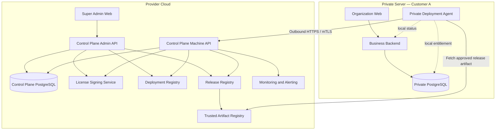
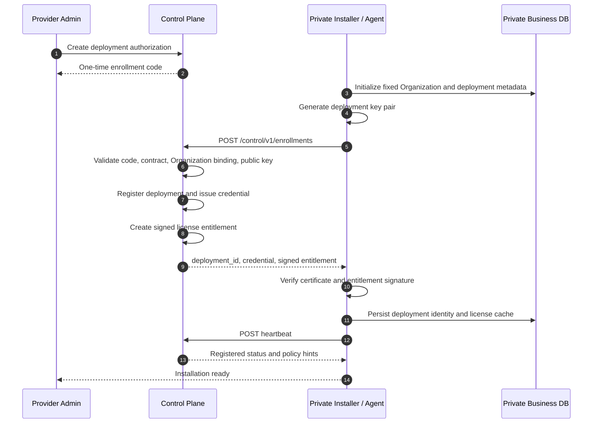
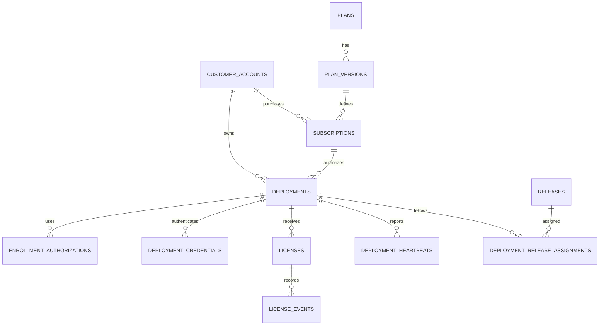

# POS Platform — Cloud Control Plane Specification

> **Document ID:** CCP-001  
> **Version:** 1.0  
> **Date:** 2026-11-03  
> **Status:** Architecture baseline — proposed for implementation  
> **Related documents:** `01-system-architecture.md`, `02-database-schema.md`, `03-api-specification.md`

---

## 1. Purpose

This document defines the Cloud Control Plane: the provider-operated service responsible for commercial accounts, Cloud subscriptions, Private Server registration, deployment identity, licenses, deployment health metadata, and software release coordination.

The Control Plane is a mandatory provider service for Private Server lifecycle management. Each Private Server must enroll with the Control Plane and periodically communicate with it. However, the Control Plane is **not** the runtime dependency for ordinary Private Server business operations.

A Private Server must continue to run locally during a temporary Internet or Control Plane outage, subject to its locally cached signed entitlement and configured grace policy.

This document is the implementation reference for:

- Control Plane service boundaries and trust boundaries.
- Customer, subscription, deployment, and license lifecycle.
- Private Server enrollment and machine identity.
- Machine-to-machine APIs and provider administration APIs.
- Heartbeats, telemetry minimization, and deployment health.
- Signed entitlements, key management, renewal, revocation, and offline validation.
- Release metadata, update channels, and controlled software upgrades.
- Failure handling, security, audit, operations, and acceptance tests.

## 2. Product and deployment context

The platform supports two Business Data Plane deployment models:

1. **Cloud SaaS:** a provider-operated Business Data Plane serving multiple Organizations with tenant isolation.
2. **Private Server:** a dedicated Business Data Plane deployment serving exactly one Organization.

Private Server delivery supports both commercial arrangements:

- Customer-owned infrastructure, where the customer supplies the server, VPS, or cloud account.
- Provider-managed dedicated infrastructure, where the provider supplies and operates a dedicated server or VPS for that customer.

Both Private Server arrangements use the same Private deployment package and Control Plane lifecycle.

### 2.1 Control Plane responsibilities

The Control Plane is the provider-side system of record for:

- Commercial customer accounts.
- Product plans and published entitlements.
- Cloud subscriptions and Private Server contracts.
- Private deployment registration and identity.
- Enrollment authorizations.
- Deployment credentials and certificate metadata.
- License issuance, renewal, supersession, and revocation records.
- Deployment heartbeat and minimized operational health history.
- Product release metadata, channels, compatibility, and deployment assignments.
- Provider-side audit events.

### 2.2 Explicit non-responsibilities

The Control Plane is not the system of record for Private Server business data. It must not store or process the following as part of normal heartbeat or license flows:

- Private Server orders or order lines.
- Payment card data, payment credentials, or payment authorization payloads.
- Private Server customer records.
- Employee personal information.
- Product catalogs, product names, or SKU-level sales information.
- Inventory balances or stock movement details.
- Receipt contents or transaction-level reports.

The Control Plane also does not:

- Execute every POS transaction.
- Authorize each local sale.
- Replace the Private Server's local user authentication.
- Provide arbitrary remote shell access to customer servers.
- Push unreviewed executable commands to Private Servers.
- Require inbound network access into customer-owned infrastructure.

Any future feature that requires access to customer business data must have a separate product requirement, privacy review, threat model, explicit customer authorization, narrow scope, and audit design.

## 3. Architecture principles

1. **Separate planes:** Control Plane and Business Data Plane have separate APIs, databases, credentials, and authorization models.
2. **Outbound-only Private connectivity:** the Private Server initiates HTTPS connections to the provider; the provider does not require direct inbound access to the customer's network.
3. **One deployment identity:** each registered Private Server has a unique immutable `deployment_id`.
4. **One Organization per Private deployment:** enrollment binds the deployment to one Organization ID. That binding cannot be changed by an ordinary update or heartbeat.
5. **Least-privilege machine identity:** deployment credentials are not user credentials or POS device credentials.
6. **Signed entitlement:** the provider signs license entitlements; the Private Server verifies them locally using trusted public keys.
7. **Local business continuity:** ordinary local business operations do not call the Control Plane synchronously.
8. **No transaction data by default:** heartbeats and operational events use allowlisted, minimized metadata.
9. **No arbitrary remote execution:** release metadata can identify approved artifacts; it does not grant a remote shell or arbitrary command channel.
10. **Auditable lifecycle:** sensitive provider actions and deployment lifecycle changes are append-only audited.
11. **Idempotent machine APIs:** retries must not enroll duplicate deployments, duplicate licenses, or duplicate lifecycle events.
12. **Explicit commercial versus runtime state:** contract status, license status, deployment connectivity, and local application health are distinct state dimensions.

## 4. Logical architecture



The logical Deployment Agent may be implemented as a background service or as a dedicated module in the Private Server runtime. It must have a narrow interface and must not have unrestricted access to business tables.

### 4.1 Control Plane components

| Component | Responsibility | Trust level |
|---|---|---|
| Super Admin Web | Provider operations UI | Provider administrator |
| Admin API | Commercial and lifecycle administration | Provider administrator/service |
| Machine API | Enrollment, heartbeat, license, release metadata | Registered deployment |
| Control Plane Database | Provider commercial and deployment metadata | Provider infrastructure |
| License Signing Service | Signs entitlement payloads | Highly restricted provider service |
| Deployment Registry | Tracks deployment identity and status | Control Plane domain component |
| Release Registry | Tracks immutable release metadata | Control Plane domain component |
| Artifact Registry | Stores or references signed release artifacts | Trusted software supply chain |
| Monitoring | Detects heartbeat and service failures | Provider operations |

### 4.2 Service deployment recommendation

For the first production generation, the Control Plane may be a modular service within the provider backend repository, but it must be a separately protected application boundary:

- Separate route prefixes.
- Separate authentication dependencies.
- Separate database credentials and migrations.
- Separate authorization policies.
- Separate audit events.
- Separate signing-service access.
- Separate rate limits for machine and administrator traffic.

It may run in the same cloud cluster or account as Cloud SaaS, but the Control Plane database must remain logically and operationally separate from customer Business Data Plane databases.

## 5. Data ownership and data classification

### 5.1 Provider-owned Control Plane data

The provider owns and operates the Control Plane database. It stores commercial relationships, deployment registration, entitlements, lifecycle events, and limited operational metadata.

### 5.2 Customer-owned business data

Private Server business data remains within the customer's deployment and backup boundary. It is not copied to Control Plane tables as a side effect of enrollment, heartbeat, license refresh, or release checks.

### 5.3 Allowed heartbeat fields

The initial allowlist may include:

- Deployment ID.
- Product version and build identifier.
- Deployment mode (`private`).
- Reported health summary.
- Database health state (`healthy`, `degraded`, `unhealthy`, `unknown`), without query contents.
- Store count, if contractually permitted.
- Active device count as an aggregate, if contractually permitted.
- Last successful backup timestamp and result, if configured.
- License ID and license state.
- Timestamp and request ID.
- Optional feature/capability identifiers.

The heartbeat must not contain customer names, employee names, customer contact details, product names, order numbers, order lines, amounts, payment details, IP addresses of POS devices, or arbitrary local log content unless a separately approved diagnostic workflow explicitly requires a field.

### 5.4 Telemetry policy

Telemetry is distinct from mandatory lifecycle traffic.

- Mandatory: enrollment, deployment authentication, heartbeat, license retrieval/renewal, and release metadata retrieval.
- Optional: usage aggregates, diagnostic bundles, performance metrics, and anonymized product telemetry.
- Optional telemetry must be documented, minimized, and contractually disclosed.
- Diagnostic bundle export must be initiated or approved by an authorized customer administrator, unless a contract and separate authorization explicitly provide another mechanism.

## 6. Control Plane identity model

### 6.1 Identity types

| Identity | Used by | Purpose | Must not be used for |
|---|---|---|---|
| Provider Admin Identity | Super Admin users | Manage customers, plans, deployments, licenses, releases | Private Server machine authentication |
| Deployment Identity | Private Server Agent | Authenticate one registered deployment | Business user login or POS login |
| License Signing Identity | Signing service | Sign entitlements | API authentication |
| Release Signing Identity | Release pipeline | Sign artifact provenance/metadata | Deployment authentication |
| Business User Identity | Organization Web | Access business features | Control Plane machine calls |
| POS Device Identity | Flutter APK | Perform permitted POS operations | Deployment enrollment |

### 6.2 Deployment identity

Each Private Server receives a globally unique `deployment_id` during enrollment. The deployment identity is immutable during ordinary operation.

The deployment should generate its key pair locally during installation:

- Private key: remains on the customer server, protected using the supported operating-system secret store or file permissions/HSM where available.
- Public key: submitted during enrollment.
- Certificate or deployment credential: issued after successful enrollment.

The provider must never receive or return the deployment private key.

### 6.3 Credential binding

A deployment credential must bind to:

- `deployment_id`.
- Credential/key identifier.
- Allowed machine API audience.
- Validity interval where applicable.
- Approved authentication method.

A credential for one deployment must not authenticate as another deployment. Credentials must not be accepted by Business Data Plane user or device authentication endpoints.

## 7. Customer and commercial account model

### 7.1 Customer account

A customer account represents the commercial relationship with the provider. It is not the same entity as a Business Data Plane Organization.

Examples:

- A customer may own one Private Server deployment and one Organization.
- A customer may have a Cloud subscription for one or more Organizations.
- A customer may contract for several independent Private Server deployments, each with its own Organization.

### 7.2 Plan and entitlement model

Plans describe a catalog of product capabilities and limits. A published plan version should be immutable. Changes to pricing, features, or limits create a new plan version or a new effective subscription entitlement.

Entitlements may include:

- Product edition.
- Enabled modules.
- Maximum Stores.
- Maximum active POS Devices.
- Maximum users, if commercially limited.
- Available support tier.
- Update channel eligibility.
- License expiration and grace policy.

Do not derive a Private Server's effective rights solely from a mutable plan row. The issued license must contain a signed, immutable snapshot of the effective entitlement at issuance time.

### 7.3 Subscription and contract states

Suggested commercial states:

- `draft`
- `pending_activation`
- `active`
- `past_due`
- `suspended`
- `cancelled`
- `expired`

The commercial state is not the same as deployment health. For example, a subscription may be active while its deployment is offline, or a deployment can be healthy while its contract is approaching expiry.

### 7.4 Commercial actions and effects

| Commercial action | Control Plane effect | Private Server local effect |
|---|---|---|
| Contract activated | Enable enrollment/license issuance | No effect until enrollment or license refresh |
| Contract renewed | Update entitlement eligibility | Obtain renewed signed entitlement |
| Contract past due | Mark account/contract state | Apply configured warning/grace policy after policy is delivered |
| Contract suspended | Record suspension and issue appropriate entitlement/revocation state | Apply signed policy when received; do not assume immediate delivery during outage |
| Contract cancelled | Record end-of-service state | Apply agreed end-of-term/grace policy; preserve data/export capability |
| Contract reinstated | Restore eligibility | Refresh entitlement and resume permitted capabilities |

All consequential changes must be audited and have an effective timestamp.

## 8. Private Server enrollment lifecycle

### 8.1 Preconditions

Before enrollment:

- A customer account exists in Control Plane.
- A Private Server contract or enrollment entitlement is approved.
- An Organization ID has been provisioned or reserved for the deployment.
- An enrollment authorization has been created.
- The installer has initialized local application configuration.
- The server has a valid HTTPS configuration for its Business API endpoint.

### 8.2 Enrollment sequence



### 8.3 One-time enrollment authorization

An enrollment authorization must:

- Be generated by an authorized provider administrator or approved provisioning workflow.
- Be bound to one customer account.
- Be bound to one Private deployment authorization.
- Be bound to the expected Organization ID.
- Have a short expiry.
- Be single-use.
- Be stored hashed or otherwise protected at rest where feasible.
- Be rate-limited and auditable.
- Be invalidated after successful use or explicit cancellation.

The authorization must not function as a reusable deployment credential.

### 8.4 Enrollment idempotency and recovery

Enrollment requests include an idempotency key and installation nonce.

If the response is lost after Control Plane registration, a retry with the same authorized enrollment context must return the existing registration outcome where safe; it must not create a duplicate deployment. Recovery must require proof of possession of the same deployment key or an explicit provider-assisted recovery procedure.

A server reinstall must not silently create a second deployment identity. The operator must choose one of:

1. Restore the existing deployment identity from a secure recovery backup.
2. Perform an authorized identity-recovery/credential-rotation process.
3. Decommission the old deployment and provision a new deployment under a new authorization.

## 9. Deployment lifecycle and status model

### 9.1 Separate status dimensions

Do not overload a single `status` field to represent all operational and commercial facts. Keep at least these dimensions:

**Registration status**
- `pending_enrollment`
- `registered`
- `decommissioned`

**Operational connectivity status** (derived from heartbeat)
- `online`
- `delayed`
- `offline`
- `unknown`

**Reported application health**
- `healthy`
- `degraded`
- `unhealthy`
- `unknown`

**License status**
- `not_issued`
- `active`
- `expiring`
- `expired`
- `revoked`
- `superseded`

**Commercial status**
- `active`
- `past_due`
- `suspended`
- `cancelled`
- `expired`

The provider UI should display these dimensions separately. A timeout must not be represented as an explicit license revocation.

### 9.2 Connectivity calculation

Initial configurable thresholds:

| Last successful heartbeat | Derived state |
|---|---|
| Within 2 heartbeat intervals | `online` |
| More than 2 intervals, within 24 hours | `delayed` |
| 24 hours or more | `offline` |
| No heartbeat ever received | `unknown` |

With a 5-minute heartbeat, a deployment is not instantly marked offline after one missed request. Use server receive time as the authoritative observation time. The deployment-reported timestamp is diagnostic only and must not control connectivity calculation.

### 9.3 Decommissioning

Decommissioning is a terminal lifecycle action for a specific deployment identity.

Requirements:
- Require explicit authorized action.
- Require re-authentication or step-up authorization for a provider administrator.
- Revoke active deployment credentials.
- Record reason and effective time.
- Prevent reactivation of that deployment identity by ordinary enrollment.
- Preserve commercial, audit, and license history according to retention policy.
- Require a new authorization and new deployment identity for a fresh installation unless an approved recovery path is used.

Decommissioning a deployment must not delete customer business data on the Private Server.

## 10. Deployment authentication and credential lifecycle

### 10.1 Preferred mechanism

Use mutual TLS (mTLS) for Private Server Agent to Control Plane Machine API authentication.

The Control Plane must validate:
- Certificate chain against the provider deployment CA or approved trust configuration.
- Certificate validity period.
- Client certificate identity and deployment binding.
- Credential revocation state available to the authentication layer.
- Intended API audience.

An alternative deployment-scoped signed token may be used only if mTLS is unavailable in a supported environment and the token has short lifetime, rotation, audience binding, and strong storage controls. Do not accept a generic long-lived API key without deployment binding.

### 10.2 Credential issuance

The initial enrollment response may include a certificate or short-lived bootstrap credential. The Private Server private key is generated locally and is never transmitted to the provider.

### 10.3 Rotation

Credential rotation should support an overlap window:

1. Deployment creates or selects a new key pair.
2. Deployment authenticates with the currently valid credential.
3. Deployment submits the new public key or certificate request.
4. Control Plane validates and issues the replacement credential.
5. Both credentials may be accepted during a short overlap period.
6. Deployment confirms successful use of the new credential.
7. Old credential is revoked.

Rotation events must be audited. Emergency revocation may bypass the overlap period.

### 10.4 Revocation limitation

A credential or license cannot be remotely invalidated on an offline server at the instant the provider performs revocation. The Control Plane can enforce revocation at the next authenticated contact, while the Private Server must follow its locally cached entitlement and grace policy until it receives updated state.

This limitation must be reflected in the customer contract and operational documentation. Never claim instantaneous offline revocation.

## 11. Machine API specification

Base URL prefix: `/control/v1`.

All machine endpoints require a registered deployment identity except the initial enrollment endpoint. They must reject Business User JWTs, POS Device tokens, and Provider Admin session tokens.

### 11.1 Route catalogue

| Method | Route | Purpose |
|---|---|---|
| `POST` | `/enrollments` | One-time Private Server enrollment |
| `GET` | `/deployments/me` | Read registered deployment identity and policy summary |
| `POST` | `/deployments/me/heartbeat` | Submit deployment health/version heartbeat |
| `GET` | `/deployments/me/license` | Fetch current signed entitlement |
| `POST` | `/deployments/me/license/renew` | Request license refresh/renewal |
| `GET` | `/deployments/me/releases` | Fetch compatible release metadata |
| `POST` | `/deployments/me/events` | Submit allowlisted lifecycle events |
| `POST` | `/deployments/me/credentials/rotate` | Rotate deployment credential |
| `POST` | `/deployments/me/decommission` | Request controlled decommissioning |

The API contract, request and response envelopes, error codes, and versioning rules are defined in `03-api-specification.md`. This document adds lifecycle and processing requirements.

### 11.2 Enrollment request

Example:

```json
{
  "enrollment_code": "<one-time-code>",
  "deployment_public_key": "<public-key-or-csr>",
  "deployment_mode": "private",
  "product_version": "1.0.0",
  "organization_id": "<fixed-organization-uuid>",
  "organization_code": "CUSTOMER-001",
  "installation_nonce": "<random-unique-nonce>"
}
```

The public key or certificate signing request is public material. Do not include the generated private key in this request.

### 11.3 Enrollment response

Response should include:
- Deployment ID.
- Customer account reference or opaque customer identifier.
- Fixed Organization binding.
- Credential/certificate issuance data.
- Signed license envelope.
- Control Plane API audience and supported protocol version.
- Initial heartbeat deadline and policy hints.
- Server time.

The response must not contain provider signing private keys or deployment private keys.

### 11.4 Heartbeat request

Example:

```json
{
  "reported_at": "2026-11-03T08:15:00Z",
  "product_version": "1.0.0",
  "build_id": "build-20261103.1",
  "health_status": "healthy",
  "database_status": "healthy",
  "store_count": 3,
  "active_device_count": 5,
  "license_id": "<license-uuid>",
  "backup_status": {
    "last_success_at": "2026-11-03T07:00:00Z",
    "last_result": "success"
  },
  "capabilities": ["pos", "inventory", "reports"]
}
```

The Control Plane must validate field lengths, enum values, timestamp skew, deployment limits, and allowlisted capabilities.

The server's `received_at` is authoritative for connectivity monitoring. `reported_at` is retained only for diagnostics.

### 11.5 Heartbeat response

May include:
- Server receive timestamp.
- Deployment registration status.
- License refresh required flag.
- License expiration warning.
- Latest compatible release version.
- Maintenance/update notice identifiers.
- Minimum supported protocol version.

The response must not deliver arbitrary shell commands or executable instructions.

## 12. Heartbeat, status, and operational telemetry

### 12.1 Initial heartbeat policy

| Setting | Initial default | Notes |
|---|---:|---|
| Heartbeat interval | 5 minutes | Configurable by provider policy |
| Request timeout | 10 seconds | Agent-side default; tune by environment |
| Retry | Exponential backoff with jitter | Avoid synchronized retry storms |
| First warning | 24 hours without successful heartbeat | Alert only; do not change business-plane health |
| Escalated warning | 72 hours | Provider operations follow-up |
| License refresh attempt | Every 6 hours | Also refresh near expiry or on provider hint |
| Entitlement grace | 7 days after last successful validation | Initial proposed policy; configurable and contractual |

The agent may send a heartbeat sooner when it detects a material health transition, but must apply throttling to avoid excessive traffic.

### 12.2 Health model

The deployment may report:
- `healthy`: core Business API and database checks pass.
- `degraded`: local service works but a non-critical subsystem is impaired.
- `unhealthy`: core service cannot perform normal operations.
- `unknown`: health could not be determined.

The Control Plane should derive a separate connectivity state from the time of the last received heartbeat. Do not overwrite health with connectivity state.

### 12.3 Data minimization

Store only allowlisted operational fields. Reject or discard unknown high-risk fields rather than storing an unrestricted JSON object from the deployment.

If a JSON metadata field is retained for forward compatibility:
- Apply a strict size limit.
- Validate field names against an allowlist.
- Reject secrets, personal data, business transaction details, or arbitrary log dumps.
- Version the heartbeat schema.
- Record the schema version that was processed.

### 12.4 Heartbeat retention

A suggested initial policy:
- Retain raw heartbeat rows for 90 days.
- Maintain a daily aggregate for longer-term availability reporting.
- Retain only fields needed for support, contractual reporting, and trend analysis.

Final retention must follow provider policy, customer contracts, and applicable law. Partition the heartbeat table by time or archive old partitions as volume grows.

## 13. License issuance and entitlement lifecycle

### 13.1 License responsibilities

The Control Plane determines commercial eligibility and issues signed entitlement snapshots. The Private Server verifies the signature and applies the entitlement locally.

The license is not a user authentication token. It does not grant a user permission to perform a business action, and it does not bypass local RBAC.

### 13.2 License payload

Minimum fields:

```json
{
  "schema_version": 1,
  "license_id": "<license-uuid>",
  "customer_id": "<customer-uuid>",
  "deployment_id": "<deployment-uuid>",
  "organization_id": "<organization-uuid>",
  "edition": "enterprise",
  "features": ["pos", "inventory", "reports"],
  "limits": {
    "max_stores": 10,
    "max_devices": 50,
    "max_users": 100
  },
  "issued_at": "2026-11-03T00:00:00Z",
  "not_before": "2026-11-03T00:00:00Z",
  "expires_at": "2027-11-03T00:00:00Z",
  "grace_policy_id": "grace-standard-01",
  "key_id": "license-signing-2026-01"
}
```

The payload must be signed as a well-defined canonical representation or a standard signed envelope. Do not invent an ad-hoc serialization/signature format. Use a reviewed library and a documented envelope format.

### 13.3 Signing algorithm and key custody

- Ed25519 is the initial recommended signing algorithm, subject to library and platform support validation.
- Signing private keys must be held in a protected signing environment, KMS, HSM, or equivalent restricted service.
- The Control Plane application database stores key identifiers and public verification metadata only.
- Private Server receives trusted public keys through a secure release/configuration mechanism.
- Each signed payload identifies the `key_id` used to sign it.
- Key rotation must support a period where old and new trusted public keys are accepted.
- A compromised signing key requires a documented emergency rotation and re-issuance process.

### 13.4 License lifecycle

Suggested states:
- `draft`
- `issued`
- `active`
- `expiring`
- `expired`
- `revoked`
- `superseded`

Transitions must be explicit and audited. A renewed license should normally supersede the previous license only after the replacement is successfully issued.

### 13.5 License refresh and renewal

The Private Server periodically requests the current entitlement. The Control Plane evaluates:
- Customer/contract status.
- Deployment registration status.
- Organization binding.
- Plan or contract entitlement.
- Effective limits and features.
- Revocation and suspension policy.

The Control Plane returns a newly signed entitlement or a structured state requiring provider review. The Private Server verifies the signature locally and atomically replaces the cached entitlement only after successful validation.

### 13.6 Grace period and temporary outage

Initial proposed defaults:
- Warning after 24 hours without successful Control Plane contact.
- Escalated warning after 72 hours.
- Cached signed entitlement grace: 7 days after last successful validation.

Grace is a policy mechanism, not a guarantee that revocation propagates while offline.

During an outage:
- Local user authentication continues.
- Local POS and inventory operations continue while the Business Data Plane is healthy and the cached license policy permits them.
- License refresh, new deployment registration, new release discovery, and provider-side visibility are unavailable.
- The agent retries using exponential backoff with jitter.

After grace expires, the default product policy should restrict new administrative provisioning and new device activations, and should prevent exceeding licensed limits. It must preserve transaction history, allow administrative recovery/renewal workflows, and must not delete customer data. The final policy must be configurable and contractually disclosed.

### 13.7 Revocation semantics

Immediate revocation of an offline deployment is technically impossible. On the next successful authenticated contact, the Control Plane communicates revocation/suspension state. The Private Server then applies the signed or authenticated policy locally.

The Control Plane UI must distinguish:
- Revocation requested.
- Revocation delivered to deployment.
- Deployment has acknowledged revocation.
- Deployment has not contacted Cloud since revocation.

Never display an offline deployment as though it has acknowledged a new revocation.

## 14. Release and update management

### 14.1 Release metadata

A release record should include:
- Release ID and semantic version.
- Channel (`stable`, `preview`, `hotfix`).
- Deployment compatibility (`cloud`, `private`, `both`).
- Minimum supported current version.
- Artifact reference in a trusted registry.
- SHA-256 checksum.
- Artifact/provenance signature reference.
- Release notes.
- Database migration compatibility metadata.
- Publication and withdrawal timestamps.
- Approval and rollout state.

### 14.2 Artifact integrity and provenance

The Control Plane must not ask a Private Server to execute arbitrary URLs or commands.

A Private Server update workflow must:
1. Obtain compatible release metadata from the Control Plane.
2. Fetch the artifact from an approved registry using secure transport and appropriate authorization.
3. Verify SHA-256 checksum.
4. Verify a trusted artifact signature/provenance statement.
5. Check deployment type, current version, and upgrade path.
6. Check customer maintenance window and approval requirements.
7. Back up the database and uploaded files.
8. Apply the approved update and migrations.
9. Run health checks.
10. Report the result to the Control Plane.

### 14.3 Update modes

- Customer-initiated update: customer administrator initiates after reviewing release metadata.
- Provider-assisted update: authorized operator schedules an update according to the support agreement; customer-owned servers still require an approved mechanism and authorization.
- Automatic update: disabled by default for Private Server. May be enabled only by an explicit customer contract and safe maintenance policy.

### 14.4 Rollout channels

- `stable`: normal production releases.
- `preview`: pre-release testing, never default for production.
- `hotfix`: urgent compatible fixes with controlled approval.

Assignments may be per deployment or per customer cohort. A release may be withdrawn, but an already installed artifact must not be silently replaced with different bytes under the same version identifier.

### 14.5 Update failure

If an update fails:
- Preserve logs locally.
- Do not delete the database.
- Keep the last known working application version when safely possible.
- Do not attempt unsafe automatic database downgrade.
- Report a minimized failure summary to the Control Plane after connectivity returns.
- Require a documented recovery or restore workflow.

## 15. Provider administration API and Super Admin workflows

The Admin API is under `/control/admin/v1` and accepts provider-admin identities only.

### 15.1 Customer management

Provider users can:
- Create and update customer commercial accounts.
- View customer contracts and deployment associations.
- Suspend or close a commercial account according to permission and contract.
- View relevant audit history.

Sensitive operations require step-up authentication and audit reason.

### 15.2 Plan management

Plan management should support:
- Draft plans.
- Immutable published plan versions.
- Feature flags/entitlements.
- Resource limits.
- Support/update channel policy.
- Effective dates.

Changing a published plan must not silently mutate an existing issued license. Re-evaluate contracts and issue a new entitlement as appropriate.

### 15.3 Deployment management

Super Admin can:
- View deployment registration, connectivity, health, reported version, and license state.
- Review heartbeat history and allowlisted operational metadata.
- Issue enrollment authorizations.
- Approve deployment identity recovery.
- Rotate or revoke credentials.
- Suspend/resume deployment eligibility under policy.
- Decommission a deployment.
- Assign compatible release channels.

Super Admin must not have unrestricted direct access to Private Server business databases.

### 15.4 License administration

Super Admin workflows:
1. Select customer and deployment.
2. Review contract and entitlement.
3. Select edition, features, limits, and validity interval.
4. Review warnings if the deployment already has a newer license.
5. Require step-up authorization for sensitive issuance/revocation.
6. Request signature from the protected License Signing Service.
7. Store signed envelope and lifecycle event.
8. Notify deployment that a refresh is available on its next authenticated contact.

### 15.5 Provider audit

Every sensitive provider action should record:
- Actor identity and role.
- Action code.
- Target entity type and ID.
- Timestamp.
- Request ID.
- Reason or ticket reference where applicable.
- Relevant before/after metadata with secrets excluded.
- Approval/step-up context where required.

## 16. Control Plane database model

The Control Plane database is separate from every Business Data Plane database. It must not use cross-database foreign keys.

### 16.1 Core tables

| Table | Purpose |
|---|---|
| `customer_accounts` | Commercial customer identity |
| `plans` | Plan catalog |
| `plan_versions` | Immutable published entitlement definitions |
| `subscriptions` | Cloud subscriptions and Private contracts |
| `enrollment_authorizations` | One-time enrollment codes and state |
| `deployments` | Registered runtime installations |
| `deployment_credentials` | Credential/certificate metadata, never private key material |
| `licenses` | Issued signed license records |
| `license_events` | Append-only license lifecycle history |
| `deployment_heartbeats` | Operational heartbeat history |
| `releases` | Immutable software release metadata |
| `deployment_release_assignments` | Deployment release channel/version assignment |
| `control_plane_audit_logs` | Provider administrator and service audit trail |
| `signing_key_metadata` | Key IDs, algorithms, public-key metadata, lifecycle status |

### 16.2 Relationships



`organization_id` is a cross-system reference only. Do not create a foreign key from Control Plane to a Business Data Plane database.

### 16.3 Credential storage

The Control Plane database may store:
- Credential ID.
- Deployment ID.
- Certificate serial or public-key fingerprint.
- Issued/expiry/revocation timestamps.
- Credential state.
- Key algorithm and metadata.

It must never store the deployment private key. License and release signing private keys must be managed by the protected signing infrastructure, not stored in an ordinary database row.

## 17. Security requirements

### 17.1 Provider Admin security

- Strong authentication and MFA for provider administrators.
- Role-based permissions and separation of duties.
- Step-up authorization for license signing, credential revocation, deployment decommissioning, and release publication.
- Rate limits and session controls.
- Audit records for all privileged operations.
- Break-glass access must be rare, time-limited, separately approved, and audited.

### 17.2 Machine API security

- mTLS for deployment authentication where supported.
- Deployment identity and audience validation.
- Rate limits per deployment and per endpoint.
- Request size limits and strict schema validation.
- Idempotency keys for mutation operations.
- Replay protection for enrollment and credential rotation.
- Certificate/key rotation and revocation processes.
- No reuse of Business User or POS Device tokens.

### 17.3 Signing service security

- Private signing keys reside in KMS/HSM or an equivalently restricted signing service.
- The Control Plane API requests signatures through a narrow signing operation.
- The signing service validates the caller, allowed license schema, key ID, and issuance policy.
- Keys have documented rotation and emergency revocation procedures.
- Signing operations are logged without storing secret key material or unnecessary sensitive payloads.

### 17.4 Data protection

- Encrypt Control Plane database backups.
- Restrict access using least-privilege service identities.
- Redact tokens, one-time enrollment codes, private key data, and secret headers from logs.
- Retain only operational data needed for contractual and support purposes.
- Define customer data access policy separately from deployment monitoring.

## 18. Failure modes and operational behavior

| Failure | Expected Control Plane behavior | Expected Private Server behavior |
|---|---|---|
| Control Plane unavailable | Machine APIs return unavailable; alert provider ops | Continue local business operations under cached entitlement; retry with backoff |
| Private Server offline | Mark connectivity delayed/offline after thresholds | Continue locally if local services are healthy |
| Invalid enrollment code | Reject and audit | Do not mark installation enrolled |
| Enrollment response lost | Resolve idempotently with proof of same deployment identity | Retry safely; do not create duplicate deployment |
| Heartbeat duplicated | Store idempotently or deduplicate by event/request ID | Retry safely |
| License signature invalid | Return/record error; investigate issuer | Reject replacement; keep last valid cached entitlement according to policy |
| License revoked while deployment offline | Record revocation as pending delivery | Continue under last valid local state until contact/grace policy; no false claim of immediate revocation |
| Release artifact checksum mismatch | Keep release flagged and alert | Refuse installation; remain on current version |
| Credential compromised | Revoke/rotate provider-side credential | Rotate using recovery path; local operations follow credential failure policy |
| Provider DB restore | Restore CP data and signing metadata from protected backup | Re-authenticate or reconcile using stable deployment IDs; no accidental duplicate registration |

### 18.1 Retry policy

Machine clients must use exponential backoff with jitter, a maximum delay, and a circuit breaker. They must avoid synchronized retries from many deployments after a provider outage.

Suggested behavior:
- Retry transient network/5xx errors.
- Do not retry permanent schema/authentication failures without corrective action.
- Respect `Retry-After` when present.
- Preserve local state until a confirmed acknowledgement is received.
- Use a stable idempotency key for each logical mutation.

### 18.2 Time handling

- Store timestamps in UTC.
- Use Control Plane receive time as the authoritative heartbeat observation.
- Treat deployment-reported time as informational.
- Validate unreasonable clock skew.
- License validation must be designed against obvious local clock rollback; do not rely solely on the Private Server's wall clock. Use persisted last-known-good validation time and authenticated server time when available.

### 18.3 Recovery and disaster recovery

The provider must back up:
- Control Plane PostgreSQL.
- Release metadata and references.
- Public signing key history and trust metadata.
- Enrollment authorization state needed for audit/reconciliation.
- Audit history according to retention policy.

Private signing keys must be backed up only according to the KMS/HSM provider's protected key-backup and recovery procedures. They must not be exported into ordinary application backups.

Define and test Control Plane RPO/RTO separately from Business Data Plane RPO/RTO. A Control Plane outage must not become an automatic data-plane outage.

## 19. Observability and alerting

### 19.1 Metrics

Recommended metrics:
- Machine API request count by route/status.
- Machine API latency.
- Enrollment success/failure count.
- Active registered deployment count.
- Heartbeat age distribution.
- Deployment health distribution.
- License issuance/renewal/revocation counts.
- Release check and update-report counts.
- Signing-service latency and failure rate.
- Credential authentication failures.
- Admin API privileged action counts.

Metrics must not contain customer PII or business transaction data.

### 19.2 Alerts

- Control Plane API unavailable.
- Control Plane database unavailable or storage pressure.
- Signing service unavailable.
- Signing key nearing expiry or scheduled rotation.
- Unusual spike in failed deployment authentication.
- Enrollment failure rate above threshold.
- Deployment heartbeat missing beyond policy threshold.
- Release registry artifact/checksum/signature mismatch.
- Unexpected high-volume license issuance or revocation.

### 19.3 Operational dashboards

Super Admin should show separate indicators for:
- Commercial contract status.
- Deployment registration state.
- Last heartbeat and derived connectivity state.
- Reported application health.
- Current version and assigned channel.
- License validity and last refresh.
- Pending update status.

A deployment that has not acknowledged a revocation must be visually distinguishable from a deployment that has applied the revocation.

## 20. Implementation sequence

### Phase 1 — Core Control Plane

- Separate Control Plane database and migrations.
- Provider Admin authentication and RBAC.
- Customer accounts.
- Plans and immutable plan versions.
- Private deployment registry.
- Enrollment authorization issuance.

### Phase 2 — Enrollment and Deployment Identity

- Enrollment endpoint.
- Locally generated deployment key pair.
- mTLS or equivalent deployment credential issuance.
- Idempotent enrollment and recovery.
- Deployment detail and audit events.

### Phase 3 — License Service

- Entitlement schema.
- Protected signing service.
- Public key distribution and key IDs.
- License issuance and renewal.
- Local verification integration test.
- Revocation delivery semantics.

### Phase 4 — Heartbeat and Operations

- Heartbeat ingestion.
- Connectivity status projection.
- Health dashboard.
- Alerting and retention.
- Optional telemetry policy controls.

### Phase 5 — Release Coordination

- Release metadata registry.
- Immutable artifact references.
- Artifact checksum and signature verification.
- Deployment channel assignment.
- Update result reporting.

### Phase 6 — Production Hardening

- Penetration testing.
- Credential rotation exercises.
- Signing-key rotation exercise.
- Control Plane backup/restore drill.
- Outage and recovery simulation.
- Load and rate-limit tests.
- Audit and privacy review.

## 21. Acceptance criteria

The Control Plane is ready for initial production only when all of the following pass:

### Enrollment
- A valid one-time enrollment authorization creates one deployment registration.
- Replaying the same enrollment request does not create duplicate deployments.
- Wrong Organization binding is rejected.
- Expired, used, or revoked enrollment codes are rejected.
- Deployment private key never leaves the Private Server.

### Authentication
- Private Server authenticates using its deployment identity.
- Business User tokens and POS Device tokens are rejected by Machine API.
- Credential rotation works with a controlled overlap window.
- Revoked credentials are rejected on the next attempted authenticated contact.

### License
- Valid signature and matching deployment/Organization binding are accepted.
- Modified, expired, wrong-deployment, or invalidly signed licenses are rejected.
- Local cached license supports the agreed outage/grace behavior.
- Revocation delivery and acknowledgement states are distinguishable.
- Signing private keys are not present in application database or repository.

### Heartbeat and privacy
- Connectivity uses server receive time.
- Health and connectivity remain distinct states.
- Heartbeat schema rejects disallowed business/customer data.
- Retention/archival policy is implemented and tested.

### Releases
- Only compatible releases are returned.
- Artifacts are verified by checksum and trusted signature/provenance.
- Private Server does not run arbitrary remote commands from Control Plane responses.
- Update failure does not automatically delete or downgrade business data.

### Operations
- Provider privileged actions are audited.
- Control Plane backup restore is tested.
- Control Plane outage does not stop healthy Private Server local POS operations.
- Dashboard does not misrepresent offline revocation as acknowledged.

## 22. Open decisions before production

The following must be decided during implementation or commercial launch:

1. Exact provider identity/MFA mechanism.
2. Certificate authority and certificate issuance technology for deployment mTLS.
3. KMS/HSM provider and signing key recovery model.
4. Final entitlement signing envelope and library selection.
5. Contractual grace period, warning period, and feature restrictions.
6. Customer consent and retention policy for optional telemetry.
7. Release artifact registry and provenance/signing standard.
8. Whether provider-managed Private Server updates can be scheduled remotely under specific customer contracts.
9. Control Plane availability target, RPO, and RTO.
10. Deployment recovery process after total server replacement.
11. Data retention requirements for commercial and audit history.
12. Customer-facing privacy statement and data-processing terms.

## 23. Related documents

- `01-system-architecture.md` — high-level platform architecture and deployment boundaries.
- `02-database-schema.md` — Business Data Plane and Control Plane database schema.
- `03-api-specification.md` — Business API and Control Plane API contracts.
- `05-private-server-deployment.md` — Private Server installation and operations (planned).
- `07-security-and-licensing.md` — cross-platform security and licensing specification (planned).

---

## Final Control Plane statement

The Cloud Control Plane is the provider-operated authority for customer commercial accounts, Private Server deployment registration, deployment identity, license issuance, release metadata, and operational status. Every Private Server must enroll with and periodically connect to this Control Plane, but the Control Plane is not part of the synchronous transaction path for local POS operations.

Private Server business data remains in its dedicated Business Data Plane database. Control Plane traffic is authenticated, minimized, auditable, and initiated outbound by the Private Server. Signed entitlements permit local verification during temporary outages; revocation and policy updates are applied when the deployment next establishes authenticated contact. This design provides provider-level lifecycle management without turning Cloud connectivity into a prerequisite for every customer sale.
