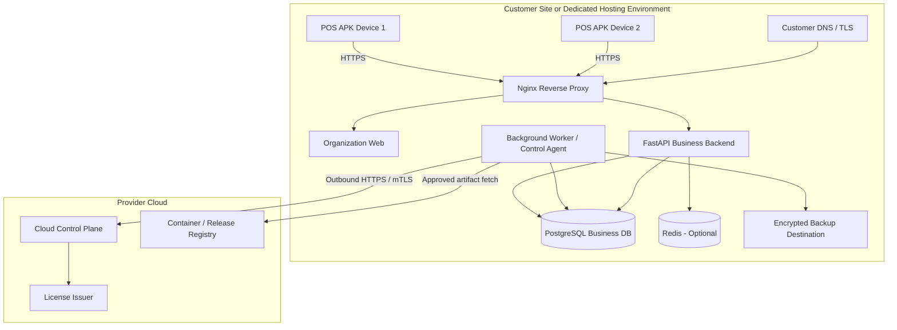
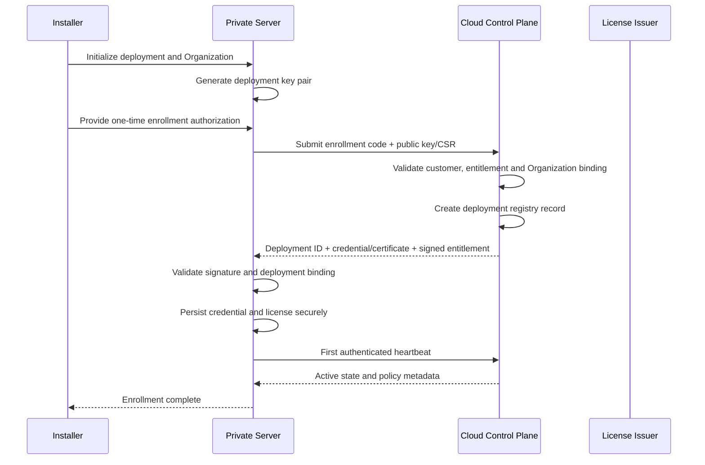
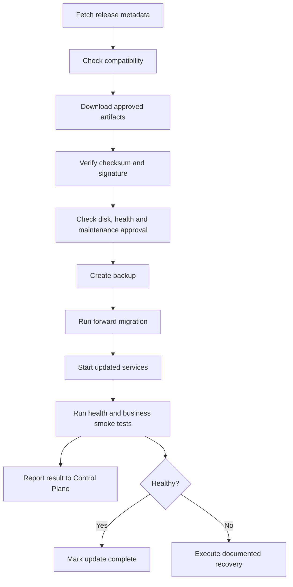

# POS Platform — Private Server Deployment Specification

> **Document ID:** DEP-001  
> **Version:** 1.0  
> **Date:** 2026-11-03  
> **Status:** Proposed for implementation  
> **Related documents:** `01-system-architecture.md`, `02-database-schema.md`, `03-api-specification.md`, `04-cloud-control-plane.md`

---

## 1. Purpose

This document defines how to provision, install, register, operate, update, back up, restore, and decommission a POS Platform Private Server deployment.

A Private Server is a dedicated Business Data Plane that serves **exactly one Organization**. It may run on customer-owned infrastructure or on dedicated infrastructure supplied and operated by the platform provider. Both delivery options use the same application codebase, container images, database schema, deployment package, and operational procedures.

Every Private Server must register with and periodically communicate with the provider's Cloud Control Plane for deployment identity, licensing, heartbeat, and release metadata. The Control Plane is not in the synchronous business transaction path. The Private Server must continue permitted local business operations during temporary loss of Cloud connectivity, subject to its locally cached signed entitlement and the configured grace policy.

This document is an implementation and operations specification. Hardware sizing, service-level objectives, retention periods, and license behavior marked as *initial target* must be validated through load testing and confirmed in each customer agreement before being treated as a contractual commitment.

## 2. Scope

### 2.1 In scope

- Customer-owned and provider-managed Private Server deployment options.
- Supported deployment topology and infrastructure prerequisites.
- DNS, TLS, firewall, and network requirements.
- Docker Compose packaging and configuration.
- First installation and Organization bootstrap.
- Cloud Control Plane enrollment and deployment identity.
- License installation, refresh, offline grace, and recovery.
- POS device activation against a Private Server endpoint.
- Health checks, logs, monitoring, and operational telemetry.
- Backup, restore, disaster recovery, and deployment cloning safeguards.
- Release download, verification, database migration, and rollback/recovery.
- Support handover, ownership boundaries, and decommissioning.

### 2.2 Out of scope

- Cloud SaaS infrastructure deployment details.
- Full Cloud Control Plane internals and provider billing workflows; see `04-cloud-control-plane.md`.
- Complete business database design; see `02-database-schema.md`.
- Full HTTP request/response contracts; see `03-api-specification.md`.
- Android application implementation details beyond endpoint binding and device activation.
- Customer-specific network, firewall, or hardware configuration that has not been assessed.

## 3. Normative language and operational defaults

The words **MUST**, **MUST NOT**, **SHOULD**, **SHOULD NOT**, and **MAY** express requirement strength.

The following values are initial engineering defaults, not guaranteed contractual terms:

| Setting | Initial default | Notes |
|---|---:|---|
| Deployment heartbeat | Every 5 minutes | Configurable by Control Plane policy |
| Heartbeat request timeout | 10 seconds | Client-side default; tune with network testing |
| License refresh attempt | Every 6 hours | Also refresh near expiry or when prompted |
| First Cloud-connectivity warning | 24 hours | Does not stop local sales |
| Escalated Cloud-connectivity warning | 72 hours | Operations/support follow-up |
| Cached entitlement grace | 7 days after last successful validation | Must be disclosed in the customer agreement |
| Full backup | Daily | Adjust based on RPO |
| Backup retention | 14 daily + 8 weekly copies | Initial policy; customer policy may require more |
| Backup restore test | At least quarterly | More frequent for higher service tiers |
| Update mode | Customer-approved | Automatic updates disabled by default |

The actual values MUST be configurable by deployment tier and must be recorded in the deployment configuration and service agreement.

## 4. Deployment model

### 4.1 Supported commercial delivery options

#### Option A — Customer-owned infrastructure

The customer provides and owns the physical server, VPS, or cloud account. The provider supplies the POS software, installation package, license, and the agreed level of deployment assistance and support.

The customer may retain responsibility for the operating system, network, storage, backup destination, and physical security. The service agreement MUST explicitly allocate these responsibilities.

#### Option B — Provider-managed dedicated infrastructure

The provider supplies a dedicated server or VPS for one customer. The provider operates the host infrastructure and may also operate application maintenance, backup, monitoring, and update services according to the service agreement.

The deployment MUST still be logically and operationally dedicated to one Organization. A provider-managed Private Server is not a Cloud multi-tenant deployment merely because the provider owns the infrastructure.

### 4.2 Shared deployment characteristics

Both options MUST use:

- `DEPLOYMENT_MODE=private`.
- `TENANT_MODE=single`.
- One immutable `DEPLOYMENT_ID`.
- One fixed `ORGANIZATION_ID`.
- A dedicated business PostgreSQL database or database instance.
- The same versioned backend and Organization Web images used by the product release.
- The same migration history and API contracts as Cloud.
- A registered deployment identity and valid signed license entitlement.
- The same Private Server backup, restore, health check, and update procedures.

### 4.3 Logical topology



The diagram shows logical roles. The initial deployment may run the Control Plane client/agent as a background process inside the backend or as a separate container. A separate `deployment-agent` container is preferred where it materially improves isolation or operational reliability, but it is not mandatory for the first release.

### 4.4 Business traffic and Control Plane traffic

- POS APK and Organization Web communicate with the Private Business Backend.
- The Business Backend reads and writes the Private PostgreSQL database.
- The Private deployment initiates outbound HTTPS connections to the Cloud Control Plane.
- The provider MUST NOT require direct inbound access to the customer's database, Redis, Docker daemon, or host management interface.
- Update artifacts are fetched from an allowlisted registry or artifact distribution service after metadata and integrity checks.

## 5. Infrastructure prerequisites

### 5.1 Operating system

The initial qualification target is a supported 64-bit Linux Server distribution with active security updates. Ubuntu Server LTS is the preferred initial reference environment, but the exact OS release MUST be recorded in the release support matrix after installation and upgrade testing.

The installation process MUST verify:

- Supported architecture (initially x86-64/AMD64; ARM64 only after explicit qualification).
- Supported Linux distribution and kernel.
- Docker Engine and Docker Compose plugin versions from the validated support matrix.
- Available CPU, memory, disk capacity, and inode capacity.
- Working DNS and time synchronization.
- Firewall rules and required outbound destinations.
- A persistent data volume for PostgreSQL.
- A persistent volume for uploaded assets and application-generated files.

Do not install the product on an unmaintained or end-of-life operating system.

### 5.2 Initial sizing guidance

Sizing depends on order volume, number of Stores, active POS devices, product catalog size, report workload, retention, and backup strategy. The values below are starting points for pilot testing only and are not performance guarantees.

| Profile | Initial CPU | Initial RAM | Initial SSD/NVMe | Typical use |
|---|---:|---:|---:|---|
| Pilot / Small | 4 vCPU | 8 GB | 100 GB | Pilot or low-volume single Organization |
| Recommended starting point | 8 vCPU | 16 GB | 250–500 GB | Production deployment with room for growth |
| Large deployment | Size after benchmark | Size after benchmark | Size after data-growth estimate | Larger catalog, transaction volume, or reporting workload |

Sizing guidance:

- PostgreSQL memory and disk I/O are critical to business API performance.
- Use SSD/NVMe storage; avoid slow network disks without measured validation.
- Reserve disk capacity for database growth, WAL, uploaded files, temporary update images, and backups.
- Keep backups on a separate destination or volume where possible; a second partition on the same physical disk is not a disaster-recovery copy.
- Use a UPS for customer-owned physical servers where power continuity is a concern.
- RAID can improve availability but does not replace backup.
- Final hardware sizing must be based on representative load tests and customer growth expectations.

### 5.3 Storage layout

Use explicit persistent directories or Docker volumes. Example host layout:

```text
/opt/pos-platform/
├── compose.yaml
├── .env
├── config/
│   ├── nginx/
│   └── deployment/
├── secrets/
├── data/
│   ├── postgres/
│   ├── redis/
│   └── uploads/
├── backups/
├── releases/
├── logs/
└── scripts/
```

Requirements:

- PostgreSQL data MUST be stored on persistent storage.
- Uploaded files MUST be stored on persistent storage or an explicitly configured object-storage service.
- Secrets MUST be protected from unprivileged OS users and excluded from source control.
- Backup storage SHOULD be outside the primary application disk or copied to a remote encrypted destination.
- The installer MUST check ownership, permissions, and available disk space before starting services.

### 5.4 Time synchronization

The host MUST use a trusted time synchronization service. Correct time is required for TLS validation, signed license expiry, audit timestamps, token expiry, and backup scheduling.

The deployment health check SHOULD report time synchronization status and significant clock skew. Store timestamps in UTC; render customer-facing times in the Organization or Store timezone.

## 6. Network, DNS, and TLS

### 6.1 Network paths

| Source | Destination | Protocol | Purpose |
|---|---|---|---|
| POS devices | Private Server reverse proxy | HTTPS / TCP 443 | Business API and Web UI |
| Admin workstation | Private Server reverse proxy | HTTPS / TCP 443 | Organization administration |
| Private Server | Cloud Control Plane | HTTPS / TCP 443 | Enrollment, heartbeat, license, release metadata |
| Private Server | Approved container registry | HTTPS / TCP 443 | Retrieve signed release artifacts |
| Private Server | DNS resolver | DNS | Name resolution |
| Private Server | NTP service | NTP / UDP 123 | Time synchronization |
| Private Server | Approved backup target | Per provider configuration | Backup export |
| Admin workstation | Server management endpoint | SSH / TCP 22 or approved port | Restricted maintenance |

Only the reverse proxy HTTPS listener should normally be exposed to POS devices and end users. PostgreSQL, Redis, backend internal ports, and Docker management interfaces MUST NOT be publicly exposed.

### 6.2 Outbound connectivity

The customer firewall MUST permit outbound connectivity to the provider's documented Control Plane and artifact registry endpoints. Actual hostnames are environment-specific and MUST be published in the deployment release documentation; do not hardcode placeholder domains into production configuration.

Private Server should use outbound-only Control Plane access. The provider must not require inbound port forwarding into a customer's private network for heartbeat, license refresh, or release discovery.

### 6.3 DNS patterns

Recommended public hostname:

```text
pos.customer-domain.example
```

The hostname must resolve to the reverse proxy address used by the deployment. Where POS devices use a private LAN, split-horizon DNS MAY resolve the same hostname to a private address, provided the TLS certificate remains trusted by the devices.

Private DNS names and internal certificate authorities are permitted only when every supported POS device trusts the issuing CA. The APK MUST NOT disable TLS certificate validation to accommodate self-signed certificates.

### 6.4 TLS requirements

- HTTPS is mandatory for production access.
- The reverse proxy certificate must be valid for the configured hostname and trusted by supported clients.
- Certificate renewal must be monitored and tested.
- TLS private keys must have restricted file permissions and must not be committed to Git or baked into container images.
- The Private Server Control Plane client must validate the provider's certificate chain and authenticate using its deployment credential, preferably mTLS.
- Do not use insecure TLS bypass flags in production.

### 6.5 Network isolation

Recommended Docker network boundaries:

- `edge`: Nginx and the minimum services that must receive proxied traffic.
- `application`: backend, frontend, and internal workers.
- `data`: PostgreSQL and optional Redis.

Only Nginx binds a host-facing application port. PostgreSQL and Redis remain internal to Docker networks unless an explicitly approved external database topology is used.

## 7. Deployment package

### 7.1 Package contents

```text
private-server/
├── compose.yaml
├── .env.example
├── README-INSTALL.md
├── nginx/
│   └── nginx.conf
├── scripts/
│   ├── preflight.sh
│   ├── install.sh
│   ├── bootstrap-organization.sh
│   ├── register-deployment.sh
│   ├── healthcheck.sh
│   ├── backup.sh
│   ├── restore.sh
│   ├── update.sh
│   └── decommission.sh
├── config/
│   └── deployment-policy.example.yaml
└── checksums/
```

Release artifacts SHOULD be delivered as signed container images and versioned configuration/scripts. A customer may receive an installer archive, but the archive must not contain provider signing private keys or reusable provider-wide credentials.

### 7.2 Container services

Initial service set:

| Service | Required | Purpose |
|---|---|---|
| `nginx` | Yes | Reverse proxy and TLS termination |
| `frontend` | Yes | Organization Web |
| `backend` | Yes | FastAPI Business Backend |
| `postgres` | Yes | Business database |
| `redis` | No | Cache, queue, or realtime support when required |
| `worker` | Conditional | Background jobs and synchronization tasks |
| `deployment-agent` | Optional | Isolated Control Plane communication and lifecycle agent |

If the Control Plane client runs inside the backend worker, it must use a separate deployment credential and narrowly scoped code path. It must not reuse Organization Admin or POS Device tokens.

### 7.3 Compose configuration principles

The production `compose.yaml` MUST:

- Pin image versions; use immutable digests where the release process supports them.
- Define health checks for critical services.
- Use restart policies appropriate to each service.
- Persist PostgreSQL and upload data.
- Keep databases off public host ports.
- Use non-root container users where supported.
- Apply resource limits after testing the target hardware profile.
- Use Docker secrets or tightly permissioned secret files for sensitive values.
- Avoid privileged containers unless a documented hardware integration requires them.
- Avoid mounting the Docker socket into application containers.
- Separate build-time configuration from runtime secrets.

The compose file is a deployment template. It must be validated against the exact container images and Compose version shipped with each release before customer distribution.

### 7.4 Example service topology

The following is an illustrative topology, not a complete production-ready Compose file:

```yaml
services:
  nginx:
    image: nginx:<pinned-version>
    ports:
      - "443:443"
    depends_on:
      backend:
        condition: service_healthy
      frontend:
        condition: service_healthy
    networks:
      - edge
      - application
    restart: unless-stopped

  frontend:
    image: registry.example/pos/organization-web:<release>
    networks:
      - application
    restart: unless-stopped

  backend:
    image: registry.example/pos/business-backend:<release>
    env_file:
      - .env
    secrets:
      - app_secret
      - database_password
    depends_on:
      postgres:
        condition: service_healthy
    networks:
      - application
      - data
    restart: unless-stopped

  postgres:
    image: postgres:<pinned-major-and-patch>
    volumes:
      - postgres_data:/var/lib/postgresql/data
    networks:
      - data
    restart: unless-stopped

networks:
  edge: {}
  application:
    internal: true
  data:
    internal: true

volumes:
  postgres_data: {}

secrets:
  app_secret:
    file: ./secrets/app_secret
  database_password:
    file: ./secrets/database_password
```

The example is intentionally incomplete: actual image names, health checks, secret file handling, TLS mounts, networks, and service dependencies must be provided by the product release. Do not copy it directly into a production environment without completing and testing those values.

## 8. Runtime configuration

### 8.1 Required deployment configuration

Example `.env.example`:

```env
APP_ENV=production
DEPLOYMENT_MODE=private
TENANT_MODE=single

DEPLOYMENT_ID=
ORGANIZATION_ID=
PUBLIC_BASE_URL=https://pos.customer-domain.example

DATABASE_HOST=postgres
DATABASE_PORT=5432
DATABASE_NAME=pos_business
DATABASE_USER=pos_app
DATABASE_PASSWORD_FILE=/run/secrets/database_password

CLOUD_CONTROL_PLANE_URL=https://<control-plane-host>
CONTROL_PLANE_AUTH_MODE=mtls
DEPLOYMENT_CERTIFICATE_FILE=/run/secrets/deployment_certificate
DEPLOYMENT_PRIVATE_KEY_FILE=/run/secrets/deployment_private_key

LICENSE_VALIDATION_ENABLED=true
LICENSE_CACHE_PATH=/var/lib/pos-platform/license

BACKUP_ENABLED=true
BACKUP_SCHEDULE=0 2 * * *
BACKUP_RETENTION_DAILY=14
```

All hostnames, file paths, secrets, and schedule expressions must be validated by the installer. The example must not be committed as a production `.env` file.

### 8.2 Configuration classes

Configuration should be grouped logically:

- Application runtime.
- Deployment identity.
- Fixed Organization binding.
- Business database.
- Cache/queue.
- Public URL and reverse proxy.
- Control Plane connectivity.
- Deployment certificate paths.
- License cache and policy.
- Backup destination and schedule.
- Telemetry and logging policy.
- Release/update policy.

### 8.3 Immutable and mutable configuration

Immutable after enrollment except through an authorized migration/recovery process:
- Deployment ID.
- Organization ID.
- Deployment mode.
- Tenant mode.
- Initial deployment key binding.

Mutable through controlled administration:
- Public URL.
- Backup schedule and destination.
- Log retention.
- Resource tuning.
- Update channel and maintenance window.
- Control Plane endpoint only through a trusted provider configuration migration.

Changing the fixed Organization or Deployment ID is not a routine settings operation. It requires an audited recovery/reprovisioning workflow.

## 9. Installation lifecycle

### 9.1 Installation states

The installer should expose explicit states:

1. `preflight_pending`
2. `preflight_passed`
3. `runtime_prepared`
4. `database_initialized`
5. `organization_bootstrapped`
6. `tls_configured`
7. `enrollment_pending`
8. `license_installed`
9. `health_check_pending`
10. `ready`
11. `failed`

The installer must retain an installation report with timestamps, step outcomes, component versions, and sanitized errors. It must never write passwords, private keys, activation codes, or full license secrets into that report.

### 9.2 Preflight checks

Before creating application data, validate:

- Supported OS and CPU architecture.
- Docker Engine and Compose plugin.
- Available CPU/RAM and disk capacity.
- Persistent data directory permissions.
- DNS resolution for the configured public hostname.
- System time synchronization.
- Required inbound and outbound connectivity.
- No conflicting service is binding the required port.
- TLS certificate availability or documented certificate setup path.
- Access to provider Control Plane and artifact registry.

Preflight failure must be actionable and must not leave a partially initialized production deployment without a recovery report.

### 9.3 Installation procedure

1. Create the host or VPS and restrict administrative access.
2. Apply OS security updates and configure time synchronization.
3. Install a supported Docker Engine and Compose version.
4. Create the installation directory and persistent volumes.
5. Create a dedicated unprivileged deployment operator account.
6. Configure firewall and DNS.
7. Configure HTTPS and certificate renewal.
8. Generate application secrets and a unique deployment key pair.
9. Pull and verify the approved release artifacts.
10. Start PostgreSQL and wait for its health check.
11. Run versioned database migrations.
12. Bootstrap the single Organization identity and first Organization Admin.
13. Start backend, frontend, and required workers.
14. Enroll the deployment with Cloud Control Plane.
15. Install and verify the signed license entitlement.
16. Run business API and Control Plane connectivity health checks.
17. Complete an administrator login and test Store creation.
18. Test POS activation using a pilot device.
19. Run backup and restore validation before production handover.

The installation must be restartable and idempotent. Re-running an installation step must not create duplicate Organizations, deployments, keys, stores, or administrator accounts.

## 10. Organization bootstrap

### 10.1 Single-Organization rule

At installation, the deployment is permanently bound to one Organization ID for normal operation.

- The installer creates or imports the Organization.
- The Organization ID is stored in protected deployment configuration and the Business Database.
- The application must verify that the configured Organization exists and matches the enrolled deployment.
- Public Organization APIs must reject attempts to create another Organization.
- The Organization Web must not expose a tenant switcher or Organization creation UI in Private mode.

### 10.2 Initial administrator

The initial Organization Admin must be created through a secure bootstrap flow:

- Use a one-time setup token or an authenticated installer flow.
- Do not use a shared default password.
- Do not log the password or setup token.
- Enforce password replacement or secure account enrollment.
- Revoke the bootstrap token after first use or its short expiration.
- Record an audit event for initial administrator creation.

### 10.3 Organization data setup

After installation, the Organization Admin configures:
- Organization profile and timezone.
- Stores and Store settings.
- Employees and roles.
- Product categories and products.
- Payment methods.
- Taxes and receipt preferences, as applicable to the market.
- POS devices.

The deployment must not require Cloud Super Admin login to create ordinary Organization business data.

## 11. Cloud Control Plane enrollment

### 11.1 Preconditions

Enrollment requires:
- A customer account or approved commercial record in provider systems.
- An enrollment authorization or one-time enrollment code.
- A fixed Organization ID.
- A unique Deployment ID or installation identity that will be assigned during enrollment.
- A generated deployment private key and corresponding public key or CSR.
- Working outbound HTTPS connectivity to Cloud Control Plane.
- Supported product version and enrollment protocol.

### 11.2 Key generation

The deployment key pair must be generated on the Private Server. The private key must not leave the deployment environment.

- Store it with restrictive file permissions or in a supported secret store.
- Submit only the public key or CSR during enrollment.
- Bind the issued certificate/credential to one Deployment ID and allowed Control Plane audience.
- Support credential rotation and revocation.

### 11.3 Enrollment workflow



### 11.4 Enrollment authorization safeguards

- Enrollment authorization is short-lived and single-use.
- It must be scoped to the intended customer, product, deployment type, and Organization where known.
- It must be rate-limited and protected against brute force.
- Reuse of a consumed authorization must be rejected.
- An installer retry must use an idempotent enrollment request identifier and an explicit recovery flow; it must not silently create a second active deployment.

### 11.5 Enrollment failure

If Cloud registration is unavailable or rejected:
- Preserve local installation diagnostics.
- Do not mark the deployment fully activated.
- Do not invent or locally self-issue a provider license.
- Do not delete the initialized database.
- Allow the installer to retry after network or authorization correction.
- Keep the business API in an installation/maintenance state until required enrollment and license conditions are met.

A previously activated deployment experiencing a later temporary Cloud outage follows the grace policy in Section 15; this is different from first-time enrollment.

## 12. License installation and validation

### 12.1 License installation

The Private Server receives a signed entitlement from Cloud Control Plane after successful enrollment or renewal.

The installer/backend must:
1. Parse the documented signed envelope.
2. Resolve the trusted key using `key_id`.
3. Verify the signature.
4. Validate `deployment_id` and `organization_id` bindings.
5. Validate `not_before`, `expires_at`, feature set, limits, and schema version.
6. Persist the verified entitlement atomically.
7. Record validation timestamp and entitlement version.
8. Emit an audit/security event without logging the full entitlement or secrets.

### 12.2 Local license cache

The cached license must be protected against unauthorized modification. Use restrictive filesystem permissions and, where practical, a local integrity-protected storage mechanism. The cache must contain the signed envelope and validation metadata, not an unsigned mutable copy of entitlements.

### 12.3 License refresh policy

Initial defaults:
- Refresh attempt every 6 hours.
- Retry with exponential backoff and jitter.
- Refresh sooner when nearing expiration or when Control Plane policy requests it.
- Warning after 24 hours without successful Cloud contact.
- Escalated warning after 72 hours.
- Cached entitlement grace of 7 days after last successful validation.

All defaults must be configurable under provider policy and the customer agreement.

### 12.4 License failure modes

| Condition | Local behavior |
|---|---|
| Control Plane unreachable, valid cached entitlement | Continue locally within grace policy |
| First enrollment, no license available | Do not mark deployment activated |
| Invalid signature | Reject entitlement; raise critical security event |
| Deployment/Organization mismatch | Reject entitlement; require recovery/support |
| Entitlement expired but within configured grace | Apply grace restrictions and display warnings |
| Grace period exceeded | Apply configured restriction policy; preserve business data |
| Revocation received while online | Apply provider policy and record acknowledgement |
| Revocation requested while offline | Record locally cached last-known state; Cloud must show revocation delivery as unconfirmed |

License is not a substitute for user, device, or business authorization.

## 13. POS endpoint and device activation

### 13.1 Device creation

The Organization Admin creates a device record in Organization Web and assigns it to a Store. The server creates a short-lived, single-use activation authorization.

### 13.2 Activation QR

QR payload may include:
- HTTPS server endpoint.
- Short-lived activation code.
- Optional deployment identifier.
- Protocol/version metadata.

It must not include:
- Long-lived access token.
- Deployment private key.
- Organization Admin password.
- Provider license signing material.

### 13.3 Activation procedure

1. POS APK scans the QR.
2. APK validates HTTPS certificate trust.
3. APK submits activation code to the endpoint in the QR.
4. Backend validates the activation authorization, deployment license, device capacity, Organization and Store.
5. Backend binds the device to its permitted Organization and Store.
6. Backend issues device-specific credentials.
7. APK stores credentials using Android Keystore-backed secure storage.
8. APK downloads its initial authorized configuration and catalog.

Changing a device's server endpoint or transferring it to another deployment requires an explicit reactivation/rebinding procedure. Do not silently switch endpoints.

## 14. Health checks and operations

### 14.1 Health endpoints

Suggested internal endpoints:

```text
GET /health/live
GET /health/ready
GET /health/dependencies
```

- `live` checks whether the process is alive.
- `ready` checks whether the service can accept its intended traffic.
- `dependencies` returns sanitized state for PostgreSQL, Redis (if enabled), object storage (if enabled), and Control Plane connectivity.

Control Plane connectivity must be reported as a separate status from Business API/database health. A Control Plane outage must not cause a healthy local Business API to be marked unhealthy solely because it cannot reach Cloud.

### 14.2 Deployment heartbeat

Initial heartbeat interval is 5 minutes. Heartbeat payload must be allowlisted and data-minimized.

Allowed examples:
- Deployment ID.
- Product and build version.
- Health state.
- Database readiness state.
- Store count.
- Active device count, if approved.
- License ID and entitlement expiry metadata.
- Last backup status/timestamp.
- Capability flags.

Do not send transaction lines, customer records, employee personal data, product-level sales data, payment details, or database dumps as routine heartbeat telemetry.

### 14.3 Logs

- Application logs should be structured JSON.
- Include deployment ID, service, version, timestamp, severity, and request/correlation ID where appropriate.
- Redact passwords, access tokens, refresh tokens, private keys, activation codes, and payment credentials.
- Business audit logs belong in the Business Database and follow customer retention policy.
- Operational logs may be exported to provider support only according to consent/agreement and minimization rules.

## 15. Control Plane connectivity and grace behavior

### 15.1 Outage handling

If Cloud Control Plane is unreachable after successful activation:
- Keep local user authentication functional.
- Keep local POS, inventory, and reporting operations available according to the valid local entitlement.
- Queue eligible Control Plane status events for later delivery.
- Retry with exponential backoff and jitter.
- Warn local administrators without interrupting checkout.
- Preserve the last successfully verified signed license.

Unavailable during outage:
- New enrollment.
- First-time license issuance.
- License renewal.
- Current revocation status.
- New release metadata.
- Provider live monitoring.

### 15.2 Grace expiry

After the configured grace period, the default restriction policy may block new administrative provisioning and new device activation, and prevent use beyond licensed limits. It must preserve business records and provide a clear renewal/recovery route.

Do not automatically delete business data. Do not cancel or corrupt a sale already committed locally merely because Control Plane connectivity is lost.

### 15.3 Connectivity status dimensions

The UI and monitoring system must distinguish:
- Business service health.
- Control Plane connectivity.
- License validity.
- Release/update state.
- Backup freshness.

Do not collapse these into one ambiguous `online/offline` status.

## 16. Provider-managed vs customer-managed deployment operations

| Responsibility | Customer-owned server | Provider-managed dedicated server |
|---|---|---|
| Hardware/VPS account | Customer | Provider |
| OS and host patching | As contracted; usually customer | Provider |
| Docker runtime | Customer/provider by contract | Provider |
| Application installation | Provider or trained customer | Provider |
| Business application support | Provider under support plan | Provider under support plan |
| Database backup | Explicitly allocated | Provider unless contract says otherwise |
| Backup destination ownership | Customer or agreed shared model | Provider/customer contractual model |
| Network/DNS/TLS | Customer or jointly managed | Provider or jointly managed |
| Control Plane registration | Provider product process | Provider product process |
| Business data ownership | Customer per contract | Customer per contract |
| Incident response | Defined in agreement | Defined in agreement |

The customer agreement must identify the responsible party, response expectations, backup destination, retention, and escalation procedure for each item.

## 17. Backup and restore

### 17.1 Data scope

A complete recovery set should include:
- PostgreSQL business database.
- Uploaded files and product images.
- Deployment configuration required to restore the same installation.
- License envelope and deployment identity metadata required by the recovery process.
- Any encryption keys/secrets that are legitimately required for recovery, stored separately with strict access control.

Do not package plaintext secrets into ordinary backup archives or email them to operators.

### 17.2 Backup policy

Initial baseline:
- Daily full logical or physical backup according to selected PostgreSQL backup tooling.
- More frequent WAL archiving/PITR for customers whose RPO requires it.
- Separate encrypted backup destination.
- Retention initially 14 daily and 8 weekly copies, configurable per agreement.
- Backup success/failure status reported locally and summarized in Control Plane heartbeat.

A successful backup command is not proof of recoverability. Restore tests are mandatory.

### 17.3 RPO and RTO

RPO and RTO must be selected by commercial tier and verified by restore drills.

Example engineering objectives for discussion, not contractual promises:

| Tier | Illustrative RPO | Illustrative RTO |
|---|---:|---:|
| Standard | Up to 24 hours | Up to 8 hours |
| Business | Up to 4 hours with WAL/PITR | Up to 4 hours |
| Enterprise | Contract-specific; potentially minutes with suitable architecture | Contract-specific |

If a restore uses a point-in-time older than previously acknowledged orders, those orders may not be automatically replayed by POS devices because the APK may already have marked them synchronized. Reconciliation must therefore consider receipts, external payment records, device logs, and server transaction/audit history. Do not assume offline Outbox replay alone can reconstruct all acknowledged server data.

### 17.4 Restore safeguards

- Restore only to a controlled environment with access restricted.
- Verify backup integrity and application/database version compatibility.
- Preserve or explicitly recover the original Deployment ID.
- Prevent two active deployments from using the same Deployment ID and credentials.
- Re-register or rotate deployment credentials when identity recovery requires it.
- Validate Organization ID binding and signed license.
- Perform database integrity checks and post-restore business smoke tests.
- Record restore operator, time, backup source, target, and result.

## 18. Update and release procedure

### 18.1 Release compatibility

Every release must identify:
- Semantic version.
- Immutable image references/digests.
- Supported deployment types.
- Minimum current version or valid upgrade paths.
- API compatibility range.
- Database migration set.
- Required configuration changes.
- Backup and recovery notes.
- Security fixes and release notes.

### 18.2 Pre-update checklist

1. Confirm the deployment is supported for the target release.
2. Confirm disk space and service health.
3. Review release notes and migration risk.
4. Confirm maintenance window and customer approval.
5. Confirm latest backup and, where appropriate, restore readiness.
6. Download artifacts from approved registry.
7. Verify image digests, checksums, and trusted signatures/provenance.
8. Confirm current and target versions.

### 18.3 Update workflow



### 18.4 Migration rules

- Use Alembic or the chosen versioned migration framework.
- Prefer expand-and-contract changes.
- Avoid destructive schema changes in the same release that first introduces a replacement field/table.
- Record migration start, completion, duration, and failure.
- Never assume database downgrade is safe.
- Define whether recovery requires application rollback, database restore, or forward-fix.

### 18.5 Example maintenance commands

The following is illustrative; exact image names, services, and migration commands must match the shipped release:

```bash
# Inspect service state
 docker compose ps

# Fetch pinned release images
 docker compose pull

# Run a pre-update backup using the shipped script
 ./scripts/backup.sh --reason pre-update

# Apply database migrations using the release's documented command
 docker compose run --rm backend alembic upgrade head

# Start or recreate services
 docker compose up -d

# Validate health
 ./scripts/healthcheck.sh
```

Do not use `latest` tags for production. Do not run migrations before a verified backup when the update procedure requires one.

## 19. Rollback and recovery

### 19.1 Application rollback

Application rollback is permitted only when the database schema remains compatible with the prior application version. Use pinned previous image digests and the release's documented compatibility matrix.

### 19.2 Database recovery

If a migration has irreversibly changed the schema or corrupted data, use a tested restore or forward-repair procedure. Do not execute an unreviewed downgrade in production.

### 19.3 Failed update procedure

1. Stop additional update attempts.
2. Preserve sanitized logs and migration status.
3. Keep customer traffic in maintenance mode only where necessary to protect data integrity.
4. Determine whether the schema is backward-compatible.
5. Apply a supported application rollback or restore recovery point.
6. Validate database integrity and business workflows.
7. Report outcome to the customer and Control Plane.
8. Open a release incident and document root cause.

## 20. Disaster recovery and deployment identity

### 20.1 Server loss

If a physical server or VPS is lost:
1. Provision replacement infrastructure.
2. Install the supported runtime.
3. Restore the latest validated backup set.
4. Restore uploaded files and approved configuration.
5. Recover the existing deployment identity only through the approved recovery procedure.
6. Ensure the original deployment cannot continue operating with the same active identity.
7. Rotate/reissue credentials if compromise or duplication is suspected.
8. Refresh license entitlement from Cloud Control Plane.
9. Validate Store, device, transaction, and payment state.
10. Reconnect POS devices and reconcile pending/unresolved transactions.

### 20.2 Cloning safeguards

A VM/template snapshot must not be used to create a second active server with a copied Deployment ID, deployment private key, or device credentials.

Before a clone becomes an independent deployment:
- Generate a new deployment identity.
- Obtain a new enrollment authorization.
- Obtain a new license and Deployment ID.
- Confirm Organization assignment under the commercial agreement.

If a clone is only a disaster-recovery standby, it must remain fenced so that it cannot accept business traffic as an active duplicate.

### 20.3 Device continuity

POS devices remain bound to a server endpoint and Deployment ID. A server migration may retain the hostname and deployment identity through a controlled recovery process. If endpoint or deployment identity changes, devices must be reactivated through an authorized workflow. Do not silently accept a new server certificate or endpoint.

## 21. Security hardening checklist

### Host
- Use a supported OS and apply security updates.
- Disable direct root SSH login where operationally feasible.
- Prefer SSH keys and restrict management source addresses.
- Use MFA for provider/customer administration where supported.
- Limit sudo access.
- Configure host firewall with default-deny inbound policy.
- Enable time synchronization.
- Monitor disk, filesystem, and certificate expiry.

### Docker
- Use pinned trusted images.
- Avoid privileged containers.
- Do not expose Docker socket to application containers.
- Do not expose PostgreSQL or Redis publicly.
- Use non-root users where supported.
- Restrict container capabilities and writable mounts.
- Keep secrets out of image layers and logs.

### Application and data
- Require HTTPS.
- Enforce RBAC and Store scope.
- Use separate user, device, and deployment credentials.
- Protect deployment private keys.
- Verify license signatures locally.
- Protect backup archives with encryption and access controls.
- Redact all secrets from operational logs.
- Audit sensitive administration actions.

### Control Plane
- Use deployment-specific mTLS credentials or equivalent authenticated identity.
- Apply rate limits and replay protection.
- Rotate credentials and signing keys under documented procedures.
- Minimize heartbeat fields.
- Never issue arbitrary remote shell commands as a heartbeat response.

## 22. Monitoring and alerting

### 22.1 Local monitoring

The Private Server should monitor:
- Business API liveness/readiness.
- PostgreSQL readiness and storage utilization.
- Redis readiness when enabled.
- Worker queue depth and failures.
- CPU, memory, disk, inode, and I/O.
- TLS certificate expiry.
- Backup age and last result.
- License expiry and cache validity.
- Control Plane connectivity.
- Application version and migration status.

### 22.2 Provider-visible monitoring

Subject to customer agreement and data minimization, Control Plane may store:
- Deployment identity and customer association.
- Last heartbeat received.
- Reported version/build.
- Health status.
- License ID and expiry metadata.
- Store/device counts if approved.
- Backup status timestamp/result.
- Release/update state.

Do not transmit detailed business transaction data as routine deployment telemetry.

### 22.3 Alert examples

| Alert | Severity | Suggested response |
|---|---|---|
| Business API unhealthy | Critical | Investigate local service and database |
| PostgreSQL unavailable | Critical | Protect data, inspect DB and disk |
| Disk usage above threshold | High | Expand/clean according to retention policy |
| Backup overdue | High | Repair backup workflow and verify next backup |
| TLS certificate near expiry | High | Renew and verify certificate chain |
| Control Plane contact >24 hours | Warning | Check outbound connectivity and credentials |
| License nearing expiry | Warning | Complete commercial renewal |
| Unsupported application version | High | Plan a tested update |
| Failed migration | Critical | Stop rollout and execute recovery plan |

## 23. Customer handover checklist

Before handover, provide:
- Deployment ID and Organization ID.
- Public hostname and TLS ownership/renewal process.
- Initial Organization Admin enrollment instructions.
- Supported Store/device limits from the license.
- Deployment software version and image digests.
- Backup schedule, destination, retention, and responsibility owner.
- Restore procedure and latest restore-test result.
- Update process and maintenance-window rules.
- Control Plane connectivity requirements.
- Support contact and escalation procedure.
- Customer data ownership and telemetry disclosure.
- Hardware/OS/network details and known limitations.

Do not provide provider signing private keys, reusable deployment private keys in plaintext, Docker registry master credentials, or other customers' configuration.

## 24. Decommissioning

A Private Server decommission must be deliberate and auditable.

1. Obtain customer authorization and verify contract status.
2. Schedule business downtime and stop new POS activation.
3. Notify users and export required business data.
4. Create a final encrypted backup and verify it.
5. Reconcile pending POS sync events and external payment records.
6. Revoke or retire deployment credentials in Cloud Control Plane.
7. Mark the deployment decommissioned; distinguish request from confirmed completion.
8. Remove public DNS and TLS routing when approved.
9. Retain or delete provider-held operational metadata according to policy.
10. Securely erase or return infrastructure according to the ownership agreement.

Do not erase customer business data solely because a subscription or deployment license has expired. Data export, retention, and deletion must follow the contract and applicable law.

## 25. Operational runbooks

### 25.1 Control Plane is unreachable

1. Check DNS and outbound TCP 443.
2. Check Control Plane certificate and deployment credential validity.
3. Check local system time.
4. Check provider incident status through an approved channel.
5. Confirm cached signed entitlement validity.
6. Confirm local Business API and PostgreSQL are healthy.
7. Keep permitted POS operations running.
8. Retry with backoff; do not create a new deployment identity as a workaround.
9. Report recovery and heartbeat when connectivity returns.

### 25.2 License validation fails

1. Read the sanitized error code; do not print secrets or full license payloads.
2. Verify trusted key ID and signature status.
3. Verify Deployment ID and Organization ID binding.
4. Verify host clock and entitlement dates.
5. Request a fresh entitlement through authenticated Control Plane channel.
6. If mismatch persists, stop activation/provisioning and contact provider support.
7. Do not edit the signed payload manually.

### 25.3 Backup fails

1. Check backup scheduler and job logs.
2. Check disk and destination availability.
3. Check database permissions and backup tool version.
4. Verify encryption/key availability.
5. Re-run backup after correction.
6. Perform integrity validation.
7. Alert the responsible party if the RPO is at risk.

### 25.4 POS devices cannot connect

1. Verify configured endpoint and DNS resolution.
2. Verify TLS certificate chain and hostname.
3. Verify reverse proxy status and routing.
4. Verify backend readiness and device authentication.
5. Verify device has not been disabled or moved to another Store.
6. Check local device time and network segmentation.
7. Preserve unsynchronized Outbox events during troubleshooting.

## 26. Acceptance criteria

A Private Server release is ready for customer pilot only when:

- Installation preflight validates supported host prerequisites.
- The installation initializes one Organization and rejects a second Organization.
- The deployment registers with Cloud Control Plane using a unique identity.
- Deployment private keys never leave the server.
- The server validates a signed entitlement and rejects tampered or mismatched licenses.
- Heartbeat uses outbound authenticated HTTPS and sends only allowlisted operational metadata.
- Temporary Control Plane outage does not stop permitted local POS operations while a valid cached entitlement remains within policy.
- Business API, database, and Control Plane health are reported independently.
- POS APK can activate against the Private Server endpoint.
- PostgreSQL and uploaded files persist across container recreation.
- Backup and restore have passed an end-to-end test.
- Update artifacts are pinned and integrity-verified.
- Database migration failure has a documented recovery path.
- Public network exposure is restricted to approved endpoints.
- Customer handover documentation is complete.

## 27. Implementation sequence

### Phase 1 — Deployment packaging
- Produce pinned application images.
- Create Compose template and host directory layout.
- Implement preflight and health checks.
- Add persistent volumes and secret handling.

### Phase 2 — Bootstrap and enrollment
- Implement one-Organization bootstrap.
- Generate deployment identity.
- Implement one-time enrollment.
- Integrate certificate/credential issuance.
- Install and validate signed license.

### Phase 3 — Operational reliability
- Implement heartbeat and license refresh scheduling.
- Implement backup and restore scripts.
- Implement log redaction and health reporting.
- Implement update compatibility metadata and image verification.

### Phase 4 — Pilot and hardening
- Test customer-owned infrastructure.
- Test provider-managed infrastructure.
- Test Cloud outage and grace behavior.
- Test restore and deployment identity recovery.
- Test POS device activation and endpoint migration.
- Run security review and load test.

## 28. Open decisions before production

The following must be finalized through pilot evidence and service policy:

1. Exact supported OS and Docker/Compose versions.
2. Final hardware sizing and benchmark profile.
3. Whether the initial Control Plane agent runs inside backend worker or as a separate container.
4. Customer-specific DNS/TLS and internal CA support matrix.
5. Backup tool selection and remote object-storage providers.
6. RPO/RTO by commercial tier.
7. Backup retention and data deletion schedule.
8. License grace and post-expiry restrictions.
9. Approved remote support method for customer-owned servers.
10. Provider-managed hosting regions and support hours.
11. Artifact registry authentication and provenance standard.
12. Upgrade support window and minimum supported version policy.

---

## Final deployment rule

A Private Server is a single-Organization Business Data Plane that is independently responsible for local business operations, but is registered with the provider's Cloud Control Plane for commercial and operational lifecycle management. Cloud connectivity is mandatory for enrollment and periodic lifecycle validation, not for every sale. The Private Server must remain recoverable, auditable, secure, and capable of continuing permitted local POS operations during temporary Cloud connectivity failures.
