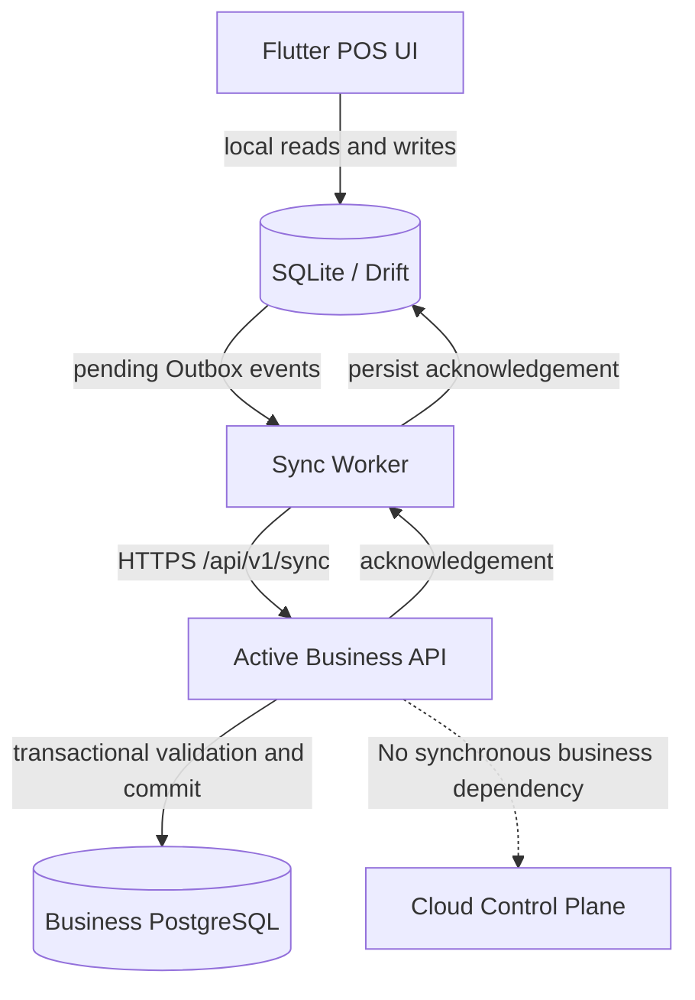
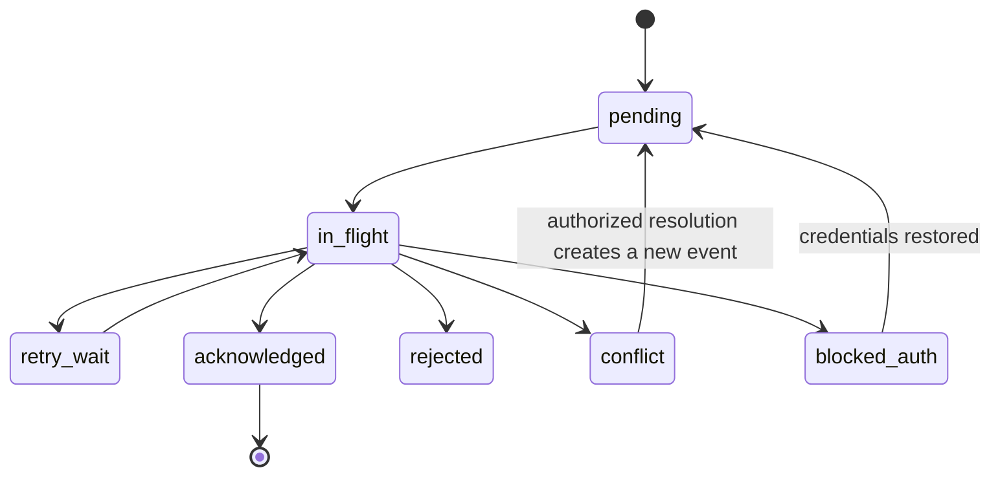

# POS Platform — Offline-First POS & Synchronization Specification

**Document ID:** POS-TECH-006  
**Version:** 1.0  
**Date:** 03 November 2026  
**Status:** Proposed — Engineering Baseline  
**Applies to:** Flutter Android POS, Business Data Plane API, Cloud SaaS, Private Server  
**Related documents:** `01-system-architecture.md`, `02-database-schema.md`, `03-api-specification.md`, `04-cloud-control-plane.md`, `05-private-server-deployment.md`

---

## 1. Purpose

This document defines the local persistence, offline sales, payment-state handling, synchronization protocol, conflict management, and recovery behavior of the Flutter POS application.

The design must work against either supported deployment:

- **Cloud SaaS:** the APK connects to the shared Cloud Business Data Plane. Its data is scoped to the authenticated Organization and assigned Store.
- **Private Server:** the APK connects to the customer's dedicated Business Data Plane. That deployment serves exactly one Organization and can contain multiple Stores.

The APK uses one implementation for both deployment models. Offline synchronization always targets the active deployment's Business API. It must not route orders, payments, inventory, or customer business records through the Cloud Control Plane.

## 2. Goals

1. Allow a cashier to continue permitted POS operations during temporary network outages.
2. Persist an accepted local sale and its Outbox event atomically.
3. Deliver pending events reliably when connectivity returns.
4. Prevent duplicate server-side orders, payments, and stock effects when requests are retried.
5. Distinguish local capture from server acceptance and external payment authorization.
6. Keep catalog and configuration caches consistent using opaque server-issued cursors.
7. Handle price, stock, device, and policy conflicts without silently discarding transactions.
8. Protect pending data when the app closes, the device restarts, or the network changes.
9. Keep a clear audit trail for local and server-side transaction state changes.
10. Define predictable behavior for device reassignment, app upgrades, and server endpoint changes.

## 3. Non-goals

This specification does not define:

- Card-terminal offline authorization. This is governed by the terminal and payment provider.
- A guarantee that every offline sale will be accepted by the server regardless of inventory, price, or license policy.
- Peer-to-peer synchronization between POS devices.
- Direct synchronization from a Private Server to the provider's Cloud database.
- A distributed global inventory reservation system.
- Arbitrary editing of a sale after it has been durably recorded locally.

## 4. Architecture and authority boundaries

### 4.1 Data flow

### 4.2 System of record

| Data | Authority while offline | Authority after server acceptance |
|---|---|---|
| Product/catalog | Last successfully synchronized snapshot | Business Data Plane |
| POS configuration | Last successfully synchronized configuration | Business Data Plane |
| Cart draft | Current device | Device until checkout or discard |
| Locally captured order | Device-local durable record, pending server decision | Business Data Plane after acceptance |
| Server order number | Not available | Business Data Plane |
| Cash tender locally recorded | Device record under offline policy | Business Data Plane after acceptance |
| Card/gateway authorization | Payment terminal/provider | Payment provider and server record |
| Inventory balance | Cached view only | Business Data Plane |
| Outbox delivery state | Device-local until acknowledgement | Device stores server acknowledgement |

A local order is not a server-confirmed order. The UI, receipt, reports, and sync indicators must not imply otherwise.

### 4.3 Cloud and Private Server independence

- The APK stores the active `server_url`, `deployment_id`, `organization_id`, `store_id`, and `device_id` in its local deployment binding.
- Business synchronization uses only the active deployment's `/api/v1` API.
- Private Server license/heartbeat communication is performed by the Private Server deployment agent, not by the cashier's sale request.
- A Cloud Control Plane outage must not block an already activated POS from creating local sales or synchronizing with an available Private Server.
- A Private Server outage makes its server API unavailable, but the APK can continue permitted local capture until its offline policy or local capacity limits require intervention.

---

## 5. Offline operation modes

The application must expose an understandable connection and synchronization state.

| Mode | Meaning | Permitted behavior |
|---|---|---|
| `online` | Business API reachable and authenticated | Normal online checkout and sync |
| `degraded` | API reachable intermittently or a dependency is impaired | Local-first capture; retry sync; display warning |
| `offline` | Business API unreachable | Permitted cached catalog sales and offline-safe payment recording |
| `syncing` | Outbox or catalog synchronization in progress | Sales remain available unless a specific operation needs fresh server state |
| `attention_required` | Permanent rejection, conflict, storage warning, or binding issue exists | Continue only operations allowed by policy; show actionable warning |
| `device_suspended` | Device explicitly suspended or credentials revoked | Do not create new sales; preserve existing local records for recovery |

Connection mode is not a substitute for payment state. A device may be online while a payment provider is unavailable, or offline while cash payments can still be locally recorded.

### 5.1 State calculation

- Network connectivity alone does not prove Business API reachability.
- The app should use a lightweight authenticated API health request with bounded timeout.
- A failed heartbeat must not immediately change an order or payment state.
- Maintain separate fields for network status, API reachability, authentication status, Outbox backlog, and last successful sync.

---

## 6. Local database design

Use SQLite through Drift or an equivalent typed persistence layer. Enable foreign keys and use explicit transactions. Database writes must be resilient to process termination and device restart.

### 6.1 Local tables

The logical local schema includes:

| Table | Purpose |
|---|---|
| `local_deployment` | Active server endpoint and deployment/Organization/Store/device binding |
| `local_device_config` | Cached device configuration and version |
| `cached_categories` | Category cache |
| `cached_products` | Product cache |
| `cached_product_variants` | Variant, SKU, price, unit and sellability cache |
| `cached_barcodes` | Barcode-to-variant lookup |
| `cached_payment_methods` | Enabled methods and offline behavior |
| `cached_tax_rules` | Relevant tax configuration snapshot, where applicable |
| `cart_drafts` | Recoverable open carts |
| `cart_draft_items` | Draft cart lines |
| `local_orders` | Local order snapshots and server synchronization state |
| `local_order_items` | Immutable local line snapshots |
| `local_payments` | Locally captured payment/tender records and authorization state |
| `outbox_events` | Durable pending event queue |
| `sync_cursors` | Opaque server-issued cursors by stream |
| `sync_conflicts` | Events requiring a human/business decision |
| `local_app_metadata` | Schema version and non-secret app metadata |
| `local_receipt_jobs` | Optional local print queue and print status |

Table names are logical identifiers. Final column definitions and indexes must be implemented as Drift migrations and reconciled with `02-database-schema.md`.

### 6.2 Local deployment binding

Recommended fields:

| Field | Description |
|---|---|
| `deployment_id` | Stable server deployment ID |
| `server_url` | Validated HTTPS Business API base URL |
| `organization_id` | Active Organization binding |
| `store_id` | Assigned Store |
| `device_id` | Registered POS Device |
| `activated_at` | Activation timestamp |
| `config_version` | Last applied configuration version |
| `binding_status` | Active, suspended, recovery_required |

Credentials must not be stored as ordinary SQLite text. Use Android Keystore-backed secure storage. The local database may store a non-secret credential reference or key alias.

Changing the endpoint, deployment, Organization, or device identity is a controlled reactivation workflow. Never silently attach old Outbox events to a different deployment.

### 6.3 Money and numeric precision

- Do not use binary floating-point for currency arithmetic.
- Store money as integer minor units where the currency's minor-unit rules are supported, or as exact decimal strings/SQLite integer-scaled values with a documented scale.
- Store `currency_code` on each order and payment snapshot.
- Store quantities in a fixed, documented decimal scale.
- Use the same rounding policy as the Business Data Plane.
- Preserve submitted and calculated totals separately where audit requirements demand it.

### 6.4 Local database integrity

- Enable SQLite foreign-key enforcement.
- Use parameterized queries.
- Run schema migrations transactionally where supported.
- Do not clear the database as an automatic error-recovery action.
- Do not use destructive schema migration when pending Outbox events exist unless a verified export/recovery procedure has been completed.
- Keep the local database on app-private storage.
- Apply Android backup policy deliberately; device credentials must never be copied into an unprotected backup.

---

## 7. Transactional Outbox

### 7.1 Core rule

The order, order lines, local payment entries, and Outbox event must be committed in a single SQLite transaction. The app must not show the sale as locally accepted until that transaction commits successfully.

### 7.2 Checkout sequence

1. Validate the cart against cached product, price, discount, tax, and payment configuration.
2. Re-check that the device is allowed to create sales under its last known authorization and offline policy.
3. Generate a globally unique `client_order_id` (UUID/ULID).
4. Generate a stable event ID and idempotency key.
5. Create immutable line snapshots: product, variant, SKU, name, unit, quantity, unit price, discount, tax, and currency.
6. Create local payment/tender records with accurate local/authorization states.
7. Create one `order.create` Outbox event containing the order and its dependent line/payment snapshot.
8. Persist order, items, payments, and event atomically.
9. Commit.
10. Display the local receipt/status and enqueue background synchronization.

### 7.3 Why one order event

An order, its lines, and its locally captured tenders form one business aggregate. They should not be sent as independent events that could result in an order without its items or duplicate payment effects. If later business requirements require separate payment capture, refund, or cash-session events, those should be separate explicit event types with their own idempotency keys and transition rules.

### 7.4 Suggested Outbox fields

| Field | Type / meaning |
|---|---|
| `id` | UUID event ID |
| `event_type` | For example `order.create` |
| `aggregate_type` | For example `order` |
| `aggregate_id` | Stable client-generated order ID |
| `idempotency_key` | Stable unique request key |
| `payload_json` | Versioned immutable payload |
| `payload_version` | Event schema version |
| `created_at` | Local UTC timestamp |
| `attempt_count` | Number of delivery attempts |
| `next_attempt_at` | Earliest next attempt |
| `last_error_code` | Last stable error code |
| `delivery_state` | pending, in_flight, acknowledged, rejected, conflict |
| `acknowledged_at` | Durable acknowledgement timestamp |
| `server_resource_id` | Server-assigned resource ID, if accepted |
| `server_reference` | Server order/reference number, if accepted |

The payload is immutable once created. A correction must be represented by a new authorized business action, not by mutating an event that may already have reached the server.

### 7.5 Local acceptance semantics

A locally committed sale may be labelled `Saved on this device` or `Pending sync`. It must not be labelled `Synced`, `Server confirmed`, or `Payment authorized` until those states are true.

The APK may print a provisional receipt using a device-local reference. It must not invent a server-issued order number. The receipt should show an offline/pending marker and a unique local reference that can be reconciled later.

---

## 8. Outbox state machine

### 8.1 Event states

| State | Meaning | Next action |
|---|---|---|
| `pending` | Ready for delivery | Attempt when API is reachable |
| `in_flight` | A request is currently being sent | Wait for result or recover after timeout |
| `acknowledged` | Server result durably saved locally | No further delivery |
| `retry_wait` | Temporary failure | Retry after backoff |
| `rejected` | Permanent validation/policy rejection | Show reason; do not auto-delete |
| `conflict` | Requires business reconciliation | Hold and expose conflict workflow |
| `blocked_auth` | Credentials or device binding require attention | Refresh or reactivation workflow |

### 8.2 State transitions

Do not change a rejected/conflicted event back to pending by editing its payload. A correction must create a new event or a separate authorized adjustment operation.

### 8.3 Lease and process recovery

- `in_flight` must have a lease/timeout so a process crash cannot strand an event permanently.
- At startup, expired `in_flight` events return to `pending` or `retry_wait` with the same identifiers and payload.
- Multiple app workers must not send the same event concurrently. Use a local database lease or a single sync coordinator.
- A request timeout has an unknown outcome: retry with the same event ID and idempotency key. The server's idempotent result resolves whether the first attempt committed.

---

## 9. Delivery semantics and idempotency

### 9.1 At-least-once delivery

The client provides at-least-once delivery. It may send the same event more than once due to timeout, app restart, network reset, or lost acknowledgement.

The Business Data Plane must make the effect idempotent. Do not claim exactly-once network delivery.

### 9.2 Stable identifiers

Generate and persist before first transmission:

- `event_id`
- `client_order_id`
- `idempotency_key`
- Local line and tender IDs

Use the same identifiers for all retries. Never generate a new key after a timeout.

### 9.3 Server processing algorithm

Within a database transaction, the server must:

1. Authenticate the device and establish Organization/Store context.
2. Validate the device's status and permitted actions.
3. Validate event type and payload version.
4. Canonicalize the payload and compute its request hash.
5. Atomically claim the idempotency key within the correct Organization and scope.
6. If the key already exists with the same hash, return the stored result.
7. If the key exists with a different hash, return `409 IDEMPOTENCY_KEY_REUSED`.
8. Validate product, price, tax, discount, payment and inventory policy.
9. Create the order, line snapshots, payment records, stock movements, cash effects, and audit records according to business rules.
10. Persist the event outcome and response snapshot.
11. Commit.
12. Return the durable result.

The idempotency record and business transaction must commit atomically. A retry must never apply stock or cash effects twice.

### 9.4 Request hash

The canonical request hash must be calculated over a deterministic representation of the semantically relevant payload. Exclude transport-only fields such as retry count. Include fields that change the business meaning, such as Store, currency, item quantities, item prices, discounts, tax, tender amount, payment method, and event type/version.

---

## 10. Synchronization protocol

The protocol has two directions:

- **Pull:** server catalog, configuration, and payment-method changes to the POS.
- **Push:** device Outbox events to the Business Data Plane.

The device must not assume that wall-clock timestamps are globally reliable. Use opaque server-issued cursors and stable event IDs.

### 10.1 API endpoints

| Method | Endpoint | Purpose |
|---|---|---|
| `GET` | `/api/v1/sync/catalog` | Pull product/category/variant/barcode changes |
| `GET` | `/api/v1/sync/config` | Pull device/store configuration |
| `GET` | `/api/v1/sync/payment-methods` | Pull payment methods and offline policy |
| `POST` | `/api/v1/sync/push` | Push a bounded Outbox batch |
| `GET` | `/api/v1/sync/status` | Read device-specific sync state |

All endpoints require a valid device credential and derive Organization and Store scope from the authenticated device record.

### 10.2 Pull cursor rules

- Cursor is opaque and server-issued.
- Cursor is bound to the device, Organization, stream, and compatible filters.
- Client must not decode, create, increment, or compare cursors.
- Each page must be applied in a local SQLite transaction.
- Save the returned `next_cursor` in the same transaction as the page changes.
- If local apply fails, roll back both data changes and cursor update.
- If a cursor expires, server returns `409 SYNC_CURSOR_EXPIRED`; client performs a full refresh using a staging strategy.
- Use tombstones for deactivated records so stale cached products and configuration are not retained indefinitely.

### 10.3 Atomic page application

Recommended algorithm:

1. Fetch one page using the current cursor.
2. Validate the response schema and version.
3. Begin a SQLite transaction.
4. Apply all upsert and tombstone changes.
5. Save the returned next cursor.
6. Commit.
7. Request the next page only after commit.

Do not advance the cursor before applying the page. Doing so can permanently skip changes after a crash.

### 10.4 Push batch rules

Initial limits (tune through testing):
- Maximum 50 events per batch.
- Maximum 1 MiB serialized request body.
- Maximum event payload size should be documented separately.
- Every submitted event must receive an individual result.
- Process events independently unless a future API explicitly defines atomic batch semantics.

Per-event statuses:

| Result | Meaning | Client behavior |
|---|---|---|
| `accepted` | Server committed the event or replayed its prior committed result | Persist acknowledgement locally |
| `retry` | Temporary server/dependency failure | Retry same event and key |
| `rejected` | Permanent validation or policy failure | Keep record and show reason |
| `conflict` | Human/business resolution required | Keep record and open conflict workflow |

A failure for one event must not conceal the outcome of other events in the batch.

### 10.5 Event ordering

- Preserve FIFO ordering for events from the same device where one event depends on another.
- An order aggregate is sent as one `order.create` event.
- Do not parallelize dependent events for the same aggregate.
- Independent orders may be processed in parallel only if server-side inventory/cash/order-number constraints are transactionally safe.
- Initial implementation should use a single ordered event sender per device for simpler correctness.

---

## 11. Catalog and configuration caching

### 11.1 Catalog data

Cache only the data needed for permitted POS sales:
- Active categories.
- Sellable products and variants.
- Barcode mapping.
- Store-specific prices.
- Unit and quantity precision.
- Relevant tax configuration snapshot.
- Image references or bounded image cache, if required.

### 11.2 Configuration data

Cache:
- Device/Store binding.
- Receipt settings.
- Allowed payment methods.
- Offline payment policy.
- Discount/price override permissions for the device role.
- Inventory offline policy and warning thresholds.
- Currency and rounding rules.
- Minimum supported APK version.
- Configuration version.

### 11.3 Staleness indicators

Show when cached data is stale. The policy may set an acceptable maximum offline age for prices, tax configuration, or payment settings.

A stale cache does not automatically authorize every sale. Each Organization's offline policy controls the permitted behavior.

### 11.4 Full refresh

When cursor expiry or schema incompatibility requires a full refresh:

1. Continue protecting pending orders and Outbox events.
2. Download catalog/configuration into staging tables or a versioned cache set.
3. Validate required datasets and versions.
4. Atomically switch the active cache version.
5. Store the new cursor.
6. Retain the previous cache until the new cache is verified.

Never clear local orders, payments, or Outbox to refresh the catalog.

---

## 12. Price, discount, tax, and product snapshots

### 12.1 Immutable sale snapshot

Each local order line must preserve:
- Product ID and variant ID, where known.
- Product code/SKU/barcode used at checkout.
- Display name and variant label at checkout.
- Unit name.
- Quantity and quantity precision.
- Unit price and currency.
- Discount amount and discount reason/code, when applicable.
- Tax rate/rule identifier and calculated tax snapshot, where applicable.
- Line subtotal and total.
- Cached catalog/config version used.

The server creates its own authoritative order-line snapshot after acceptance.

### 12.2 Price validation on sync

The server must never blindly trust client-submitted prices. Apply the Organization's configured policy, for example:

- **Strict current-price policy:** reject an offline order whose price no longer matches the server's current price.
- **Cached-price grace policy:** accept the cached price when the cache age/version is within a configured tolerance.
- **Authorized override policy:** accept a price override only when the device/user's previously issued permission and policy allow it; audit the override.

The selected policy must be explicit and must not be inferred from a generic `offline` flag.

### 12.3 Deactivated products

If a product or variant was deactivated after the device's last sync, apply the configured offline policy. Possible outcomes:
- Reject and create a conflict.
- Accept with an audit warning if the policy permits grandfathering of the cached sale.

Do not silently substitute a different product or price.

---

## 13. Inventory synchronization and conflicts

### 13.1 Stock is server-authoritative

The cached stock value is an estimate for cashier guidance. The Business Data Plane inventory ledger and stock movements are authoritative after synchronization.

### 13.2 Offline policies

Configure per Organization, and optionally by Store/product category where justified:

| Policy | Behavior |
|---|---|
| `reject_if_insufficient` | Reject event if server stock cannot satisfy sale |
| `allow_negative_stock` | Accept sale and permit negative stock according to business rules |
| `accept_pending_review` | Record an explicit pending-review/exception outcome for authorized review |

The initial product release should implement only the policies actually exposed in Organization Web. Avoid hidden fallback behavior.

### 13.3 Concurrent device sales

Two or more POS Devices may sell the same last unit while offline. No local algorithm can guarantee global stock exclusivity without an online reservation or preallocated stock allowance.

The platform must:
- Document that limitation to the Organization.
- Apply the configured server-side policy on sync.
- Record every accepted/rejected stock effect.
- Expose conflicts to authorized users.
- Never overwrite a stock balance using a device's stale cached value.

### 13.4 Conflict resolution

A conflict record should include:
- Event and order ID.
- Device and Store.
- Server result code.
- Relevant product/quantity or policy detail.
- Local transaction timestamp and server receipt timestamp.
- Available resolution actions and required permission.
- Resolution actor, timestamp, and resulting adjustment/order action.

Do not mutate the original Outbox payload to resolve a conflict. Resolution must create a separately auditable action, such as an approved stock adjustment or a new correction transaction.

---

## 14. Payment-state semantics

Offline order capture and external payment authorization are different facts. The application must show them separately.

### 14.1 Payment states

| State | Meaning |
|---|---|
| `recorded_locally` | Cashier/device recorded the tender locally; not yet server-accepted |
| `pending_sync` | Tender is waiting for order/event synchronization |
| `pending_authorization` | External provider authorization has been initiated but not confirmed |
| `authorized` | Provider authorization is confirmed |
| `captured` | Provider capture is confirmed, where applicable |
| `failed` | Provider or server reports failure |
| `cancelled` | Payment was explicitly cancelled/voided under provider rules |
| `partially_refunded` | Some amount has been refunded |
| `refunded` | Full refundable amount has been refunded |

The exact set of persisted payment states must match the Business Database schema. UI-only states such as `pending_sync` may be derived from the Outbox state rather than introducing a contradictory payment state in the server database.

### 14.2 Method policy

| Method | Offline recording | Important rule |
|---|---|---|
| Cash | Usually allowed by policy | Local recording is not server acknowledgement |
| Bank transfer | Policy-controlled | Do not assume a transfer occurred without verification |
| Card terminal | Depends on terminal/provider | Only terminal/provider confirmation establishes authorization |
| Online gateway | Normally not available offline | Require a confirmed provider response |
| Store credit/gift balance | Normally requires online validation unless a controlled offline allowance exists | Prevent overspending across devices |

### 14.3 Cash handling

A cash tender may be recorded locally if the Organization enables offline cash sales. The cash drawer/session rules must also be cached and valid for the device's current session. If a cash session is required but not available, follow the configured policy rather than fabricating one.

### 14.4 Card terminals and external devices

Never store card PAN, CVV, PIN, magnetic-stripe data, or raw payment credentials in SQLite or Outbox payloads. Store only safe provider/terminal references and outcome metadata. Terminal offline behavior must be certified and configured independently.

### 14.5 Unknown payment outcome

If the terminal/provider times out after a request, the outcome is unknown. Query the provider using its reference/idempotency capability before retrying a charge. Do not create a second charge simply because the POS did not receive the first response.

---

## 15. Receipt and cashier UX

### 15.1 Local receipt

A receipt printed before server acknowledgement must:
- Use a clearly identified local reference.
- Display `Pending synchronization` or an equivalent localized label.
- Avoid fabricating an official server order number.
- Not state that a card/gateway payment was authorized unless confirmed.
- Include the Store identity and local sale time according to the cached receipt template.

### 15.2 Status indicators

The POS should make these states distinguishable without interrupting normal checkout:
- Online / Offline / Degraded.
- Pending sync count.
- Last successful sync time.
- Rejected events needing attention.
- Conflicts needing manager action.
- Stale catalog/configuration warning.
- Device suspended/revoked state.

### 15.3 Cashier actions

Cashier may:
- View the current connection state.
- View recent local orders and their sync state.
- Retry safe pending events.
- Reprint a receipt.

Only authorized manager/admin roles may:
- Review and resolve business conflicts.
- Void/correct a server-accepted order through normal business APIs.
- Perform manual data recovery or device reassignment.

Cashiers must not edit an immutable pending order payload after checkout.

---

## 16. Retry strategy and network handling

### 16.1 Retry classification

| Failure | Classification | Action |
|---|---|---|
| DNS/network timeout | Temporary | Retry same event |
| Connection reset | Temporary / unknown outcome | Retry same event/key |
| HTTP 408 | Temporary | Retry with backoff |
| HTTP 429 | Temporary | Respect `Retry-After` |
| HTTP 5xx | Temporary | Retry with backoff and jitter |
| HTTP 401 | Authentication | Attempt token refresh once; then block pending sync for reauthentication |
| HTTP 403 | Authorization/device state | Stop automatic retries; show device/policy issue |
| `409 IDEMPOTENCY_KEY_REUSED` | Permanent data integrity issue | Quarantine event and raise diagnostic alert |
| `409 SYNC_CURSOR_EXPIRED` | Recoverable pull issue | Full cache refresh |
| Product/price/stock policy conflict | Business conflict | Hold for review or apply explicit policy |
| Unsupported payload version | Compatibility issue | Stop event and require compatible APK/server release |

### 16.2 Exponential backoff

Use exponential backoff with jitter. Suggested initial schedule:

- Immediate attempt after checkout when online.
- 2 seconds.
- 5 seconds.
- 15 seconds.
- 30 seconds.
- 1 minute.
- 2 minutes.
- 5 minutes.
- Maximum 15 minutes while the app is active.

The schedule is a starting point and should be tuned through field testing. Respect server-provided retry hints. Reset backoff after a successful delivery or a meaningful connectivity/authentication state change.

### 16.3 Worker scheduling

- Use a single sync coordinator per app installation.
- Use Android WorkManager or an equivalent OS-supported background execution mechanism for deferred work.
- Do not assume background execution is immediate or guaranteed by Android.
- Trigger sync on app start, app resume, checkout completion, network recovery, and scheduled work when permitted.
- Apply bounded request timeouts and bounded batch sizes.

---

## 17. Time, ordering, and identifiers

### 17.1 Time fields

Persist:
- `client_occurred_at`: device-reported time with timezone offset where available.
- `client_recorded_at`: local persistence time.
- `server_received_at`: server receipt time.
- `server_committed_at`: server commit time.

Server timestamps are authoritative for server ordering and reporting. Client timestamps are retained for audit and cashier context, not trusted as secure time.

### 17.2 Clock skew

- Detect large device/server clock differences.
- Display a warning if the device clock is materially wrong.
- Do not reject a valid offline event only because its local timestamp is slightly skewed.
- Apply policy for extreme future/past timestamps and record the reason.
- Never use client timestamps as the sole synchronization cursor.

### 17.3 Local references

Generate a collision-resistant local reference using a device identifier plus a locally monotonic sequence or UUID. Official order numbers remain server-assigned. The local reference must be searchable during reconciliation.

---

## 18. Device storage limits and data retention

Offline operation is limited by device storage and the size of cached data/transactions.

The app must:
- Monitor available storage.
- Warn at configurable thresholds.
- Avoid caching unnecessary image sizes or full historical records.
- Retain unacknowledged Outbox events until safely resolved.
- Provide an authorized export/recovery procedure for stuck events.
- Never silently delete pending sales to free space.
- Archive or compact only acknowledged records according to a documented retention policy.

If storage becomes critically low, block new offline sales before risking corruption or loss of previously accepted local orders. The threshold must be configurable and tested on the target hardware.

---

## 19. Application upgrade and local database migration

### 19.1 Upgrade principles

- Version the SQLite schema.
- Apply deterministic local migrations.
- Preserve Outbox payload bytes and identifiers where possible.
- Keep backward/forward compatibility rules explicit for event payload versions.
- Do not delete pending events during migration.
- Test upgrades from every supported app version path.

### 19.2 Unsupported event payload

If a newer APK emits an event version unsupported by the server:
- Server returns a stable compatibility error.
- Client retains the event.
- Client must not downgrade or rewrite an immutable payload in place.
- Release compatibility policy determines whether the APK can continue new offline sales or must stop and prompt for update.

### 19.3 Uninstall and reinstall

Uninstall can remove local data depending on Android behavior and device management policy. Do not claim pending orders can always be recovered after uninstall. Provide enterprise device-management/backup guidance and an authorized data-export procedure where supported.

---

## 20. Device reassignment and endpoint changes

### 20.1 Store reassignment

Organization Web initiates reassignment. Before the server accepts the new Store binding:
1. Device is marked `reassignment_pending`.
2. Device is asked to synchronize pending events.
3. Server verifies that no unresolved pending events remain, or records an administrator-approved disposition.
4. The server updates the Store assignment.
5. The APK receives the new binding and configuration.
6. Cached Store-scoped data is refreshed.

### 20.2 Deployment/server change

Moving from one server endpoint to another is not a normal Store reassignment. It requires an explicit migration/reactivation workflow.

- Pending Outbox events must be synchronized to their original server or handled through an authorized recovery/export process.
- Existing local data must not be pushed to a different Organization/deployment by default.
- Device tokens from the old deployment must be invalidated/revoked according to the migration plan.
- The new server issues new device credentials.

---

## 21. Security and privacy

- All production synchronization uses HTTPS.
- Device credentials are stored in Android Keystore-backed storage.
- Device API scope is limited to its assigned Organization and Store.
- The client does not get to choose `organization_id` or `device_id` as an authorization claim.
- Local SQLite data is stored in app-private storage; sensitive data is minimized.
- Do not store raw payment credentials, PAN, CVV, PIN, or magnetic stripe data.
- Do not log full payment payloads, tokens, or personal data.
- Outbox events contain only the business fields necessary to reproduce the operation.
- Server validates all payloads and ignores client-supplied authority claims.
- A rooted/compromised Android device is outside the guarantee of local storage integrity; use device management and server-side validation for risk reduction.

---

## 22. Observability and diagnostics

### 22.1 Client metrics

- Current connectivity/API state.
- Pending event count and age of oldest event.
- Sync success/failure count.
- Retry count by error class.
- Catalog/config cursor age.
- SQLite available storage.
- Local database schema version.
- Last successful push/pull time.
- Conflict/rejection count.

### 22.2 Server metrics

- Events received/accepted/rejected/conflicted/retried.
- Duplicate idempotency hits.
- Idempotency hash mismatch count.
- Average/percentile sync latency.
- Batch size and request size.
- Device sync lag.
- Stock/price conflict counts.
- Per-deployment sync health for Private Server; per-tenant/device health in Cloud.

### 22.3 Correlation identifiers

Each event/request should include or generate:
- `request_id`
- `batch_id`
- `event_id`
- `client_order_id`
- `idempotency_key`
- `device_id` (server-derived authority)

Use these identifiers to trace a sale from local checkout through server acceptance. Redact secrets and sensitive payment data.

---

## 23. Failure scenarios and expected behavior

| Scenario | Required behavior |
|---|---|
| Network drops before request | Event stays pending; retry later |
| Server commits but response is lost | Retry same key; server replays stored outcome |
| App crashes after local commit | Recover Outbox on next launch |
| App crashes before local commit | No accepted local sale is shown |
| App crashes after response before local ack write | Retry same key; recover the same server outcome |
| Catalog cursor expires | Full catalog refresh without deleting pending orders |
| Device token expires | Refresh once; otherwise show blocked-auth state |
| Device is suspended | Stop new sales according to policy; retain local events for authorized recovery |
| Control Plane unavailable | Business API synchronization continues if the active Business Server is available and valid cached entitlement permits operation |
| Private Business Server unavailable | Local capture continues within offline policy; retry when available |
| Price changed while device offline | Apply configured price conflict/grace policy |
| Stock depleted by another POS | Apply configured inventory conflict policy |
| Outbox storage near capacity | Warn; at critical threshold stop new offline acceptance safely |
| Endpoint changed with pending events | Block silent switch; require sync or explicit recovery workflow |
| Printer fails after checkout | Sale remains recorded; expose print retry, never create a second sale |

---

## 24. Test strategy

### 24.1 Unit tests

- Local order calculation and rounding.
- Immutable snapshot construction.
- Outbox event creation.
- Idempotency key stability.
- Backoff calculation and jitter bounds.
- State transition validation.
- Payment status derivation.
- Cursor persistence logic.
- SQLite migration with pending events.

### 24.2 Integration tests

- Local order and Outbox commit atomically.
- Rollback leaves neither a partial sale nor an orphan event.
- Same event retried returns same server result.
- Same key with changed payload returns conflict.
- Partial batch results are handled per event.
- Catalog page and cursor update commit atomically.
- Device cannot push to another Store/Organization.
- Private Server sync works when Cloud Control Plane is unavailable.
- Cloud SaaS and Private Server return compatible business API contracts.

### 24.3 Fault-injection tests

Test at least:
- Network loss before request reaches server.
- Network loss after server commit.
- App process killed during local transaction.
- App process killed during sync response handling.
- Device reboot while events are in flight.
- Server restart while receiving a batch.
- PostgreSQL failover/restart during transaction.
- Expired access and refresh tokens.
- Expired cursor.
- Full local storage.
- Local database migration with pending Outbox events.
- Long offline period followed by a large backlog.
- Multiple POS Devices selling the same final stock unit offline.

### 24.4 Acceptance criteria

The release is not ready until:

1. A cashier can complete a permitted offline cash sale and the order is durable before the UI confirms local acceptance.
2. Every local order and its Outbox event are committed atomically.
3. A device restart does not lose pending events.
4. Repeated delivery does not duplicate orders, payments, stock movements, or cash effects.
5. Server acknowledgement is stored locally before the event is considered complete.
6. Server-issued order numbers are not fabricated offline.
7. External payment authorization is never inferred from local persistence.
8. Catalog cursor is advanced only with a committed local page application.
9. Cursor expiry triggers safe full refresh while preserving local transactions.
10. Stock and price conflicts are visible, auditable, and follow Organization policy.
11. Cloud Control Plane outages do not synchronously block Business API sales or synchronization.
12. Endpoint reassignment cannot silently transfer pending data to a different deployment.
13. Storage exhaustion does not silently delete accepted local sales.
14. Cloud SaaS and Private Server pass the same POS synchronization contract tests.

---

## 25. Implementation sequence

### Phase 1 — Local persistence foundation

- Drift schema and migration strategy.
- Deployment binding and secure credential storage.
- Product/config cache.
- Cart draft persistence.
- Local order, line, payment, and Outbox atomic write.

### Phase 2 — Online POS and catalog pull

- Device activation and bootstrap.
- Catalog/config/payment method pull.
- Cursor storage and full refresh.
- Online order API integration.

### Phase 3 — Offline capture and Outbox push

- Offline checkout rules.
- Durable queue and leases.
- Retry policy.
- Per-event result handling.
- Idempotent server persistence.

### Phase 4 — Conflict and operational workflows

- Price and stock conflict presentation.
- Manager resolution actions.
- Device reassignment protection.
- Queue/storage diagnostics.

### Phase 5 — Hardening

- Fault injection.
- Long-offline backlog tests.
- App upgrade/migration tests.
- Hardware printer/scanner testing.
- Security and tenant isolation testing.

---

## 26. Open decisions before production

The following must be configured or confirmed with the target business and hardware; they must not be silently assumed:

1. Maximum supported offline duration.
2. Maximum allowable catalog/configuration age.
3. Price grace policy and permitted offline overrides.
4. Inventory policy for offline sales.
5. Whether a cash session must be open to sell offline.
6. Which payment methods permit offline recording.
7. Supported card terminals and their offline authorization behavior.
8. Maximum local Outbox size and warning/stop thresholds.
9. Receipt format for a locally accepted but not server-accepted sale.
10. Retention and authorized recovery process for long-pending/rejected events.
11. Supported Android versions and background scheduling behavior.
12. Whether a future release requires multi-device stock quotas or server-side reservations.

---

## 27. Final design statement

The Flutter POS application uses a local SQLite database and transactional Outbox to capture sales reliably during temporary connectivity loss. The synchronization protocol provides at-least-once delivery and relies on server-side idempotency for duplicate-effect prevention.

Cloud SaaS and Private Server expose the same Business API contract. Private Server business data remains on its dedicated server; the Cloud Control Plane is not in the sale synchronization path.

A local sale, server-accepted order, cash tender record, and external payment authorization are separate states. The application must present those states accurately and preserve unresolved transactions until they are acknowledged or explicitly reconciled.

This document is the implementation baseline for POS offline persistence and synchronization. Detailed column-level definitions remain governed by `02-database-schema.md`, while route-level request/response contracts remain governed by `03-api-specification.md`.
