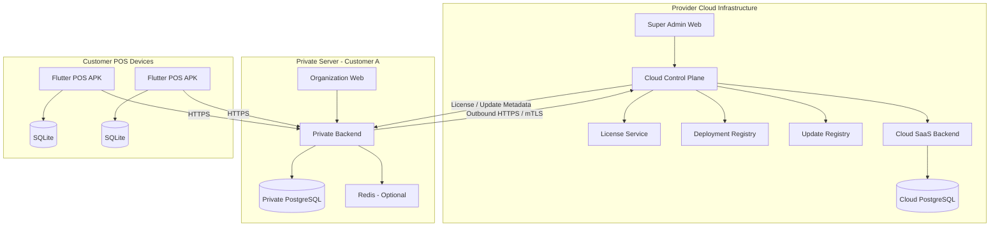

# POS Platform
## Architecture Decision Records & Technical Specification

**Version:** 1.0  
**Date:** 03 November 2026  
**Status:** Proposed – Architecture Baseline  
**Product Model:** Hybrid Cloud SaaS + Private Server  
**Primary Stack:** FastAPI · Next.js · Flutter · PostgreSQL · SQLite · Docker

---

# PART I — PRODUCT VISION & ARCHITECTURE OVERVIEW

## 1. Product Vision

Build a commercial Point of Sale (POS) platform that supports two deployment models using one shared product codebase.

### 1.1 Cloud SaaS

- Hosted and operated by the platform provider.
- Supports multiple Organizations.
- Organizations share the cloud infrastructure but their business data must be logically isolated.
- Platform Super Admin manages subscriptions, Organizations, plans, and platform operations.
- Organizations manage their own stores, employees, products, inventory, and sales.

### 1.2 Private Server

Private Server supports two commercial delivery options:

**Option A – Customer-owned infrastructure**
- Customer provides a physical server, VPS, or cloud instance.
- Platform provider installs and maintains the software.
- Customer owns and controls the underlying infrastructure.

**Option B – Provider-managed dedicated infrastructure**
- Platform provider supplies a dedicated server or VPS.
- Each customer receives an isolated deployment.
- Infrastructure, software maintenance, and support can be included in the commercial agreement.

Both options use the same Private Server software package.

### 1.3 Private Server tenancy

One Private Server deployment serves exactly one Organization.

- One deployment = One Organization.
- One Organization may have multiple Stores.
- Each Store may have multiple POS Devices.
- A deployment cannot create or manage additional Organizations.
- The same application code is used for Cloud and Private Server.

### 1.4 Core principles

1. One shared codebase.
2. One Flutter POS APK.
3. Cloud SaaS uses multi-tenancy.
4. Private Server uses single-tenancy.
5. Private Server must register with and connect to Cloud Control Plane.
6. Business transactions remain local to the selected deployment.
7. POS supports offline-first operation.
8. License and subscription management are separated from business logic.
9. All deployments follow versioned database migrations.
10. Security and tenant isolation are architectural requirements, not optional features.

---

# PART II — SYSTEM ARCHITECTURE

## 2. High-Level Architecture

The platform is divided into two major planes.

### 2.1 Cloud Control Plane

Operated by the platform provider.

Responsibilities:

- Platform Super Admin.
- Cloud Organization management.
- Subscription and billing management.
- Private Server registration.
- Private Server license issuance.
- Deployment health monitoring.
- Version and update distribution.
- Optional operational telemetry.
- Customer support and deployment management.

### 2.2 Business Data Plane

Runs the actual POS business application.

Responsibilities:

- Organization administration.
- Store and employee management.
- Product catalog.
- Inventory.
- Sales orders.
- Payments.
- Refunds.
- POS devices.
- Offline synchronization.
- Business reports.

Deployment types:

- Shared Cloud Data Plane.
- Dedicated Private Server Data Plane.

**Important:** Private Server communicates with Cloud Control Plane through outbound authenticated connections. Cloud Control Plane must not be required for every sale, payment recording, inventory operation, or receipt printing.

## 3. Architecture Diagram



Cloud SaaS Organizations connect directly to Cloud SaaS Backend.

Private Server Organizations connect to their own dedicated backend.

The Flutter APK selects its backend endpoint during device activation.

---

# PART III — ARCHITECTURE DECISION RECORDS

## ADR-001: Shared Product Codebase

**Status:** Accepted

### Context
The product must support Cloud SaaS and Private Server without maintaining two independent applications.

### Decision
Maintain a shared source codebase and shared business logic.

Deployment-specific behavior is controlled through configuration and explicit deployment profiles.

### Consequences
- One set of business rules.
- One API contract.
- One migration history.
- Reduced maintenance cost.
- Cloud and Private Server require separate deployment configuration and integration testing.

---

## ADR-002: Hybrid Deployment Model

**Status:** Accepted

### Context
Different customers have different infrastructure and data ownership requirements.

### Decision
Support:
- Shared Cloud SaaS.
- Customer-owned Private Server.
- Provider-managed dedicated Private Server.

All deployment types use the same product release.

### Consequences
- Additional deployment and release management complexity.
- Private Server installation must be automated.
- Software versions must remain compatible with supported migrations.

---

## ADR-003: Multi-tenant Cloud, Single-tenant Private Server

**Status:** Accepted

### Context
Cloud customers share infrastructure. Private Server customers require isolated environments.

### Decision

Cloud:
- Multiple Organizations in a shared application/database environment.
- Business records are scoped by `organization_id`.

Private Server:
- Exactly one Organization per deployment.
- Business records still retain `organization_id`.
- Organization ID is fixed during installation.
- No Organization creation or switching through Private Server UI.

### Consequences
A single database schema can be reused across deployment types.

---

## ADR-004: Mandatory Cloud Control Plane Connection

**Status:** Accepted

### Context
The provider must manage Private Server licenses, subscriptions, deployments, supported versions, and customer support.

### Decision
Every Private Server must register with Cloud Control Plane.

Mandatory communication includes:
- Initial deployment registration.
- License activation and renewal.
- Periodic license validation.
- Deployment heartbeat.
- Version compatibility checks.
- Security and update metadata retrieval.

Optional communication includes:
- Aggregated operational metrics.
- Diagnostic logs.
- Support bundles.
- Deployment usage summaries.

### Connectivity rules

Private Server uses outbound HTTPS connections. Mutual TLS (mTLS) is recommended for deployment authentication.

Cloud Control Plane must not require direct inbound access to customer infrastructure.

### Failure behavior

If Cloud connectivity is unavailable:
- Local authentication continues.
- POS sales continue.
- Local database remains operational.
- Inventory operations continue according to local business rules.
- Existing device tokens remain valid until their configured expiry.
- License validation uses a locally cached signed entitlement.
- Cloud-dependent administration and updates become temporarily unavailable.

A configurable grace period is applied to temporary Cloud connectivity failures.

A suggested initial policy is:
- Heartbeat interval: 5 minutes.
- License refresh attempt: every 6 hours.
- Cached license validity: 7 days after the last successful validation.
- Warning after 24 hours without Cloud connectivity.
- Escalated warning after 72 hours.
- Grace-period expiration: block new administrative provisioning and new device activation; do not delete data or interrupt an active transaction.

Final commercial grace periods must be configurable by license policy.

### Consequences
The provider retains deployment visibility and license control without making Cloud availability a dependency for every business transaction.

---

## ADR-005: Dedicated Database per Private Server

**Status:** Accepted

### Context
Private Server customers require strong infrastructure and data isolation.

### Decision
Every Private Server deployment owns its PostgreSQL instance or dedicated PostgreSQL database.

No business transaction data is automatically synchronized to provider Cloud.

### Consequences
- Better data isolation.
- Easier backup and restoration per customer.
- Independent database maintenance.
- Additional database provisioning and upgrade operations.

---

## ADR-006: PostgreSQL as Primary Database

**Status:** Accepted

### Decision
Use PostgreSQL for all server deployments.

Cloud may use a managed PostgreSQL service or PostgreSQL cluster.

Private Server uses PostgreSQL deployed through Docker or an approved external database installation.

Use:
- UUID primary keys.
- Foreign keys.
- Database indexes.
- Transactions.
- Database migrations.
- Appropriate row-level security for Cloud multi-tenancy.

---

## ADR-007: Flutter as the Shared POS Application

**Status:** Accepted

### Decision
Build one Flutter Android application for all customers.

The APK must support:
- Cloud endpoint.
- Private Server endpoint.
- Device activation.
- Store assignment.
- Secure credential storage.
- Offline transactions.
- Local receipt printing.
- Barcode scanning.

The APK must not contain Organization administration or branch management features.

---

## ADR-008: Offline-first POS

**Status:** Accepted

### Decision
Use SQLite locally with a transactional Outbox pattern.

A sale is first committed locally, then synchronized with the server.

The local transaction and Outbox event must be written atomically.

Each transaction receives a unique UUID and idempotency key.

The backend must prevent duplicate order creation when requests are retried.

### Consequences
- Sales can continue without Internet.
- Synchronization becomes more complex.
- Inventory conflict handling must be explicitly defined.
- Offline payment methods must be restricted to methods that can safely be recorded offline.

---

## ADR-009: License Digital Signature

**Status:** Accepted

### Decision
Use asymmetric digital signatures for Private Server licenses.

- License issuer holds the Private Signing Key.
- Private Server contains only the Public Verification Key.
- License payload is signed using an approved algorithm such as Ed25519.
- License payload includes customer, deployment, Organization, edition, features, limits, and expiration information.

Private Server must reject invalid, modified, or mismatched license payloads.

License validation must not depend on contacting the Cloud for every request.

---

## ADR-010: Docker Compose Deployment

**Status:** Accepted

### Decision
Use Docker Compose for the first production generation.

Services:
- Nginx.
- FastAPI.
- Next.js.
- PostgreSQL.
- Redis, when required.
- Background workers, when required.

Kubernetes is not required for the initial product release.

---

## ADR-011: REST API as Primary Integration

**Status:** Accepted

### Decision
Use REST APIs with versioned routes.

Example:
`/api/v1/...`

WebSocket may be added for:
- Live order updates.
- Inventory notifications.
- Device status.
- Realtime dashboard events.

The POS must remain functional when WebSocket is unavailable.

---

## ADR-012: Deployment-specific Configuration

**Status:** Accepted

### Decision
Use explicit deployment profiles.

Supported profiles:
- `cloud`
- `private`

Do not scatter deployment-specific conditionals throughout business logic.

Deployment-specific behavior must be isolated in configuration, dependency injection, or clearly separated infrastructure adapters.

---

# PART IV — TECHNICAL SPECIFICATION

## 4. Technology Stack

| Layer | Technology | Responsibility |
|---|---|---|
| Backend | Python + FastAPI | API and business logic |
| ORM | SQLAlchemy 2.x | Database access |
| Migrations | Alembic | Schema versioning |
| Validation | Pydantic | Request/response validation |
| Database | PostgreSQL | Persistent business data |
| Cache | Redis | Optional cache and realtime support |
| Admin Web | Next.js + TypeScript | Platform administration |
| Organization Web | Next.js + TypeScript | Business management |
| UI | shadcn/ui + Tailwind CSS | Shared UI components |
| Android | Flutter | POS application |
| State | BLoC or Riverpod | Flutter state management |
| Local DB | SQLite + Drift | Offline storage |
| API | REST | Client/server communication |
| Realtime | WebSocket | Optional live updates |
| Deployment | Docker Compose | Application packaging |
| Proxy | Nginx | Reverse proxy and TLS |
| Monitoring | Prometheus-compatible metrics and logs | Operational monitoring |

Use pinned, tested dependency versions rather than unbounded latest-version installation.

---

## 5. Repository Structure

```text
pos-platform/
│
├── apps/
│   ├── backend/
│   │   ├── app/
│   │   │   ├── api/
│   │   │   ├── core/
│   │   │   ├── modules/
│   │   │   ├── infrastructure/
│   │   │   ├── deployment/
│   │   │   └── main.py
│   │   ├── migrations/
│   │   ├── tests/
│   │   └── Dockerfile
│   │
│   ├── super-admin-web/
│   │
│   ├── organization-web/
│   │
│   └── pos-mobile/
│       ├── lib/
│       │   ├── core/
│       │   ├── features/
│       │   ├── data/
│       │   ├── domain/
│       │   └── main.dart
│       └── test/
│
├── packages/
│   ├── api-contracts/
│   ├── shared-types/
│   └── ui-components/
│
├── infrastructure/
│   ├── docker/
│   ├── cloud/
│   ├── private-server/
│   ├── nginx/
│   └── monitoring/
│
├── licensing/
│   ├── issuer/
│   ├── validator/
│   └── schemas/
│
├── database/
│   ├── migrations/
│   ├── seeds/
│   └── documentation/
│
├── docs/
│   ├── architecture/
│   ├── adr/
│   ├── api/
│   ├── database/
│   ├── deployment/
│   ├── security/
│   └── operations/
│
└── README.md
```

---

## 6. Backend Module Architecture

Recommended backend modules:

```text
modules/
├── authentication/
├── authorization/
├── organizations/
├── stores/
├── employees/
├── devices/
├── products/
├── categories/
├── inventory/
├── sales/
├── payments/
├── refunds/
├── reports/
├── subscriptions/
├── licensing/
├── deployments/
├── synchronization/
├── notifications/
└── audit/
```

The backend should be a modular monolith initially.

Do not split the system into microservices prematurely.

Each module owns its business rules, service layer, repositories, schemas, and API routes.

The deployment profile determines which modules and features are enabled.

---

## 7. Deployment Configuration

### Cloud

```env
DEPLOYMENT_MODE=cloud
APP_ENV=production

DATABASE_URL=postgresql://...
REDIS_URL=redis://...

CLOUD_CONTROL_PLANE_URL=https://control.example.com
LICENSE_VALIDATION_ENABLED=false

TENANT_MODE=multi
```

### Private Server

```env
DEPLOYMENT_MODE=private
APP_ENV=production

DATABASE_URL=postgresql://...
REDIS_URL=redis://...

CLOUD_CONTROL_PLANE_URL=https://control.example.com
DEPLOYMENT_ID=dep_customer_001

TENANT_MODE=single
ORGANIZATION_ID=org_customer_001

LICENSE_VALIDATION_ENABLED=true
```

Environment files must never be committed with real credentials.

Private Server installation must generate secure secrets and store them outside the source repository.

---

# PART V — DATA MODEL

## 8. Main Database Tables

### 8.1 Identity and Access

| Table | Purpose |
|---|---|
| users | User accounts |
| roles | Roles |
| permissions | Permissions |
| user_roles | User-role assignments |
| role_permissions | Role-permission assignments |
| sessions | Session management |

### 8.2 Organization and Store

| Table | Purpose |
|---|---|
| organizations | Organization records |
| organization_settings | Organization configuration |
| stores | Branch/store records |
| store_settings | Store-specific settings |
| employees | Employee profiles |

### 8.3 POS Devices

| Table | Purpose |
|---|---|
| devices | Registered POS devices |
| device_tokens | Device authentication credentials |
| device_activations | Activation requests |
| device_events | Device activity and status |

### 8.4 Product and Inventory

| Table | Purpose |
|---|---|
| categories | Product categories |
| products | Product catalog |
| product_variants | Product variants |
| product_barcodes | Barcode mapping |
| inventories | Stock balance by store |
| stock_movements | Inventory movements |
| stock_adjustments | Stock adjustments |

### 8.5 Sales and Payments

| Table | Purpose |
|---|---|
| orders | Sales orders |
| order_items | Order lines |
| order_discounts | Discounts |
| payments | Payment records |
| payment_methods | Payment configuration |
| refunds | Refund transactions |
| refund_items | Refunded items |

### 8.6 Synchronization

| Table | Purpose |
|---|---|
| sync_events | Synchronization events |
| idempotency_keys | Duplicate request protection |
| sync_cursors | Synchronization checkpoints |

### 8.7 Subscription and License

Cloud Control Plane:

| Table | Purpose |
|---|---|
| customers | Commercial customer records |
| plans | Subscription plans |
| subscriptions | Cloud subscriptions |
| deployments | Registered deployments |
| licenses | Issued license records |
| license_events | License lifecycle events |
| deployment_heartbeats | Deployment health status |
| releases | Software release metadata |

Private Server may store a local copy of the validated license entitlement and deployment identity.

---

## 9. Common Data Rules

1. Business entities use UUID primary keys.
2. Business records include `organization_id`.
3. Store-scoped records include `store_id`.
4. Device-generated orders include a unique `idempotency_key`.
5. Monetary values use integer minor units or fixed-precision decimal types. Do not use floating-point arithmetic for money.
6. Orders and payments maintain immutable transaction history.
7. Inventory is updated through stock movements.
8. Every critical operation records actor, timestamp, and source device.
9. Use UTC for stored timestamps and convert to the configured local timezone for display.
10. Foreign keys and database constraints must enforce valid relationships.

### Tenant isolation

Cloud:
- Derive Organization context from authenticated identity.
- Validate membership and permission on every request.
- Apply tenant-scoped queries.
- Use PostgreSQL RLS as additional defense.
- Prevent cross-tenant access through API tests.

Private:
- Fix the active Organization ID during installation.
- Reject requests referencing another Organization.
- Prevent Organization creation through public business APIs.

---

# PART VI — API SPECIFICATION

## 10. API Versioning

Base route:

`/api/v1`

All endpoints use JSON unless a binary upload/download is required.

Standard response:

```json
{
  "success": true,
  "data": {},
  "message": null,
  "error": null,
  "request_id": "uuid"
}
```

Errors should use consistent error codes and HTTP status codes.

## 11. Authentication APIs

```text
POST /api/v1/auth/login
POST /api/v1/auth/refresh
POST /api/v1/auth/logout
GET  /api/v1/auth/me
```

Organization users authenticate against the selected deployment.

POS devices use separate device credentials.

## 12. Organization and Store APIs

```text
GET    /api/v1/organization
PATCH  /api/v1/organization/settings

GET    /api/v1/stores
POST   /api/v1/stores
GET    /api/v1/stores/{store_id}
PATCH  /api/v1/stores/{store_id}
```

Organization creation is available only through Cloud Super Admin or the Private Server installation process.

## 13. Device APIs

```text
POST /api/v1/devices/activation
POST /api/v1/devices/activation/confirm
GET  /api/v1/devices/me/config
POST /api/v1/devices/heartbeat
POST /api/v1/devices/refresh-token
POST /api/v1/devices/logout
```

Device activation codes:
- Must be short-lived.
- Must be single-use.
- Must be generated by the backend.
- Must not contain permanent secrets.
- Must be scoped to a specific Organization and Store.

## 14. Product APIs

```text
GET /api/v1/products
GET /api/v1/products/{product_id}
GET /api/v1/products/search
GET /api/v1/products/barcode/{barcode}
GET /api/v1/categories
```

POS product synchronization must support incremental updates using a cursor or version number.

## 15. Sales APIs

```text
POST /api/v1/orders
GET  /api/v1/orders
GET  /api/v1/orders/{order_id}
POST /api/v1/orders/{order_id}/cancel
POST /api/v1/orders/{order_id}/refund
```

Order creation must support an idempotency key.

The server must validate:
- Device authorization.
- Organization and Store ownership.
- Product availability.
- Price and discount rules.
- Payment method availability.
- Inventory policy.

The backend is the authoritative source for final transaction validation.

---

# PART VII — POS DEVICE & OFFLINE SPECIFICATION

## 16. Device Activation

Workflow:

1. Organization Admin opens Device Management.
2. Admin creates a POS Device.
3. Admin selects the Store.
4. Backend generates a short-lived activation code and QR.
5. APK scans the QR.
6. APK validates the server certificate and connects to the endpoint.
7. Backend validates the activation code and license limits.
8. Backend issues device credentials.
9. APK stores credentials securely.
10. APK downloads the initial product and configuration dataset.

The QR should contain:
- Server endpoint.
- Activation code.
- Optional deployment identifier.
- Protocol/version information.

It must not contain permanent device credentials.

## 17. Offline Database

Recommended local entities:

```text
local_database/
├── products
├── categories
├── product_variants
├── cart_drafts
├── orders
├── order_items
├── payments
├── outbox_events
├── sync_cursors
├── device_config
└── cached_settings
```

Sensitive tokens must be stored in Android Keystore-backed secure storage, not ordinary SQLite columns.

## 18. Outbox Synchronization

Workflow:

1. User confirms a sale.
2. App validates local cart and permissions.
3. App generates order UUID and idempotency key.
4. Order and Outbox event are committed in one local transaction.
5. UI confirms local acceptance according to payment policy.
6. Sync worker sends the event when connectivity is available.
7. Backend validates and commits the order.
8. Backend returns an acknowledgement.
9. App marks the event as synchronized.

Retry policy should use exponential backoff with jitter.

Do not delete an Outbox event until the server acknowledgement has been durably stored.

## 19. Inventory Conflict Policy

Recommended initial policy:

- Online transactions validate current stock on the backend.
- Offline transactions use the last synchronized stock snapshot.
- Backend applies a configurable stock policy when offline orders arrive.
- Conflicting transactions are not silently overwritten.
- Stock movement records remain auditable.
- Admin can review conflicts and perform adjustments.

The product must explicitly define whether each Organization permits negative stock.

## 20. Offline Payment Policy

Offline order recording is not equivalent to offline payment authorization.

Supported methods must be classified:

- Cash: can be recorded offline.
- Bank transfer: require an appropriate confirmation policy.
- Card terminal: depends on the payment terminal's own authorization and offline capabilities.
- Online payment gateway: requires successful provider authorization.

The APK must not display an online payment as successfully authorized merely because an order was stored locally.

---

# PART VIII — CLOUD CONTROL PLANE

## 21. Private Server Registration

Each Private Server receives a unique deployment identity.

Registration workflow:

1. Installer initializes Private Server.
2. Installation generates a deployment identity and key pair.
3. Installer submits an enrollment request to Cloud Control Plane.
4. Cloud validates the customer's entitlement and enrollment authorization.
5. Cloud registers the deployment.
6. Cloud issues deployment credentials.
7. Private Server obtains its signed license entitlement.
8. Deployment becomes active.

Use mTLS or an equivalent strong deployment authentication mechanism.

Private Server must initiate outbound connections. Do not expose PostgreSQL, Redis, or Docker management ports to the public Internet.

## 22. Cloud Control Plane APIs

Suggested endpoints:

```text
POST /control/v1/deployments/register
POST /control/v1/deployments/heartbeat
GET  /control/v1/deployments/{id}/license
POST /control/v1/deployments/{id}/license/renew
GET  /control/v1/releases
GET  /control/v1/releases/{version}
POST /control/v1/deployments/{id}/events
```

These APIs belong to Cloud Control Plane, not the normal business API.

## 23. Deployment Heartbeat

Recommended payload:

```json
{
  "deployment_id": "dep_customer_001",
  "deployment_version": "1.0.0",
  "deployment_mode": "private",
  "license_id": "lic_001",
  "health": "healthy",
  "last_backup_at": "2026-11-03T00:00:00Z",
  "timestamp": "2026-11-03T01:00:00Z"
}
```

Do not send customer transaction details, customer lists, employee information, or product-level sales data in heartbeat events.

Telemetry must be documented, minimized, and governed by the customer agreement.

---

# PART IX — LICENSING

## 24. License Payload

Example:

```json
{
  "license_id": "lic_001",
  "customer_id": "customer_001",
  "deployment_id": "dep_customer_001",
  "organization_id": "org_001",
  "edition": "enterprise",
  "features": [
    "pos",
    "inventory",
    "reports"
  ],
  "limits": {
    "max_stores": 10,
    "max_devices": 50
  },
  "issued_at": "2026-11-03T00:00:00Z",
  "expires_at": "2027-11-03T00:00:00Z",
  "key_id": "license-key-2026-01"
}
```

The final license file includes the signed payload and signature.

## 25. License Validation Rules

Private Server validates:
- Signature integrity.
- Trusted signing key ID.
- Deployment ID.
- Organization ID.
- Edition and enabled features.
- Resource limits.
- Expiration.
- Revocation status when refreshed through Cloud.

The Cloud must maintain signing-key rotation procedures.

A compromised private signing key must be replaceable without requiring a full product reinstall.

## 26. License Expiration Behavior

License expiry must not delete business data.

Recommended behavior:
- Show warnings before expiry.
- Continue local operations during the configured grace period.
- Block new device activations or additional capacity beyond license limits when required.
- Preserve transaction history and exports.
- Provide an administrator workflow to renew or upload an updated license.

The exact commercial enforcement policy is configurable per contract.

---

# PART X — PRIVATE SERVER DEPLOYMENT

## 27. Docker Compose Services

Recommended initial services:

```text
private-server/
├── compose.yaml
├── .env
├── nginx/
│   └── nginx.conf
├── backend/
├── frontend/
├── postgres/
├── redis/
├── license/
├── backup/
├── scripts/
│   ├── install.sh
│   ├── update.sh
│   ├── backup.sh
│   ├── restore.sh
│   ├── healthcheck.sh
│   └── register-deployment.sh
└── docs/
```

Redis is optional until the system requires shared caching, queues, or realtime fanout.

## 28. Installation Requirements

Installation must:
1. Check supported OS and Docker version.
2. Generate secure application secrets.
3. Initialize database.
4. Run migrations.
5. Create the initial Organization.
6. Create the initial Organization Admin.
7. Configure the domain and HTTPS.
8. Register the deployment with Cloud.
9. Activate the license.
10. Perform health checks.
11. Produce an installation report.

The initial admin password must be provided securely and forced to change on first login.

## 29. Backup and Restore

Backup must cover:
- PostgreSQL database.
- Product images and uploaded files.
- Application configuration.
- License and deployment metadata required for recovery.

Do not include plaintext secrets in backup reports or logs.

Requirements:
- Scheduled backups.
- Encrypted backup storage.
- Configurable retention.
- Restore testing.
- Backup health reporting.
- Customer-controlled backup destination where applicable.

Backup schedules and retention must be configurable per deployment.

---

# PART XI — SECURITY REQUIREMENTS

## 30. Authentication and Authorization

- Role-based access control.
- Organization and Store scope enforcement.
- Separate credentials for users and devices.
- Secure password hashing.
- Short-lived access tokens.
- Refresh-token rotation.
- Device-token revocation.
- Login and activation rate limiting.
- Audit logging for sensitive actions.

## 31. Network Security

- HTTPS required in production.
- mTLS recommended for deployment-to-control-plane communication.
- Database ports must not be publicly exposed.
- Redis must not be publicly exposed.
- Docker socket must not be exposed to application containers.
- Private Server only initiates required outbound Control Plane connections.
- Firewall rules must be documented.

## 32. Data Security

- Tenant isolation tests.
- Least-privilege database accounts.
- Encryption at rest where supported.
- Secure backup storage.
- Sensitive-field redaction in logs.
- No permanent credentials in QR codes.
- No hardcoded license signing private keys in application source.

## 33. Audit Events

Critical actions must record:
- Actor.
- Organization.
- Store where relevant.
- Device where relevant.
- Action.
- Entity type and identifier.
- Timestamp.
- Request ID.
- Relevant before/after metadata, with sensitive values excluded.

---

# PART XII — RELEASE AND UPDATE MANAGEMENT

## 34. Versioning

Use semantic versioning:

`MAJOR.MINOR.PATCH`

Example:
- 1.0.0 – Initial release.
- 1.0.1 – Bug fixes.
- 1.1.0 – Backward-compatible features.
- 2.0.0 – Breaking changes.

## 35. Release Process

1. Build and test the release.
2. Run automated migration tests.
3. Generate versioned Docker images.
4. Publish release metadata to the update registry.
5. Test Cloud deployment.
6. Test a Private Server staging deployment.
7. Publish release notes.
8. Deploy according to customer maintenance windows.

Private Server updates must not silently overwrite customer data.

Database migrations must include backup and recovery procedures.

For production upgrades, support a tested rollback strategy. Destructive migrations must use staged migration procedures rather than relying on an unsafe automatic downgrade.

---

# PART XIII — TESTING & ACCEPTANCE CRITERIA

## 36. Architecture Acceptance Tests

### Cloud

- Can create multiple Organizations.
- Organization A cannot access Organization B data.
- Super Admin can manage Cloud subscriptions.
- Organization Admin cannot access platform administration.
- Store and device limits are enforced.

### Private Server

- Can install one Organization.
- Cannot create another Organization.
- Can create multiple Stores.
- Has a separate PostgreSQL database.
- Can register with Cloud Control Plane.
- Can validate a signed license.
- Cannot activate devices beyond configured limits.
- Continues normal local POS operations during temporary Cloud connectivity failure.

### Shared APK

- Can activate against Cloud.
- Can activate against Private Server.
- Cannot switch endpoints without an authorized reactivation flow.
- Stores credentials securely.
- Supports offline sales according to payment policy.
- Prevents duplicate order creation during retries.
- Synchronizes pending orders after connectivity returns.

### Backup and Recovery

- Can create a backup.
- Can restore a backup to a clean deployment.
- Can recover after a failed application update.
- Can re-register a restored deployment using an authorized recovery process.

## 37. Non-functional Requirements

Initial engineering targets, to be validated through load testing:

| Area | Initial Target |
|---|---|
| API availability – Cloud | 99.9% monthly target |
| POS local interaction | Responsive without network |
| Online API latency | P95 under 500 ms for common operations |
| Offline synchronization | Automatic retry |
| Duplicate order prevention | Idempotent |
| Tenant isolation | Automated regression tests |
| Backup | Configurable RPO/RTO |
| Security | HTTPS and least privilege |
| Deployment | Repeatable installation |

Performance targets are engineering goals, not guaranteed service-level commitments until infrastructure and load tests are completed.

---

# PART XIV — DEVELOPMENT ROADMAP

## Phase 1: Architecture Foundation

- Repository setup.
- FastAPI modular monolith.
- PostgreSQL schema.
- Organization and Store.
- Authentication and RBAC.
- Cloud/Private deployment profiles.
- API contracts.

**Deliverable:** Working backend foundation.

## Phase 2: Organization Management

- Organization Web.
- Product catalog.
- Categories.
- Stores.
- Employees.
- Device management.

**Deliverable:** Organization can configure its POS environment.

## Phase 3: POS Android

- Flutter application.
- Activation.
- Product search.
- Cart.
- Checkout.
- Payment recording.
- Receipt printing.
- SQLite and Outbox synchronization.

**Deliverable:** Functional online/offline POS.

## Phase 4: Cloud SaaS

- Super Admin.
- Multi-tenant Cloud deployment.
- Plans and subscriptions.
- Cloud monitoring.
- Tenant isolation verification.

**Deliverable:** Commercial Cloud SaaS.

## Phase 5: Private Server

- Single-tenant installation.
- Deployment registration.
- License issuer and validator.
- Docker package.
- Backup and restore.
- Update management.
- Customer-owned and provider-managed deployment support.

**Deliverable:** Commercial Private Server package.

## Phase 6: Production Hardening

- Load testing.
- Security testing.
- Disaster recovery.
- Monitoring and alerting.
- Hardware compatibility testing.
- Documentation and customer handover.

**Deliverable:** Production-ready platform.

---

# PART XV — OPEN ARCHITECTURE DECISIONS

The following details are intentionally left configurable until hardware and business requirements are confirmed:

1. Supported Android screen sizes and minimum Android version.
2. Exact touchscreen display models.
3. Receipt printer interfaces: USB, Bluetooth, LAN, or integrated printer.
4. Barcode scanner interfaces: camera, USB HID, or Bluetooth HID.
5. Payment gateway and card-terminal integrations.
6. Inventory policy for offline sales.
7. Tax and invoice requirements by target market.
8. Final license grace period and commercial terms.
9. Cloud infrastructure provider.
10. Private Server minimum hardware specifications.
11. Required RPO and RTO per customer tier.
12. Supported update channels and maintenance windows.

These decisions should be recorded as additional ADRs once the requirements are confirmed.

---

# FINAL ARCHITECTURE STATEMENT

The POS Platform will use a shared product codebase with two deployment models:

**Cloud SaaS**
- Multi-tenant.
- Provider-managed.
- Central Super Admin.
- Shared infrastructure.

**Private Server**
- Single-tenant.
- One deployment per Organization.
- Customer-owned or provider-managed infrastructure.
- Dedicated business database.
- Mandatory Cloud Control Plane registration and connectivity.
- Local business operations continue during temporary Cloud connectivity failures.

**POS Android**
- One shared APK.
- Configurable server endpoint.
- Device-specific authentication.
- Store-bound operation.
- Offline-first transaction handling.

The Cloud Control Plane manages the commercial and operational lifecycle of the platform. The Business Data Plane executes the customer's actual POS operations.

This separation is the foundation for scaling the product from a single deployment to a commercial multi-customer platform without maintaining separate products.